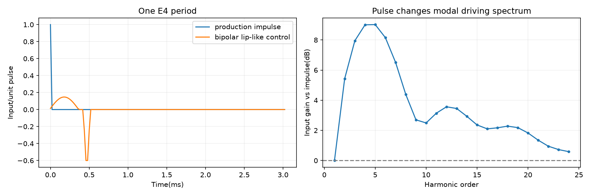

# Trumpet excitation controls

All candidates retain production modal coefficients, envelope and release. These are experimental excitation models.

Opposite half-sine lobes: opening12%period, gap2%, closing3%; zero-area; fundamental magnitude normalized to unit impulse, phase not matched.

Per-cycle frequency offset std0.6%, clipped1.8%; amplitude std8%, clipped0.76..1.24. Both decay exponentially with30ms time constant after each note-on.

500..10000Hz bandpassed Gaussian drive; RMS ratio to nominal impulse train =0.040*exp(-age/40ms)+0.005 while gated. Resonator filtering affects audible noise level.

combined_parallel_breath adds separate500..10000Hz breath to combined_drive at-36dB active RMS relative to production baseline, following baseline envelope. Other variants have no parallel path.

Phenomenological excitation controls, not a coupled lips/breath-pressure/bore simulation. Pulse/table co-design would be required for production. Input noise level is not output noise level.

| Candidate | Phrase | Single |
|---|---|---|
| pulse_shape | [play](pulse_shape_phrase.wav) | [play](pulse_shape_single.wav) |
| onset_instability | [play](onset_instability_phrase.wav) | [play](onset_instability_single.wav) |
| drive_air | [play](drive_air_phrase.wav) | [play](drive_air_single.wav) |
| combined_drive | [play](combined_drive_phrase.wav) | [play](combined_drive_single.wav) |
| baseline | [play](baseline_phrase.wav) | [play](baseline_single.wav) |
| combined_parallel_breath | [play](combined_parallel_breath_phrase.wav) | [play](combined_parallel_breath_single.wav) |

[Results](results.json)

Run: `python python/modal_sim/trumpet_excitation_experiment.py`
