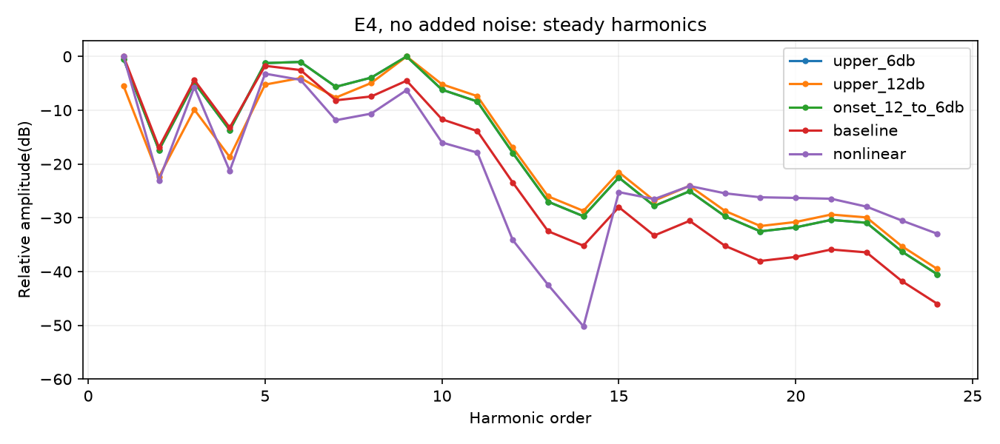

# Trumpet harmonic-only experiment

No added noise. Modal G candidates use the integer ENG1 core; time-varying G and nonlinear postprocessing are experimental.

k<=4 unchanged; dB gain ramps linearly with harmonic order4..10, then holds at+6/+12dB. a1/a2 and original envelope unchanged.

Same+6dB sustain gain; starts+12dB, extra6dB falls exponentially with30ms time constant. G updates32-sample cadence and note-on.

tanh(2.5*x)/tanh(2.5), peak-normalized input,4x oversampling. Output processing control, not a physical lip model or RTL implementation.

Constant RMS-matched gain per scene, peak<=.88, no output compressor;20ms file-end fade.

| Candidate | Phrase | Single |
|---|---|---|
| upper_6db | [play](upper_6db_phrase.wav) | [play](upper_6db_single.wav) |
| upper_12db | [play](upper_12db_phrase.wav) | [play](upper_12db_single.wav) |
| onset_12_to_6db | [play](onset_12_to_6db_phrase.wav) | [play](onset_12_to_6db_single.wav) |
| baseline | [play](baseline_phrase.wav) | [play](baseline_single.wav) |
| nonlinear | [play](nonlinear_phrase.wav) | [play](nonlinear_single.wav) |

[Results](results.json)

Run: `python python/modal_sim/trumpet_harmonic_experiment.py`
