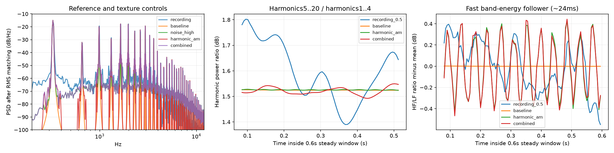

# Trumpet texture sensitivity experiment

Offline additions to production baseline. No production RTL or deployment resources changed.

Instrument-average stored residual-shape FIR plus 600..10000Hz bandpass; -36/-30dB active RMS relative to base; causal 10ms envelope; exact-zero gate.

1500Hz highpass component with continuous 23/37/61Hz sinusoidal AM, nominal 15% RMS; no pitch change; artificial sensitivity test.

Inter-harmonic energy includes window leakage, pitch drift, vibrato/AM sidebands. Not an estimate of true air-noise level or perceived roughness.

Matched active RMS per scene, common peak-safe target <=.88, constant gain, no compressor; terminal20ms fade.

| Candidate | Phrase | E4 single |
|---|---|---|
| baseline | [play](baseline_phrase.wav) | [play](baseline_single.wav) |
| noise_low | [play](noise_low_phrase.wav) | [play](noise_low_single.wav) |
| noise_high | [play](noise_high_phrase.wav) | [play](noise_high_single.wav) |
| harmonic_am | [play](harmonic_am_phrase.wav) | [play](harmonic_am_single.wav) |
| combined | [play](combined_phrase.wav) | [play](combined_single.wav) |
| static_brightness | [play](static_brightness_phrase.wav) | [play](static_brightness_single.wav) |

[Recording reference](recording_reference_E4.wav)

[Measurements and hashes](results.json)

Run: `python python/modal_sim/trumpet_texture_probe.py`
