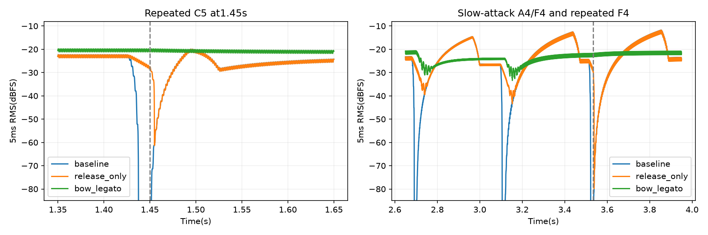

# Violin continuity diagnosis

Trumpet-style21..25ms gate gaps plus5..13ms release from1/4 sustain; slow41..320ms attack, peak-to1/4 decay, same-pitch retrigger clears.

Original score gaps, original attack/decay/sustain, only release slope80ms from1/4 sustain.

20ms attack,full sustain,no decay,80ms release; adjacent different pitches have zero scheduled gate gap with release overlap; repeated pitches continue bow/history and update velocity;180ms phrase breath retained.

Bow legato merges same-pitch rearticulations into continuous bow; not an implemented MIDI/RTL legato policy. Resonator ring-up remains. It is a listening candidate.

| Candidate | Audio |
|---|---|
| baseline | [play](hinos_violin_baseline.wav) |
| release_only | [play](hinos_violin_release_only.wav) |
| bow_legato | [play](hinos_violin_bow_legato.wav) |

[Results](results.json)

Run: `python python/modal_sim/violin_continuity_experiment.py`
