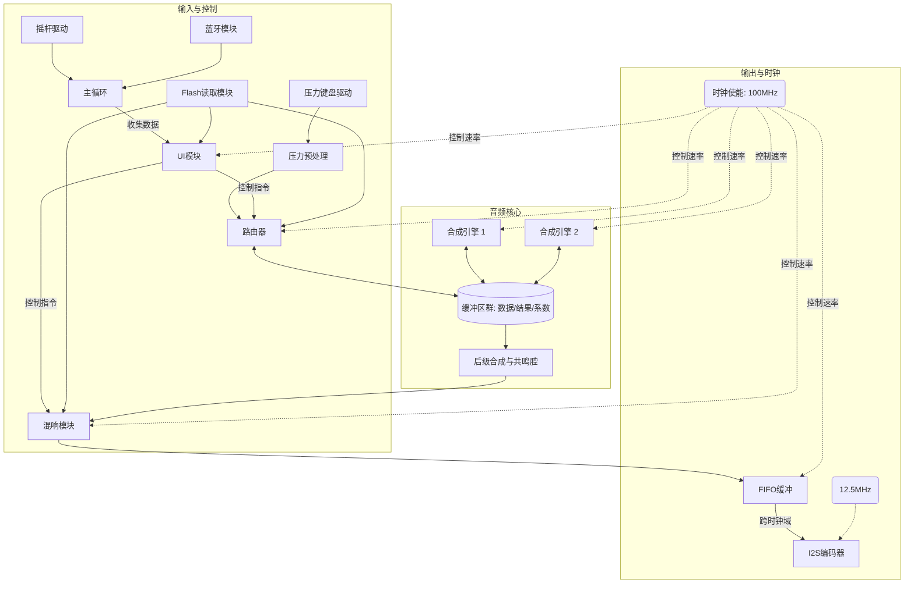

### FPGA项目架构检查表

#### 整体与配置
- [x] **整体架构简图**：见上方Mermaid流程图（含100MHz主时钟域与12.5MHz I2S时钟域划分）。
- [x] **Flash读取模块**：为混响模块、路由器模块和UI模块提供配置参数与素材资源数据。
- [x] **时钟使能 (clk_en)**：在主时钟域(100MHz)下控制各模块实际运行速率。

#### 输入与驱动
- [x] **压力键盘驱动**：采集压力分布，实现音乐触发与Aftertouch表情控制。
- [x] **压力预处理**：将压力模拟值转换为合成引擎可用的数据。
- [x] **摇杆驱动**：自动刷新两个极坐标数据寄存器。
- [ ] **蓝牙模块**：接收蓝牙数据，包含MIDI解析与FIFO IP。

#### 控制与UI
- [ ] **主循环**：低速率轮询摇杆、音乐缓冲与蓝牙数据，并发送给UI。
- [ ] **UI模块**：可视化界面，输出控制指令切换乐器、效果及混响。

#### 音频处理核心
- [x] **路由器 (Router)**：选择引擎，管理系数缓冲区以实现乐器切换，接收UI控制。
- [x] **合成引擎 1 & 2**：两种不同原理的合成器，读取数据缓冲区并写回结果缓冲。
- [x] **缓冲区群**：包含数据缓冲、结果缓冲、系数缓冲，用于路由与引擎间沟通。
- [x] **后级合成与共鸣腔**：为结果缓冲数据添加音色细节。
- [x] **混响模块**：处理音频信号得到最终结果，受UI控制启用不同效果。

#### 输出
- [x] **FIFO缓冲**：跨时钟域缓冲，将最终音频结果传给I2S编码器。
- [x] **I2S编码器**：将音频数据编码成I2S数据流输出（运行于12.5MHz时钟域）。
