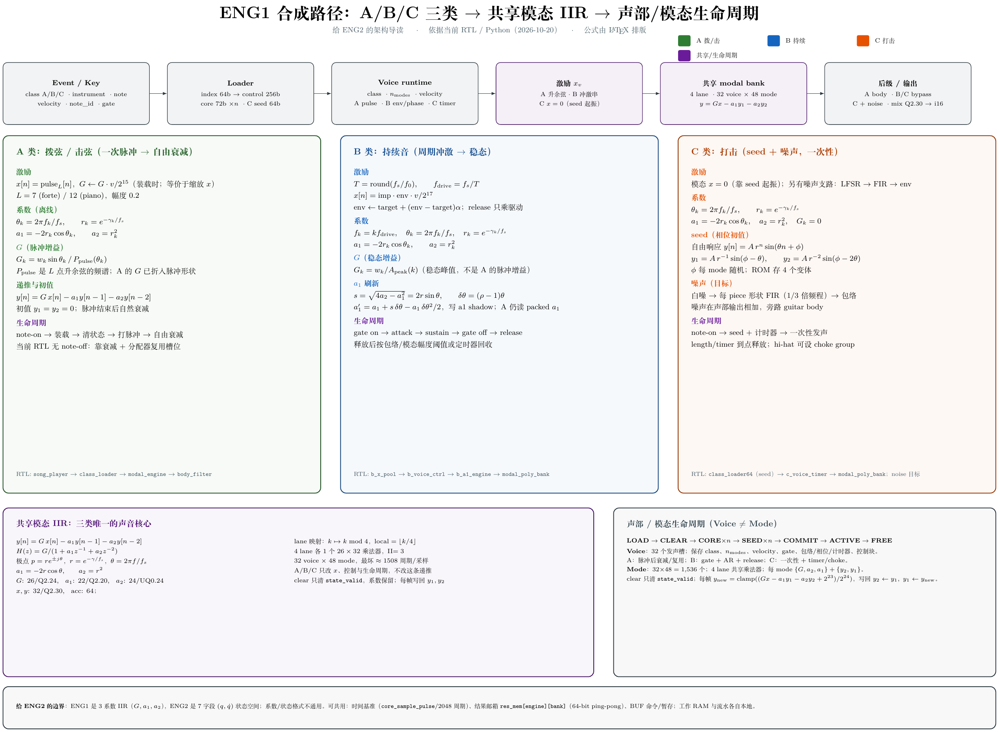

# ENG1 合成路径导读（给 ENG2）

这张图把 ENG1 的三类合成（A 拨/击、B 持续、C 打击）压成一条主线：**同一个二阶 IIR 模态核心，不同的激励、系数来源和生命周期**。



> 可打印版：[PDF](ENG1_synth_path.pdf) · LaTeX 源码：[ENG1_synth_path.tex](ENG1_synth_path.tex)

## 怎么读这张图

- **顶部横条**是每采样的主流水：Event/Key → Loader → Voice runtime → 激励 `x_v` → 共享 modal bank → 后级/输出。
- **中间三栏**是 A/B/C 的算法差异：左边 A 是一次脉冲，中间 B 是周期冲激 + AR 包络，右边 C 是 seed 初值 + 噪声。
- **下面紫色块**是三类共用的 IIR：差分方程、传递函数、极点、`a1/a2` 反推和位宽。
- **绿色块**是声部/模态生命周期：装载、清状态、写系数/seed、commit、运行、释放。
- **最下面灰块**是给 ENG2 的边界：哪些能共用，哪些不能。

## 一句话区别

| 类 | 激励 | G 怎么来 | 生命周期 |
|---|---|---|---|
| A 拨/击 | 7/12 样本升余弦，一次发完 | `G=w·sinθ/P_pulse`，脉冲谱折进去 | 自由衰减；当前无 note-off，槽位复用 |
| B 持续 | 每 `T=round(fs/f0)` 发一个冲激，乘 AR 包络 | `G=w/A_peak`，稳态增益 | gate on/off；release 后回收；a1 刷新 |
| C 打击 | 模态 `x=0`，靠 `y1/y2` seed 起振；另有噪声 | `G=0` | 一次性；length timer + choke |

三类共用：

```text
y[n] = G·x[n] − a1·y[n−1] − a2·y[n−2]
H(z) = G / (1 + a1·z⁻¹ + a2·z⁻²)
poles = r·e^(±jθ),  r = e^(−γ/fs),  θ = 2πf/fs
a1 = −2r·cosθ,      a2 = r²
```

## A 的系数

离线 FFT 得到每个模态的 `f_k, γ_k, w_k`：

```text
θ_k = 2π f_k / fs
r_k = exp(−γ_k / fs)
a1  = −2 r_k cosθ_k     (Q2.20, 22 bit)
a2  = r_k²              (UQ0.24, 24 bit)
G_k = w_k · sinθ_k / P_pulse(θ_k)
```

`P_pulse` 是 7/12 点升余弦的频谱；A 的 G 已经把脉冲形状折进去，所以它**不是** B 的稳态增益。

## B 的系数

驱动是周期冲激串，`T=round(fs/f0)`，`f_drive=fs/T`；模态放在驱动谐波上：

```text
f_k = k · f_drive
θ_k = 2π f_k / fs
r_k = exp(−γ_k / fs)
a1  = −2 r_k cosθ_k
a2  = r_k²
G_k = w_k / A_peak(k)
```

`A_peak(k)` 是单位冲激串下该模态的稳态峰值。颤音/弯音只改 `a1`：

```text
s    = sqrt(4a2 − a1²) = 2r·sinθ
δθ   = (ratio − 1)·θ
a1'  = a1 + s·δθ − a1·δθ²/2
```

结果写进每 lane 的 **a1 shadow**（22-bit × 32×12）；A 仍读 packed `a1`，所以 A 逐位不变。

## C 的系数与 seed

C 的模态部分同样用 `a1/a2`：

```text
a1 = −2r cosθ,  a2 = r²,  G = 0
```

但它不用冲激，而是直接写状态初值。对 `y[n]=A·r^n·sin(θn+φ)`：

```text
y1 = A·r⁻¹·sin(φ − θ)
y2 = A·r⁻²·sin(φ − 2θ)
```

`φ` 每 mode 随机；ROM 存多个变体，按 hit 轮换。噪声支路单独：白噪 → 每 piece 的 FIR → 包络，在声部输出相加、旁路 guitar body。

## 声部 vs 模态

- **Voice**：一个发声槽，32 个；保存 class、`n_modes`、velocity、gate、包络/相位/计时器、控制块。
- **Mode**：一个二阶谐振器，32×48 = 1,536 个；4 lane 共享乘法器，不是 1,536 个乘法器。
- `mode k → lane k%4, local k/4`；每 lane 一块 72-bit 工作 RAM，系数和状态交错。
- `clear` 只清 `state_valid`，不擦系数；装载失败不能破坏旧声部。
- 每帧只算 active voice；`ynew` 饱和到 Q2.30；`voice_sum/mix_sum` 64-bit Q2.30。

## 给 ENG2 的边界

1. **ENG1 是 3 系数 IIR**（`G,a1,a2`），ENG2 是 7 字段 `(q,q̇)` 状态空间；**系数和状态格式不通用**，不能把 72-bit core 直接喂给 ENG2。
2. 可共用的是：时间基准（`core_sample_pulse` / 2048 周期）、结果邮箱 `res_mem[engine][bank]`（64-bit ping-pong）、BUF 的命令/暂存；**工作 RAM 和流水各自本地**。
3. ENG1 的 per-voice 输入是 `x_vec`（Q2.30），输出 `voice_sum/mix_sum`（Q2.30）；A/B/C 只在“激励 + 控制 + 生命周期”不同，递推核心相同。

## 当前实现状态（别把图当全部已上板）

- **已接**：A 路径、B/C loader、B x 池、C timer、B θ ROM + a1 shadow + `b_a1_refresh` 路由。
- **算法目标/未接**：B 的 AM/vibrato 完整表情、C 的噪声 FIR、C 的 choke 全量、B 的 release/回收策略；图中已用“目标/未接”标注。
- **验证边界**：B/C 目前只验证非零输出、装载/Control/timer，不等于逐位音色验收；A 的逐位回归仍是基线。

相关代码：
[`modal_engine.sv`](../rtl/core/modal_engine.sv)、[`poly_modal_lane.sv`](../rtl/core/poly_modal_lane.sv)、[`b_voice_ctrl.sv`](../rtl/core/b_voice_ctrl.sv)、[`b_a1_refresh.sv`](../rtl/core/b_a1_refresh.sv)、[`class_loader64.sv`](../rtl/core/class_loader64.sv)、[`b_a1_engine.sv`](../rtl/core/b_a1_engine.sv)。
