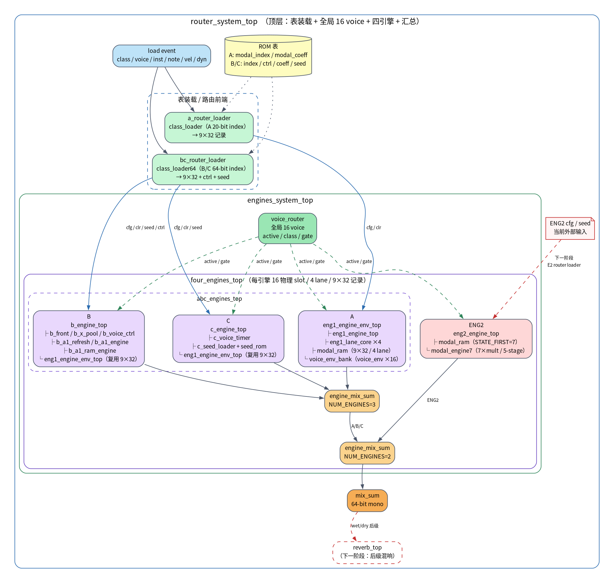

# 四引擎接入 ENG2 + 后级混响设计



> 图源：[`engines_system_flow.dot`](diagrams/engines_system_flow.dot)  
> SVG：[`engines_system_flow.svg`](diagrams/engines_system_flow.svg)

## 1. 当前封装模块

| 层 | 模块 | 职责 |
|---|---|---|
| 顶层 | `router_system_top` | 事件、表装载、全局 voice、四引擎、汇总 |
| 前端 | `a_router_loader` | A 的 20-bit index + coeff → 9×32 |
| 前端 | `bc_router_loader` | B/C 的 64-bit index/control/coeff/seed → 9×32 |
| 前端 | `class_loader` / `class_loader64` | A / B/C 的 ROM 读时序与 cfg/seed 输出 |
| 路由 | `voice_router` | 全局 16 voice 的 active/class/gate |
| 系统 | `engines_system_top` | router + 四引擎 + mix 的系统封装 |
| 引擎 | `abc_engines_top` | A/B/C 三引擎并列 |
| 引擎 | `four_engines_top` | A/B/C + ENG2 + 汇总 |
| A | `eng1_engine_env_top` | A 的 engine + envelope 封装 |
| A | `eng1_engine_top` | 16 voice TDM、4 lane 调度、mix 累加 |
| A | `eng1_lane_core` ×4 | 单乘法器、6→8 拍/mode |
| A | `voice_env_bank` / `voice_env` ×16 | 每 voice 包络 |
| 公共 | `modal_ram` | 每 lane 9×32 BSRAM；A/B/C 与 ENG2 共用 |
| B | `b_engine_top` | B 的 front + engine + envelope |
| B | `b_front` / `b_x_pool` / `b_voice_ctrl` | B 的 NCO + AR 激励 |
| B | `b_a1_refresh` / `b_a1_engine` / `b_a1_ram_engine` | B 的 a1 字段刷新 |
| C | `c_engine_top` | C 的 timer/fade + engine + seed |
| C | `c_voice_timer` / `c_seed_loader` / `seed_rom` | C 的时长、seed 装载 |
| ENG2 | `eng2_engine_top` | 4 lane 9×32 RAM + `modal_engine7` |
| ENG2 | `modal_engine7` | 7 乘法、5 级流水纯计算 |
| 汇总 | `engine_mix_sum` | valid 锁存 + 多引擎求和 |
| 后级 | `reverb_top`（下一阶段） | 混响、wet/dry、立体声输出 |

## 2. 当前状态

- 四引擎主体、9×32 RAM、4 lane、16 voice router 已完成。
- ENG2 已能通过 `router_system_top` 的 **外部 cfg/seed 端口**工作。
- `router_system_top` 的 class=3 现在走 `e2_router_loader`；E2 外部 cfg 端口保留为手动口。
- E2 接入并重定时后的最新 P&R（`router_probe`，2026-10-21 19:55）：
  - Fmax = **100.075 MHz**
  - Setup 违例 = **0**，TNS = 0
  - Hold 违例 = 0
  - 最差 slack = +0.007 ns（仍非常紧）
  - 关键路径：router `class_r` → B 引擎 RAM 写口（`u_b/.../u_ram/f3`）
  - E2 的 RAM→DSP 路径已通过 `co_data_r/st_q_r` 一级流水打散。
- 资源：BSRAM 190/340，DSP 88.5/298，Logic 12,736，Register 8,224。
- 结论：E2 接入后 100 MHz 时序通过，但余量只有 0.007 ns，需要继续留 margin。

## 3. 接入 ENG2 的计划

目标：ENG2 与 A/B/C 一样，由事件 + router 自动装载，不再从顶层手接 cfg。

### 3.1 新增 `e2_router_loader`（已完成）

`rtl/core/e2_router_loader.sv` 已加入：复用 `class_loader64` 的 index/control/seed，
coefficient 单独读 224-bit（7×32）表，打包成 9×32；`tb_e2_router_loader` PASS。


参考 `bc_router_loader`，但 E2 的 index/control 格式独立：

```text
load_event(class=3, voice, inst, note, vel)
        ↓
e2_index_rom / e2_ctrl_rom / e2_coeff_rom / e2_seed_rom
        ↓
9×32 cfg / clr / seed / n_modes / theta
        ↓
eng2_engine_top
```

输出：

- `cfg_we/cfg_voice/cfg_mode/cfg_data`
- `clr_we/clr_voice`
- `seed_we/seed_voice/seed_mode/seed_data`
- `n_modes`、`seed_base`、`commit_ctrl`

### 3.2 系统接线

1. `router_system_top` 增加 `e2_router_loader` 实例。
2. `load_class==3` 时选择 E2 loader，`cfg_engine=3`、`seed_engine=3`。
3. `engines_system_top` 去掉 E2 外部 cfg/seed 端口，改由 router 总线驱动。
4. `voice_router` 的 class=3 路径保持：active/note_start/gate 直接进 E2。
5. E2 的 16 slot、4 lane、9×32、`STATE_FIRST=7` 不变。

### 3.3 验证顺序

1. `tb_e2_router_loader`：index → 9×32、seed 数量、n_modes。
2. `tb_router_system_e2`：class=3 load → E2 cfg → 非零 mix。
3. `tb_four_engines_top`：A/B/C/E2 同时 active，互不阻塞。
4. 重新跑 P&R，确认 Fmax 不低于 100 MHz。

### 3.4 时序注意

当前 Fmax 只有 100.004 MHz。E2 的 `modal_engine7` 仍是 7 个 32×32 乘法器，接入 router 后组合路径可能再加长。

建议：

- E2 先保持当前 `modal_engine7`，只做 router 接线；
- 若 Fmax 掉到 100 以下，优先把 E2 乘法器拆成两级流水，而不是继续压组合逻辑；
- 不要用 distributed RAM 掩盖 BSRAM 问题。

## 4. 后级混响设计

### 4.1 插入位置

```text
four_engines_top.mix_sum
        ↓
   reverb_top
        ↓
   audio output / DAC
```

`mix_sum` 是 64-bit mono；混响输入取高 24-bit，内部 24-bit 定点。

### 4.2 结构

采用 Freeverb/Schroeder 结构：

```text
in ──► predelay ──► 8×comb（左右各 4，并行）
                         │
                         ▼
                   4×allpass（左右各 2，串联）
                         │
                         ▼
                    wet/dry mix ──► out L/R
```

模块：

| 模块 | 职责 |
|---|---|
| `reverb_top` | 顶层封装、sample_valid、bypass |
| `reverb_ctrl` | room_size / damping / wet / dry / width |
| `reverb_predelay` | 可选前延迟，避免干声与早期反射重叠 |
| `comb_filter` ×8 | 延迟 + 阻尼低通 + feedback |
| `allpass_filter` ×4 | 扩散 |
| `delay_ram` | 1R1W BSRAM 延迟线，24-bit |
| `reverb_mix` | wet/dry、立体声宽度、软限幅 |

### 4.3 接口草案

```systemverilog
module reverb_top #(
    parameter int SAMPLE_W = 24,
    parameter int MAX_DELAY = 8192
) (
    input  logic clk,
    input  logic rst_n,
    input  logic sample_valid,       // 48 kHz 单拍
    input  logic signed [SAMPLE_W-1:0] sample_in,
    input  logic bypass,
    input  logic [15:0] room_size,   // UQ1.15
    input  logic [15:0] damping,
    input  logic [15:0] wet,
    output logic signed [SAMPLE_W-1:0] out_l,
    output logic signed [SAMPLE_W-1:0] out_r,
    output logic out_valid
);
```

### 4.4 资源/时序预算

- 48 kHz、100 MHz：一帧约 2083 拍，混响有充足时间做串行/半并行。
- 8 条 comb 延迟线，按 20–50 ms、24-bit 估算：
  - 8 × 2400 × 24 ≈ 460 kbit；
  - 当前 BSRAM 已用 195/340，剩余 145 块，混响预计 25–40 块，资源够但需要实测。
- 关键路径：
  - comb：delay RAM 读 → damping LPF → feedback MAC → 写；
  - allpass：读 → 乘 → 加 → 写；
  - 全部寄存器化，避免把 RAM 读、乘、加挤在一拍。
- 建议先做 **单声道混响**，验证结构和资源，再扩立体声。

### 4.5 实施顺序

1. `delay_ram` + `comb_filter` 单测（impulse response、feedback 衰减）。
2. `allpass_filter` 单测（能量保持、扩散）。
3. `reverb_top` 单声道、bypass 单测。
4. 立体声 + wet/dry + 软限幅。
5. 接在 `four_engines_top.mix_sum` 后，跑 48 kHz 样本流回归。
6. 最后再和新的 board top / 音频输出联调。

## 5. 建议的下一轮

优先顺序：

1. **E2 router loader + 系统接线**（架构闭环）；
2. 重新 P&R，确认 E2 接入后 Fmax；
3. 再做 `reverb_top`（先单声道）；
4. 最后做新的生产 board top 集成（旧 board_top 已删除）。

在 E2 接入前，不建议先做混响，否则 E2 的 cfg/seed 改动会再次影响系统顶层和时序。
