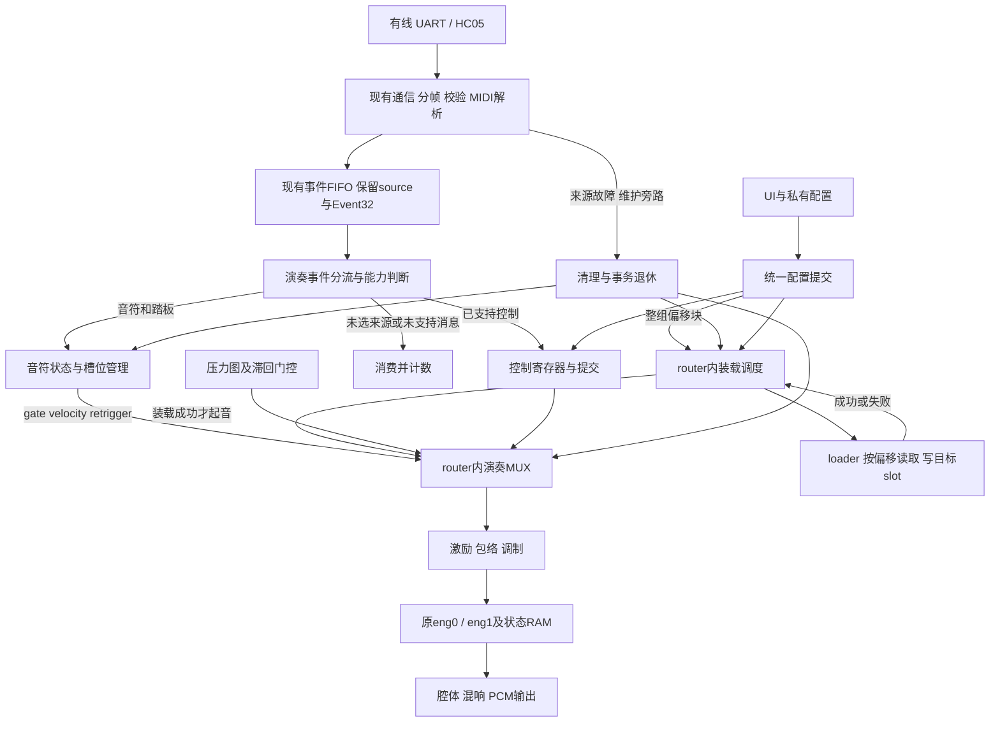

# MIDI 演奏与通信接入

更新：2026-10-29。第3.1/3.2及9/10节保留各实施阶段范围；当前代码差异和日期化结果分别以[问题台账](bugs.md)与[最新核对](工程评审与验证.md#global-docs-2026-10-29)为准。演奏状态、两组16音、加载失败保护和UI联合配置已有；当前忙时panic逻辑不再等同于原测试快照，音频顶层接线缺失。持续音色前端统一见[设计与基线](ENG1演奏前端设计.md)。

本页只维护MIDI功能范围、演奏状态/音高适配、线上配置到内部请求的转换和恢复语义。通信位/帧/解析已有实现；演奏状态层和router内MIDI选源已连接真实eng0/eng1仿真，私有配置与其它DSP消费者仍待接。线上字段/编码只在 [PROTOCOL_V1](../rtl/drivers/analyzer/PROTOCOL_V1.md) 维护；本地配置字典/提交/CDC见 [控制与侧栏](控制与侧栏设计.md)，日期化结果见 [工程评审与验证](工程评审与验证.md)。

**当前联合配置与接线见[第10节](#joint-config-backend)**，两组16音基础见[第9节](#midi-bank-fixes)：32音资源按两组16音切换，保留16个发声槽，不引入动态单槽装载或新增生产模块。第8节保存总体合同，未实现的DSP能力和整机验证不计入已完成。

## 1. 已确定的首版功能范围

### 1.1 MIDI 演奏消息

| 功能 | MIDI 1.0 消息 | 语义要求 |
|---|---|---|
| 音符、力度 | `9n note velocity` | velocity=0 按 Note Off 处理；非零力度保留原始 7-bit 值供适配层转换 |
| 松开按键 | `8n note release_velocity` | 释放对应音符；首版可忽略释放力度的数值，仍需消费该字节 |
| 弯音 | `En lsb msb` | 14-bit，中心 8192；范围待定；与颤音共用音高控制能力但不是同一参数 |
| 颤音深度 | `Bn 01 value` | CC1；具体深度映射和与当前颤音实现的接口待定 |
| 音量 | `Bn 07 value` | CC7；通道音量，不能与起音 velocity 混用 |
| 延音 | `Bn 40 value` | CC64（十六进制 40）；0..63 关闭、64..127 开启 |
| 音色选择 | `Cn program` | 只需一字节数据；标准 program 到本机音色的映射表待定，不直接强转本机枚举 |
| 全部松开 | `Bn 7B 00` | CC123；等价于该通道所有键松开，须与延音踏板／释放段区分于硬静音 |
| 紧急停止 | `Bn 78 00` | CC120；该通道 All Sound Off，不得仅置 fmap=0 后仍任由 release 发声 |
| 表情 | `Bn 0B value` | CC11；用户确定由线性调制模块实现；协议语义是独立振幅表情，不是 Pitch Bend |

`n` 是 0..15 的 MIDI channel。协议保留 channel 字段；当前集成选择一个演奏通道、使用全局单音色；通道0..5的固定映射见下方3.2，不支持多音色同时演奏。

### 1.2 私有配置

用户确定首版保留：

- **EQ 配置**。
- **混响配置**，包含本机 NONE / HALL / BATHROOM 预设选择；是否另带可调 amount 待定。

当前不自动增加 src_sel、bank、通道选择、波特率等远程配置命令。`src_sel` 已存在于顶层；是否由主机写入需另外确认。

### 1.3 暂缓清单

暂缓其功能实现，但解析器必须能正确识别长度并跳过，不得导致后续 MIDI 错位：

- Channel Pressure、Polyphonic Key Pressure。
- CC2 吹气、CC4 脚控等其他表情来源。
- CC5/65/84 滑音、CC68 连奏。
- CC66 选择延音、CC67 柔音、CC69 Hold 2。
- CC71/74 音色／亮度，CC72/73/75 包络时间。
- CC76/77/78 独立颤音速度／深度／延迟控制。
- CC10 声像、CC8 平衡及立体声控制。
- CC91 标准混响发送量、CC93 合唱发送及 CC92/94/95 等其他效果深度。首版混响通过私有配置控制，不将预设选择冒充 CC91。
- CC0/32 Bank Select、完整 GM 音色库。
- 通用 RPN/NRPN，包括经 MIDI 设置弯音范围、微调及粗调。
- 厂商 SysEx、GM/GS/XG 扩展配置；系统时钟／歌曲位置／传输同步。
- CC121 Reset All Controllers 及其他未列入首版的 Channel Mode 操作；不默认为已支持。
- 频率相关阻尼曲线。EQ 是幅频塑形，不等于改变模态 gamma。
- 音频回传、固件／系数下载、录音回传，不属于此次协议首版范围。

## 2. 两层协议，不把私有字节混进裸 MIDI

```text
UART / HC-05 透明字节流
  → 外层分帧、长度检查、校验、类型分流
    ├─ MIDI_DATA → 标准 MIDI 解析 → 演奏事件
    └─ CONFIG    → 私有命令解析 → EQ / 混响配置
```

ACK 是传输层回复，不是新增的一种演奏／配置功能。电脑和手机使用同一上层协议；两条物理 UART 若同时存在，应先明确会话／来源选择，不能把字节直接交错拼接。

MIDI 解析模块只收完整字节及 valid/ready，输出事件，不依赖 UART 波特率、HC-05 或外层帧。外层消息类型／配置命令也不塞进 MIDI parser。

## 3. 已实现线上格式

v1 使用 SLIP、版本/类型/SEQ/长度、payload 和 CRC16；完整字段长度、字节序、长度边界及样例以 [线上规范](../rtl/drivers/analyzer/PROTOCOL_V1.md) 为准。首版 TYPE 为 MIDI_DATA/CONFIG/REPLY，不传 `.mid` 文件头、delta-time 或 tempo meta event；文件解析和走带定时由上位机负责。

已实现完整帧验证后才交付业务，错误帧丢弃/恢复；两条来源分别维护 UART/分帧状态，仲裁后保留 source_id。默认两路 115200，UART 参数独立。无需再将分帧/CRC 当作尚未设计。

## 4. 已实现解析与回复语义

- MIDI 支持同包 running status、实时插入/系统消息跳过及规定短消息；pending/running 状态不跨帧继承。具体输出子集见 [解析器说明](../rtl/drivers/analyzer/README.md)。
- MIDI 不逐帧 ACK/重发 Note On；Config 请求等后端真实完成后回复，不能在进入 FIFO 时提前成功。
- Config 有每源去重/在途状态和最终结果；会话重建清对应缓存。只有真实完成才能给成功，失败结果按协议返回。
- comm_top 使用事件 FIFO empty 与 midi_ops_idle 建立配置屏障，且共享 parser 单配置在途；慢后端仍可能阻塞其它来源解析。
- framing/break/overflow/半帧超时/断开触发来源隔离，恢复须等真实清音与操作退休及重建请求。接口与midi_voice_top消费者已有，板级须连接真实清理/退休，不能直接把完成确认绑1。

这些是当前通信子系统合同，不证明所有 MIDI 对声音的作用都已生效。协议没有采样级远程时间戳，也没有 PCM 上传命令。

<a id="midi-consumer"></a>

## 5. 演奏状态与音高适配

```text
Note On / Off / velocity / sustain → 音符状态管理 → router内演奏MUX
Pitch Bend / CC1 / CC7 / CC11     → 对应控制寄存器／调制接口
Program Change                   → program 映射／本机音色选择
EQ / Reverb CONFIG               → 后级配置
```

- CC7 与 CC11 分开保存；建议振幅控制 `gain = volume_gain * expression_gain`，CC11 使用用户指定的线性调制路径，不覆盖 CC7，也不靠改起音 velocity 实现。
- 不把 CC11 或 CC1 直接写成 fmap 压力：否则可能意外改变力度、触发门限或压力调音。
- sustain 关闭后对已松开的音符进入释放，而不是无条件清除所有按住的键。
- CC120 与 CC123 分开。CC120 标准作用于指定通道；若 UI 的“紧急停止”要全设备静音，可以对所有通道发送 CC120，但共享混响尾音是否清除还需本机策略。
- 全设备紧急停止若要求无残留，还要同时考虑排队事件与混响状态；单纯停止 sample tick 可能冻结而不是清除内部状态。
- 不支持的 program、超出 32 音清单、同音重叠、声部抢占、切换 src_sel 的处理由适配层规定，不由 MIDI 字节解析器擅自决定。

<a id="note-state-step31"></a>

### 3.1 对接实施进度：事件转演奏状态（2026-10-28）

此编号对应系统对接阅读清单的3.1。该阶段实现见 [midi_note_state.sv](../rtl/midi/midi_note_state.sv)，3.1完成时链路为：

```text
comm event_valid/ready + event_data/source
  → midi_note_state（已实现，真实parser接入仿真通过）
  → op_valid/ready + 状态快照 + retrigger/hard_clear
  → 引擎输入适配器（下一步，尚未实现）
  → voice_router（尚未在生产顶层连接）
```

MIDI按演奏时间陆续发送事件，持续时间通常由Note On与Note Off的到达间隔决定。状态层不保存整首曲谱、不做持续时间倒计时、不生成逐采样压力波形；它用槽位寄存器保存归属、原始velocity、key_down和gate，另用32bit保存两来源×16通道的踏板状态。引擎内部继续逐采样计算激励、包络和递推。

本步采用的有限策略如下，后续可根据资源接口演进：

| 项目 | 当前行为 |
|---|---|
| 音高资源 | `slot_note_map`是实际预载音高表，槽0在最低7bit；测试使用piano_flash.py默认16音；没有任意音高生成 |
| 槽位归属 | 保存source/channel/original_note；Note Off按已保存归属查找，不按当前映射重算 |
| 同音重叠 | 同一归属再次On更新力度并请求retrigger；不累计叠按次数，随后一次Off即释放该键 |
| 忙槽、缺失音高 | 拒绝新On，置`op_rejected`并增加饱和计数，不抢占其它来源/通道 |
| 力度 | 原样保留1..127；零力度On按Off；尚未转成fmap |
| CC64 / CC123 | 每来源每通道延音；CC123令按键松开，允许踏板继续保持；不能复活已释放音 |
| CC120 | 关闭匹配gate并请求hard_clear，包含仍有归属的释放尾音槽；真正DSP清除由后级完成 |
| 其它控制事件 | 原始事件保留在`op_event_data/op_source_id`，供后续Program/Bend/CC1/7/11消费者处理，不宣称已生效 |

`slot_note_map`不会给引擎换系数。资源/音区变更仍须先清理并与加载事务对齐；验证“改映射后Off仍释放原槽”不等于允许随意热改正在发声的音高表。释放后保留slot_owned，是为了清理时仍能识别该来源的释放尾音；后续重新占用必须落实retrigger。

**操作握手：** 接收一个事件后产生一个`op_valid`；快照、事件和retrigger/hard_clear掩码保持到`op_ready`，其间停止接收下一事件。这样紧邻的On/Off不会在后级观察之前被合并。后级只有实际完成对应门控、重触发、清除或控制动作后才能确认；简单把`op_ready`绑1不能证明引擎听到了起音。FIFO仍使用通信模块现有队列，本层只有一个在途操作。吞吐和故障期间的最大等待时间须在真实适配器接入时验证。

**来源清理：** `source_cleanup_req[1:0]`是保持型请求，可来自comm的source_quarantine。先等待此前操作退休，再产生按来源筛选的hard_clear快照，后级确认后才置相应`source_cleanup_done`；请求保持时不重复清理，请求撤销后重新使能。`source_ops_idle/midi_ops_idle`表示本层操作退休，持有的按键不妨碍idle；整机还需合并其它消费者的在途状态，并确认共享效果尾音策略，不能将本层状态直接视为全设备清音完成。所有接口同clk域。

验证入口：`python3 sim/run_midi.py`。Icarus与Questa 2025.2均通过状态层663次断言和真实parser→状态层→延迟模拟消费者测试（同帧running status的On/Off，2项操作有序退休）；Questa编译0错误/0警告。覆盖力度1/64/127、源/通道隔离、全部32组踏板索引、重复Off、CC120/123、重触发、背压、原归属释放、清理等待/确认/重新使能及在途复位。另重跑tb_midi_analyzer、tb_comm_top、tb_comm_faults、tb_session_ctrl，4项通过。模拟消费者不包含voice_router，不代表真实发声、采样级时序、DSP清零或I2S通过。

3.1阶段未连接真实引擎；后续3.2已实现下述router内选源，保留此段作为状态层独立验证范围。

<a id="router-midi-step32"></a>

### 3.2 对接实施进度：router内部选源（2026-10-28）

入口为 [midi_voice_top.sv](../rtl/router/midi_voice_top.sv)：接已解析的comm事件、压力图、当前演奏通道和实际预载音高表，输出原有64bit音频结果及QSPI接口。ADC驱动、通信物理链、UI配置后端和PCM/I2S仍在其外部，不代表板级整机已连接。

```text
comm事件 → midi_note_state → gate/velocity/retrigger/hard_clear ─┐
压力图   → voice_router内的压力滞回门控/原始压力 ────────────────┤
                                   performance_input_mux选源 ─┘
                                      ↓ 激励、包络、清除调度
                                   原有eng0/eng1 → 后级 → y_data
```

没有把MIDI伪装成fmap。`voice_router`新增可选MIDI输入，`MIDI_ENABLE=0`为默认值，原压力垫实例维持原路；集成入口开启此参数。选源逻辑封装在 [performance_input_mux.sv](../rtl/router/routers/performance_input_mux.sv)。

| 信号 | MIDI路径 | 压力垫路径 |
|---|---|---|
| 门控 | `slot_gate`，包含踏板保持 | 原fmap滞回判定 |
| 激励幅度 | `{velocity,velocity[6]}`，1→2、64→129、127→255 | 原8bit压力不变 |
| 起音 | 显式retrigger，可在gate持续为1时再触发 | 保留原门控起音沿 |
| 动态包络电平 | 255，避免重复乘velocity；现dyn0移位输出为0x7F800000 | 原压力 |
| 压力调音 | 不发起MIDI力度引起的压力调制请求 | 原调制路径 |
| 强制清除 | 逐槽清激励/包络，通过原st_zero清计算状态 | 切源时清旧槽 |

`exc_router`接已选源的`strike_level/retrigger/slot_clear`，继续按有效乐器选择激励参数，输出原来的xmap/xmap_valid。后续eng1专用形状应封装在激励模块并由exc_router选择；本轮没有编造四种eng1乐器的专用形状，也未修改eng0/eng1计算核心。当前eng1仍使用原默认斜坡/尾巴参数，其幅度定标不等于已完成音色校准。

**消费时序：** MIDI快照在router实际`frame_start`采样边界应用，gate/velocity保持，retrigger/hard_clear只消费一次；`midi_ready`到整帧声部写回和后级排空才确认。NoteOff确认进入释放，不等待尾音结束。切源先执行一帧清除，再放行新来源；集成入口同时清理旧MIDI归属，并触发基础表重载，避免同音色切源时遗留压力调制后的系数。调用者须保持run和时钟运行，否则无法推进完成。

**固定通道映射：** 界面通道1..6对应线上字段0..5，依次为吉他、钢琴、小号、小提琴、大提琴、长笛，见 [midi_instrument_map.sv](../rtl/midi/midi_instrument_map.sv)。7..16未映射。`selected_channel`选择当前通道，不按交错到来的每个NoteOn反复抢换全局音色。仅选中通道的新On进入状态层，原归属的Off和控制消息仍保留上下文；改通道先清理两来源旧状态，再改变音色请求。表项存在不证明Flash已有该音色系数；必须结合`channel_mapped/load_err`判断资源状态。

Program/Bend/CC1/7/11通过`control_valid/control_ready/control_data/control_source_id`交给真实消费者，保持背压，不伪造生效。集成顶层内部没有额外排队操作，source_ops_idle/midi_ops_idle仍表示操作退休；来源清理只承诺相应声部状态，不能据此声称共享腔体、混响和外部PCM队列完全无尾音。UI接收通道/音色菜单及配置结果回报尚未连接。

**本轮同时修复两项router边界错误：** 等待换音色时模态数保持旧有效音色，避免钢琴旧表配20模态；A/B引擎结果在双方y_valid同拍一起锁存，避免eng1的B结果在几拍后读取时已清零。另前移必要声明以使当前仓库源文件直接通过Questa编译，不再依赖旧的声明兼容副本。

验证入口：`python3 sim/run_router_midi.py`，Questa 2025.2五项通过：16通道映射、选源136次检查、真实eng0集成28次检查、eng1集成7次检查及43帧混音比较、pending音色配置。状态层两项Icarus回归也通过。真实router测试为4槽×4模态（pending测试为4×64）；空Flash启动后在测试中force系数返回总线提供合成系数，计算核心、状态RAM写回及后级保持真实，不抑制7061或使用兼容RTL副本。编译有6条输入端口kind默认值警告，0错误；不将其写成0警告。

最终压力垫音乐TB修改前后各256采样逐点一致，SHA256为`0e083df95e839864dddf2f76d69d0c59d71e9c0c1f48971f3effb5df096316c5`。该比较沿用历史TB直接灌RAM/inst_prev的白盒初始化，单独使用既有7061选项，不能升级为真实Flash验证。没有新增PnR、48k满规模吞吐、真实音色听感或I2S验收结论。

### 力度到门控的实际边界

当前voice_router的门限为起音fmap>230、门控保持fmap>=26、低于26松开。原始MIDI velocity为0..127，直接复制到8bit fmap不会触发任何Note On；简单乘2也只让较大的力度越过起音门限。消费者须明确“gate/retrigger与幅度独立”或“经校准映射到门控区间”的策略，覆盖velocity1/中值/127、持续压力和松键；不得偷偷夹到高值并宣称保持了完整力度动态。3.2已采用独立门控和起音事件：MIDI不经过压力门限，velocity只映射激励幅度；parser仍保留原始7bit事件语义。

### 音符归属、重触发与切换

消费者保存 `(source_id,channel,original_note)` 到实际槽位/目标音高的归属，以及按键/踏板/力度状态。例：原note60经+12移调在72发声，UI改成+0后，note60的Note Off仍释放此前72的槽，不能用新规则重新算成60。接收通道改变也不能丢旧音的松键；新过滤规则只影响新的Note On，或先有序清理。

同音重叠、满槽抢占必须冻结策略。fmap非零→另一个非零不是新的起音沿，短暂拉零若未被采样消费也不保证重触发；需明确retrigger/clear/gate接口或等门控消费确认。两个物理来源即使channel/note相同也不能互相清错音。

当前loader已能给每slot独立音高表，但没有任意运行时note/pitch端口；消费者须冻结“预载16键映射、音区重载或动态生成参数”的一种资源策略。主机轨道、MIDI通道、硬件槽位和模态数分别计数；全局inst/共享后级限制不因多轨编辑而改变。

### Pitch Bend 的DSP边界（方案）

ABC递推为 `y=G*x-a1*y1-a2*y2`，`a1=-2*r*cos(theta), a2=r², theta=2*pi*f/fs`。
频率乘rho不能直接把a1乘rho。候选方案为控制率重算系数/安全影子提交、逐voice变速重采样、离散音高表切换/交叉淡化；分别验证计算/内存预算、衰减变化和连续变调能力。当前后台吉他调制并非所有音色通用的Bend消费者。

冻结系数的Schur条件 `a2<1, a2>a1-1, a2>-a1-1` 只能证明定常系统稳定。即使插值各点满足条件，也不证明时变递推无失稳/爆音；需检查量化余量、更新速度、状态连续和最坏输入。eng0的状态矩阵及各Q格式不同，另核对矩阵更新，不能套用ABC的cos公式。先单模态数值参考，再单voice RTL，最后全槽周期/PnR，不把历史48k/48.828k采样偏差当作当前必须靠弯音修正的事实。

## 6. 私有配置与 DSP 后端

EQ_SET/REVERB_SET 的编码、范围/结果见 v1；参数解析和 shadow 校验已实现，EQ DSP 与混响安全提交消费者尚待接。EQ 的中心频率/增益/Q 不等于任意 IIR 系数上传。

混响 wire 编号与 router 原生枚举必须显式转换：线上/统一菜单 `0=NONE,1=HALL,2=BATHROOM`，router 原生 `BATHROOM=0,HALL=1,NONE=2`。`reverb_router` 仍按预设固定干湿增益，没有独立 amount 输入；新增字段不代表后端已支持。

当前 comm 的 source_id/SEQ/command/payload/shadow 也不是 sidebar 的 `{tag,id,value}`。适配器须保留物理来源、回复上下文、复合参数和权限；未接入返回相应失败结果。

### 屏障、回复与来源恢复

`cfg_valid&&cfg_ready`仅接收请求；真实成功/失败后才送cfg_done并保持到握手。现有屏障是event FIFO empty与midi_ops_idle，idle指此前操作退休，不是所有声音衰减结束。若配置等待所有gate关闭又挡住后续Note Off，会形成死锁。适配层必须给出等待/拒绝/取消政策。

线上EQ/REVERB请求保留source_id/SEQ/command/payload及pending上下文，转换内部请求后等待匹配结果，再映射线上结果码；复合EQ不能截成一个标量。内部槽1没有物理来源区分，权限/来源清理在转换前执行。线上没有音色/音区/音量等命令时，不能凭本地参数ID自行发送扩展命令。

故障隔离后，真实消费者清理该来源音符/踏板并退休已接受操作，再返回source_cleanup_done/source_ops_idle；不能绑1、误清另一来源或将已生效共享配置擅自回滚。Config屏障与本地仲裁须共同保持已接受事务的顺序；当前单配置在途共享parser仍可能被慢后端阻塞。

若未来增加MIDI Clock/曲谱/伴奏，由独立tempo/transport保存音乐时间；当前parser识别后忽略F8..FF，没有相应业务动作。音乐节拍、音频采样和显示帧节拍各自调度。

## 7. 后续实施与资源输入

当前已确定单演奏通道/全局单音色、六项固定通道映射及MIDI独立门控。后续采用16条32bit偏移块让loader选择音高来源，完整目标结构与实施顺序统一看第8节。

仍需实际交付的输入是六种乐器的正式连续32音编号/资源表、eng1各乐器激励形状、真实控制DSP消费者，以及最大规模实时性测量。设计可以先实现通用接口，不以尚未确定的音域起点写死地址，也不把这些未交付内容计为已支持。

<a id="midi-architecture"></a>

## 8. MIDI总体合同（2026-10-28，按两组16音收敛）

本节收束职责与接口；已实现范围以第9节为准。用户已明确：音色先支持吉他、钢琴、小号、小提琴、大提琴、长笛；后续资源扩展为连续32音；velocity进入激励，router内部MUX选源，保持eng0/eng1计算核心；loader接收16条32bit偏移，指定每个slot从哪里装载系数。以下未明确的实现策略为建议默认值。

### 8.1 范围与模块边界

- 当前暂定每乐器32音资源，loader一次装入低/高一组16音。切组先清旧音再重载，不支持跨两组同时发声；32音不等于32复音。实际可用规模还受eng1吞吐限制。
- 同一时刻选择压力垫、有线MIDI或蓝牙MIDI中的一个演奏来源；MIDI选择一个通道，采用全局单音色。来源和通道归属仍保存，便于释放与恢复。
- 线上保留标准MIDI编号0..127。每乐器的连续32音起止编号由正式资源清单提供，本轮不擅自冻结范围；当前16音镜像先作为过渡资源。
- 不新增普通MIDI逐条ACK，不把.mid文件、delta-time或PCM塞进MIDI_DATA；上位机解析文件并按演奏时间发送。



| 模块 | 唯一职责 | 不承担的职责 |
|---|---|---|
| 现有comm/parser | 验证帧、解析事件、保留来源、队列与会话恢复 | 不分配slot、不选择音高资源、不等待声音衰减 |
| 演奏分流 | 来源/通道准入、消息能力判断、有限时间退休 | 不直接写系数/状态RAM |
| midi_note_state演进 | 保存原note/来源/通道/力度/踏板、分配槽、生成trigger/release/clear | 不计算Flash地址细节、不生成激励波形 |
| router资源调度 | 提交偏移块、屏蔽装载槽、仲裁写口、校验完成归属、装完再起音 | 不解析MIDI字节 |
| loader | 锁存请求、按偏移读取、向指定slot写系数/参数、报告完成/失败 | 不解释velocity，不决定音符持续时间 |
| router演奏MUX与parts | 选门控/力度/起音/清除，按乐器生成激励/包络 | 不知道UART、CRC或MIDI running status |
| 配置/恢复控制 | 来源/通道/乐器切换、错误恢复、清音完成与UI实际值 | 不把ready或收到请求等同成功 |

分流、资源调度可以是顶层的小状态机，不要求每个名字都新建一份复杂模块。继续使用现有comm FIFO，不为曲谱、持续时间或每采样压力增加RAM。

### 8.2 loader接口：16×32bit偏移块

**偏移块表示16个目标slot的读取位置，共512bit/64字节，不是32个slot。** 每项建议定义为“相对本乐器资源区的字节偏移”，slot0对应最低32bit。来源地址和目标写地址独立：

```text
Flash源地址 = instrument_base(inst) + slot_offset[slot] + mode × REC_BYTES
RAM目标地址 = {slot, mode}                  // 保留现有NMP补齐布局
```

既有每模态记录为64字节，包含7个计算系数、7个调制参数及保留字段；首版建议固定每音N_MODES条记录，不足部分补零。这样新读法不改变计算核心及RAM读口。

| 请求字段 | 建议语义 |
|---|---|
| inst | 本次乐器/资源格式，沿用当前编号 |
| slot_offsets[16×32] | 每个slot的源字节偏移；相同偏移可装到不同slot |
| update_mask[16] | 仅这些slot需要写入；初始全装可用FFFF |
| load_id / map_version | 仅未来并发装载才需要；当前整组单在途，由配置FSM等待旧操作完全退休，不增加这些字段 |
| start/busy/done/err | 可保留现有单在途握手，空闲时start才接收；完成回传对应标识和失败原因 |

start被接收时，**inst、整块偏移、mask一次锁存**。上层修改下一版映射不能改变正在读的源地址。mask=0为明确的无操作完成，不启动QSPI、不写RAM；offset=0是合法地址，不能借它表示空槽。

当前loader一次header后连续读取所有slot。任意偏移块允许不连续、重复或逆序的源位置，所以应改为：

```text
选mask中的一个slot
→ CS/header指向该slot的源地址
→ 读完该音全部模态并写到这个目标slot
→ 结束本次Flash读，满足CS间隔
→ 处理mask中的下一个slot
→ 完成
```

第一版不必优化相邻地址合并。只给旧base24加一个偏移、随后继续旧的整表顺序读，不能实现任意16项映射。

**资源按（乐器，MIDI音高）排列。** 若连续32音采用紧凑布局：

```text
note_index = midi_note - first_note(inst)    // 先检查0..31
NOTE_BYTES = N_MODES × 64
slot_offset = note_index × NOTE_BYTES
instrument_base = 该乐器资源区起点
```

例如仅演示音域48..79、N_MODES=64：每音4096B，每乐器32音128KiB。slot0装note60时偏移为12×4096=0xC000；slot1装note64时为0x10000。目标RAM依旧分别写slot0、slot1。

直接使用`midi_note × NOTE_BYTES`也可以，但乐器资源区须按原始编号跨度预留地址或使用显式base表；不能一边按原始MIDI编号寻址，一边仍只给每乐器分配32音大小，否则跨入其它资源区。建议首版使用减first_note的紧凑布局。

正式资源清单至少绑定乐器编号、engine格式、first_note/count、记录宽度、存储模态数、资源基址/长度和版本/校验。检查加法溢出、源地址范围及对齐后再转换到QSPI地址位宽。打包器与loader共用这份布局说明，不能只改RTL不重生成镜像。

当前`rtl/core/index_loader*`可参考“按note查资源、装到目标voice”的事务形式，但不能直接替换：它使用另一套72bit/288bit系数格式，且某些路径会按velocity缩放G。新方案保持**velocity只作用于激励**，loader不重复乘力度。

### 8.3 当前装载粒度：整组16音

按用户最新决定，只实施整组装载。`NOTE_BANKS=1`时每乐器资源步长为`2*SLOTS*N_MODES*64`，`note_bank=0/1`分别选择低/高组，slot偏移为`(note_bank*SLOTS+slot)*N_MODES*64`。默认SLOTS=16，因此资源为连续32音，工作RAM和计算核心仍为16槽。

配置流程为清理旧声部和后级 → 锁存目标通道/来源/音组 → 发起全组加载 → 检查done/err → 运行并排空首帧 → 提交active通道/音组。装载失败进入明确故障状态，不发布新active值；恢复必须显式reload/重试。输入在维护期间消费并作为取消/忽略计数，不重复播放旧事件。

loader仍支持update_mask及任意偏移，便于测试和后续复用，但当前midi_voice_top始终整组更新，不新增单槽装载调度、动态音高分配或32音常驻缓存。来自另一半音组的On被明确拒绝；切组由当前本地配置输入发起，线上没有擅自增加音区命令。上位机要与当前选组同步，不能默认32个音同时都已装入。

整组切换保留S_LOAD停顿，不能宣称切组时旧音不断流。64模态×64B、25MHz四线数据下，单音理想数据时间约0.328ms，整组约5.24ms，实际还包含header、写入和CS间隔。延迟须与音频PCM补零/欠载策略一起实测；已有eng1吞吐问题也未因此解决。

### 8.4 音符状态、连续起音与当前音组

当前保留预载音高到固定slot的映射，不增加动态分配状态机。每槽记录来源、通道、原note、velocity、按键和踏板状态。新On在当前组内查找slot，直接提交gate/velocity/retrigger，不按每个NoteOn访问Flash；同音再次On复用当前系数并重触发。

不同归属要复用释放中的同音槽时，必须等待router给出的voice_idle，不能仅按gate=0就截断旧释放段。同一归属重触发仍允许主动重启。正常操作一次一个在途，后续事件保留在现有通信FIFO；控制、普通操作、配置及来源清理分别有有限超时或故障出口。

| 情况 | 收束策略 |
|---|---|
| 一个长音 | 一次On保持，Off结束；持续/周期激励由乐器模块产生，不靠重复On维持 |
| 不同音连续On | 有资源和空闲槽就分别起音，先前音保持到对应Off |
| 同一source/channel/note再次On | 同槽重触发，最新力度覆盖；不累计叠按次数，随后一次Off释放该键 |
| On velocity=0 | 按Off处理 |
| Off | 按原归属查找；踏板未保持时进入release，不等于硬清除 |
| CC64关闭 | 仅释放已松键且被踏板保持的槽，按住的键不变 |
| CC123 | 当前通道全部物理按键松开，遵守踏板保持 |
| CC120 | 当前通道硬清发声状态；控制器值是否重置不与来源重建混淆 |
| 越界On/资源缺项/满槽 | 分别拒绝并分类计数；不夹到邻音、不绕回、不覆盖其它槽 |
| 改音域后的Off | 按原归属释放，不以新音域过滤或重新映射 |

音域判断放在演奏适配层，parser继续解析完整的7bit note。上位机采用同一资源清单，只让用户选该乐器可用的32音；导入曲谱遇到越界音要提示/过滤或由用户选择整体移调，不能默默夹音。当前未冻结32音起始编号，不影响上述接口设计。

<a id="joint-midi-configuration"></a>

### 8.5 来源、通道与乐器只有一个生效配置

- 来源枚举沿用UI：0压力垫、1有线MIDI、2蓝牙MIDI。两个通信接收端仍独立运行；只选择一个演奏来源，未选来源的演奏消息消费并忽略/计数，不再长期压住event_ready。
- 非选中来源的配置权限独立判断，不因演奏未选中就堵住CONFIG解析；维护期间丢弃旧来源事件必须是显式取消，不伪装成已经演奏。
- MIDI通道字段0..5固定映射吉他、钢琴、小号、小提琴、大提琴、长笛；其它通道没有本机映射。只接收当前选中通道的新On，Off/清理按旧归属处理。
- UI的`0=全通道，1..16=指定通道`与RTL的0-based字段必须转换。首版不开放“全通道同时按不同音色演奏”，不能把UI值0直接当成线上channel0。
- MIDI模式下音色与绑定通道必须联合配置（用户已确认）：UI选择音色，反查其通道；UI选择已映射通道，正查其音色。两者构成一次目标快照、一次清理/装载、一个最终结果；不能拆成两笔可独立成功的参数请求，也不能在UI只读显示或只改inst。PAD模式保留独立音色选择。
- 联合结果必须让UI同拍更新音色0100与通道0501，并通过同一显示快照送入像素域。例如选择钢琴，最终是INST_PIANO和UI通道2（RTL channel1）。等待中两个active值均保留；失败不提交任一新值，且必须显式展示故障/当前资源无效，不能将保留的历史active身份解释为旧表已回滚。
- 现已在config_dispatch增加AUDIO_BACKEND和实际audio_config_t快照，启动时同步一次；后续匹配tag/id及有效成功结果才整包更新关联字段，标量结果不再单独改音频字段。接线与验证见第10节。未映射通道、全通道模式及无正式资源的音色仍拒绝，不由联合配置隐式开放。
- UI和MIDI共用同一配置所有者，禁止并行直接改inst。Program Change目前不覆盖这张固定表，暂按未支持处理；以后若开放需另定义program映射。
- 切来源、通道、音色或键位音区统一执行：停止准入新On → 取消/退休旧操作 → 清旧声部与尾音 → 必需资源装载/校验 → 提交active配置 → 回报真实结果。不能等待FIFO后面的NoteOff来满足“所有键已松开”。

维护时继续消费/取消被隔离来源的旧事件，保留其它来源；已接收的配置保留来源/SEQ/tag/id直到结果返回。目标装载失败时保持明确故障/无声状态并报告失败，不能在旧表已被覆盖后声称已回滚、也不能提前更新UI实际值。

### 8.6 控制消息必须有有限结局

当前已复现CC7等待未接后端时，后续Off和来源清理一起被挡住。后续分流器必须区分三种情况：

| 消息能力 | 接收后的动作 | 退休条件 |
|---|---|---|
| 已支持的本地控制，如踏板 | 本地状态更新或在下一安全采样边界提交 | 实际提交完成 |
| 已支持但需DSP处理 | 锁存完整请求，设置超时，追踪pending/active及实际完成 | 成功或明确失败，禁止无限等待 |
| 已解析但尚无消费者 | 消费并增加unsupported诊断，不更新实际效果 | 有限时间直接退休，不把control_ready悬空为0 |

普通MIDI没有逐消息回复，“退休”不等于给主机伪造成功ACK。Config仍须真实后端完成后按现有协议回复。慢DSP控制若允许后台执行，必须保留其在途计数；source_ops_idle/midi_ops_idle不能只看FIFO空。前后有语义依赖的操作按序提交，不将未完成的系数控制冒充已生效。

CC7保存通道音量，CC11保存独立表情，CC1保存颤音深度，Bend保存14bit目标；它们不覆盖起音velocity，也不借压力门限实现。未实现DSP作用前相应能力必须报未支持。EQ/Reverb继续走既有私有配置，不新增远程音色/音域命令。固定通道策略下Program Change暂不改音色。

### 8.7 清理、超时与恢复不会排在普通队列后

设置独立的`cleanup_req[source]`和全局panic入口，优先于尚未生效的普通操作。清理可中止LOADING或等待控制完成的操作，不能要求先把同一条卡住的普通队列执行完才能开始清理。

清理顺序：关闭该来源新准入 → 标记旧事务失效 → 在安全边界终止Flash/调制写入 → 清匹配声部与挂起起音 → 排空/取消旧来源事件与完成通知 → 确认实际空闲 → 允许会话重建。当前整组单在途方案不新增generation字段：配置FSM先等旧装载终止及声部维护完成，再发新请求；旧done不能越过此边界触发旧音。未来允许并发装载时才需要独立事务标识。

单槽读超时/坏资源：该槽保持无效，废弃部分系数，返回错误，不影响其它槽。清理完成同时要求旧写入已停止，不能只清元数据后就置source_cleanup_done。若硬件操作无法在限定时间退出，进入故障并保持隔离，不谎报清理成功。

建议活动来源出现CRC坏帧、结构错误或截断MIDI时也触发可归属来源的清理/隔离，解决已发On但丢Off的挂音风险。物理来源从接收链路/解析上下文取得，不信任损坏包中的SEQ；其它来源继续工作。这是待实现的恢复策略增量，需要同步session_ctrl和协议错误处理说明；当前并非所有这些错误都会隔离。语法正确但未支持的消息不因此触发故障。普通长时间无串口数据不判断线、不自动结束长音。

首版只有一个活动演奏来源/通道，因此清理当前全部演奏声部、切音色或panic时，可同时清共享腔体/混响，避免旧来源尾音带入新来源；清理非活动来源不能误清当前来源的声音。普通Off/CC123保留释放尾音。全局“立即无声”还需让PCM/I2S输出队列清除旧样本或切换输出代际，不能只停止start或sample tick；MIDI侧清理确认与整机静音确认分开。

所有超时以仍在运行的系统时钟计数，至少区分loader、控制、配置、清理阶段。阈值根据实际Flash吞吐、模态数和最坏调度测量给定，并形成有限上界；本设计不编造尚未测得的毫秒保证。

### 8.8 解析与上位机的固定约定

- 每包1..32字节、自包含、短消息不跨包，同包允许running status；上位机首版每条消息显式status，后续再优化包内省略。32种音高与32byte包长无关。
- 同包多条On按顺序产生多个事件；不是带时间戳的同时起音事务。普通事件逐项应用，不丢失retrigger；和弦起音偏差在吞吐测试中量化。
- 上位机按曲谱时间发送，不一次突发整首曲谱；FPGA不保存曲谱、不解析SMF tempo/delta-time。
- 同音采用最新起音覆盖；上位机合轨先整理重叠同音，推荐Off→On连击。活动通道映射、音域/资源版本与板端一致。
- MIDI_DATA不自动重发，避免重复NoteOn；恢复后先同步控制/配置再恢复演奏，旧会话事件不得重新播放。
- 超出能力的控制在上位机可隐藏，但板端仍完整消费，不能靠主机“永远不发”来避免死锁。

### 8.9 设计阶段问题归属与完成判据（历史发现，当前状态见bugs）

| 编号 | 当前事实 | 本方案处理与关闭条件 |
|---|---|---|
| M01 控制等待挡Off | 已复现CC7无后端时Off及清理不退休 | 能力分流+有限失败+清理旁路；CC7/Program/Bend插在On/Off之间均能排空 |
| M02 未选来源堵队头 | 已复现压力垫模式event_ready=0 | 维护后消费忽略未选演奏；其它来源配置仍可解析/回复 |
| M03 连续同音语义 | 3个On实际3次retrigger，一次Off释放最新音 | 固定last-wins并覆盖On/On/Off、Off/On、踏板下连击及满负荷序列 |
| M04 音高与slot绑定 | 当前每次预载一组16音 | loader偏移块；32音分两组切换，重复偏移、乱序映射不串槽；不再要求动态单槽分配 |
| M05 loader事务不完整 | 当前inst组合决定源地址，不能锁定任意16项偏移 | start时整体锁存；装载中改输入不改变源/目标；mask外RAM不变 |
| M06 Flash物理读取 | 既有QSPI协议错误尚未修复 | 按芯片规范的独立模型及真片校验；不以同样错误的模型或直灌RAM关闭 |
| M07 装载停全局声音 | 当前S_LOAD阻塞整个router | 按整组切换的已知停顿验收，加载/失败期间禁止半表发声；单槽不断流不在当前范围 |
| M08 释放槽被复用 | 已增加voice_idle检查 | 不同归属不得覆盖仍在release的同音槽；通用动态分配不在当前范围 |
| M09 加载/调制并发 | 后台改表已见混合版本 | 目标槽写口互斥与安全提交；参数/系数/模态数一起对应正确版本 |
| M10 配置编号与生效 | UI通道0含义不同、混响枚举不同，配置后端待接 | 显式转换、单一配置所有者、pending/active、真实匹配结果和有限失败 |
| M11 丢Off与旧完成复活 | 部分协议错只计数，清理可能被普通控制挡住 | 按源错误恢复+取消/标识匹配；CRC/截断Off、迟到load_done、断线后重建不挂音 |
| M12 满规模实时性 | eng1已测输出间隔4166拍，超2083预算 | 按实际可用规模报告；计算核作者修吞吐或明确降低支持规模后接入，不靠FIFO掩盖 |
| M13 音色资源/激励 | 六项映射已有，四种eng1专用激励及32音资源未交付 | 每乐器绑定资源/Q格式/激励形状，测试起音、持续、松键和听感；不能把枚举当交付 |
| M14 整机静音边界 | 当前止于64bit输出，无真实PCM/I2S闭环 | 声部清理、共享效果和输出队列分别确认，再验收整机panic |

本节记录设计阶段的责任、处理规则和关闭条件；第9节更新本轮已实施状态，不再将M01/M02等继续列为未修复。当前已通过的3.1/3.2回归保持原范围。最近额外补测在`/tmp/fpga-midi-review-20261028/`：连续同音、缺失音高和M01/M02复现，不更改生产RTL。

### 8.10 当前与后续边界

第9节已实现控制/队列/清理有界处理、按源恢复、偏移装载、两组16音和失败重试，第10节接联合UI配置。当前剩余为正式六种32音资源、eng1持续激励/ADSR、真实控制DSP，以及音频顶层恢复和上板；单槽动态装载不在范围内。

不重写既有MIDI parser，不把全部业务塞进control_loop，不修改eng0/eng1递推算法。旧core loader仅参考事务结构；现有模块内部修复并逐项验证。

<a id="midi-bank-fixes"></a>

## 9. 当前修复：两组16音与MIDI安全处理（2026-10-28）

本节记录两组16音阶段；后续联合配置与PAD失败处理以第10节为准。本轮按用户决定保留16个工作槽，32音在loader中分两组装载；没有新增生产RTL模块，不实现动态单槽音高分配。现有midi_voice_top、midi_note_state、performance_input_mux、voice_router、weight_loader、comm_top/session_ctrl内部完成以下修复。

### 9.1 已修行为

| 问题 | 当前实现 |
|---|---|
| 未支持控制挡住Off | CONTROL_SUPPORTED默认全0；CC1/7/11、Program、Bend无后端时消费并增加unsupported_count，不伪造效果成功 |
| 声明支持但后端无响应 | 有界control超时，产生control_cancel并退休；后续Off继续执行 |
| 清理排在控制后面 | 匹配来源的控制立即取消；尚未进采样计算的On也可取消；已执行帧先退休，再真正清声部 |
| run=0清理无法推进 | 配置/清理按需强制router推进采样作业；普通演奏的run语义保留 |
| 维护/执行无响应 | 普通操作、配置、来源清理均有超时；进入config_failed，不假报source_cleanup_done；显式reload重试 |
| 未选来源堵队列 | 压力垫模式、未选物理MIDI来源、维护期旧消息消费并计数；未选通道的控制也不送全局后端 |
| 已清理隔离仍阻挡配置 | 已服务的保持型cleanup请求不再让midi_ops_idle永久为0，避免堵住另一来源的CONFIG屏障 |
| 已清理隔离反复中止重载 | loader只在维护尚未真正完成时中止；保持隔离期间仍可重载恢复，不反复abort同一请求 |
| 释放段被其它归属覆盖 | 状态层接voice_idle；不同归属不能仅因gate=0就覆盖仍在release的同音槽，同归属重触发保留 |
| 源地址随外部inst变化 | loader接收时锁存inst、偏移块、mask；router送已锁存inst_lat |
| 6Bh地址协议错误 | 按制造商[W25Q64JV Rev M手册](https://e2e.ti.com/cfs-file/__key/communityserver-discussions-components-files/908/W25Q64JV-RevM-12242024-Plus.pdf#page=32)使用8串行命令+24串行地址+8 dummy，再读四线数据；QE仍由板级初始化保证 |
| loader失败无界/半表暴露 | 校验资源区边界、地址宽度及64B对齐；支持abort/timeout，失败将mask目标填零，完成前不提交配置 |
| 丢失Off后可能挂音 | comm默认ISOLATE_PROTOCOL_ERRORS=1，SLIP/LEN/CRC/版本类型/超时及MIDI语法错误按物理来源隔离，等实际清理与显式session_restart后恢复 |
| 切源/切组遗留尾音 | 维护帧实际写回/后级排空后清内部腔体与混响；最后活动通道CC120也清共享尾音。外部PCM队列不在本模块内 |

### 9.2 接口与接线

当前入口是 [midi_voice_top.sv](../rtl/router/midi_voice_top.sv)。

- `NOTE_BANKS=1`开启两组资源，默认SLOTS=16即32音；`NOTE_BANKS=0`继续兼容仓库当前16音非连续镜像。不要把16音旧镜像配到32音资源步长。
- `first_midi_note`是该乐器连续32音的正式起点；`note_bank=0/1`选择其中16音。该参数不得与实际镜像不一致。32音起点还未由用户最终冻结。
- `midi_select=0/1`选PAD/MIDI，`midi_source_id=0/1`选有线/蓝牙，`SINGLE_SOURCE=1`为默认。测试中SINGLE_SOURCE=0仅用于核对多来源归属隔离，不代表多音色能力。
- `selected_channel`仍为0-based，0..5固定对应六种音色；UI的1-based通道编号需在配置后端显式转换。无映射通道或非法32音范围会报配置失败，不偷偷换成另一乐器。
- `config_busy/config_failed/active_channel/active_bank`区分请求、成功提交和故障。失败时active字段保留最近成功身份，不能解释为旧表已自动回滚或旧声音仍在播放。
- `panic`是同clk域的清音请求；保持时输出静音并拒绝新演奏。系统时钟必须继续运行，停止时钟无法执行清理。当前普通run=0不阻止维护。
- `CONTROL_SUPPORTED[4:0]`从低位到高位为CC1/CC7/CC11/Program/Bend。只有真实消费者可按valid/ready原子生效时才置位；默认不支持，明确记录，不将“握手退出”冒充DSP功能实现。
- `control_cancel`撤销尚未握手的控制。后端不得在valid/ready前不可撤销地改变声音；需要独立start/done的多周期后端须另接真实完成协议，不能直接宣称适配现接口。
- `CONTROL_TIMEOUT_CYCLES`、`OP_TIMEOUT_CYCLES`、`CONFIG_TIMEOUT_CYCLES`默认分别为名义CLK_HZ下10/50/200ms，均可覆盖；CONFIG_TIMEOUT也限定来源清理。默认值是工程预算，不是板级测量结论。
- `unsupported_count/control_timeout_count/dropped_count/rejected_note_count`分类诊断，32bit饱和。error_sticky四位分别是未支持控制、控制超时、普通操作超时、配置/清理失败。
- comm的`source_quarantine`接`source_cleanup_req`，完成/idle反向连接；保持隔离直到显式重建。error_sticky每源bit4现表示半帧超时或MIDI语法，原midi_parse_error单拍诊断仍保留。尚未新增线上恢复命令，session_restart继续由既有本地/连接恢复入口提供。

### 9.3 loader与镜像

weight_loader保留start/busy/done/err，并新增USE_OFFSETS、FLASH_NOTES、锁存偏移块、update_mask、abort和error_code。当前top开启分组时传FLASH_NOTES=2*SLOTS和全组mask。每槽一次独立6Bh事务，支持任意/重复偏移；RAM目标仍为{sel,slot,mode}，非二次幂N_MODES仍按NMP补齐。error_code=1地址、2全0/FF空表、3中止、4超时；mask=0无SPI/无写入并正常完成。

[piano_flash.py](../rtl/router/tools/piano_flash.py)新增`--notes 32 --first-midi <正式起点>`及可选`--manifest`。32音必须连续递增；不提供起点时报错，不暗定音域。默认16音产物与原bin/mem逐字节一致。示例仅演示命令，不冻结40为正式起点：

```bash
python3 rtl/router/tools/piano_flash.py --notes 32 --first-midi 40 \
  --out /tmp/piano32.bin --mem /tmp/piano32.mem --manifest /tmp/piano32.json
```

manifest绑定音符列表、16槽分组、记录/音高/乐器步长、固定Q、输入与镜像SHA256。它用于布局与烧录核对，不表示loader已增加整镜像CRC或能识别任意非零系数损坏；当前在线检查仍是地址与空表检查。各音色的数据和激励定标仍须作者确认。

### 9.4 本轮实际验证及保留项

- `python3 sim/run_comm.py --out build/midi_fixes/comm_final`：13项通过，包含坏CRC/长度恢复、截断Off来源隔离、另一来源继续工作、真实清理/重建屏障。
- `python3 sim/run_midi.py --out build/midi_fixes/state`：两项通过，状态层663次检查及真实parser到状态层顺序验证。
- `python3 sim/run_router_midi.py`：八项Questa通过，包括原五项、16slot/32音/3模态loader偏移（234笔记录写核对）、loader超时、真实16槽/32音的安全与切组用例。Flash模型独立按8+24+8时钟解码，不复用DUT计数或header函数；原集成用合成系数返回总线隔离声学差异，状态RAM、调度和后级仍真实。
- 安全用例覆盖未支持CC7→Off、支持控制超时、清理取消控制、run=0维护、未选来源/通道排空、保持隔离下重载、切组持音清理、失败不提交active、显式重试、无采样边界的操作及清理故障、恢复后旧On不重放。
- 默认16音镜像与checked-in产物逐字节相同；32音131072B生成/回读通过，非法范围/重复/不连续列表拒绝。生成的40..71仅为测试资源，未替换仓库正式镜像。
- 原压力垫256点修改前后逐点一致，SHA256仍为`0e083df95e839864dddf2f76d69d0c59d71e9c0c1f48971f3effb5df096316c5`。eng0/eng1源码未改。没有新增PnR/真Flash/PCM/I2S结论。

第9节实施当时尚缺：eng1吞吐/零模态、PAD系数原子提交、混响宽乘积、正式资源/激励、DSP消费者、UI后端及PCM/I2S。后续eng1流水/零模态和联合配置已有进展，当前系统音频受接线缺失阻塞；状态以台账为准。无物理状态的有线静默拔线不能靠普通串口空闲识别；本轮没有编造心跳协议。两组切换仍有阻塞装载停顿，不能宣称32音跨组不断流。

<a id="joint-config-backend"></a>

## 10. 联合配置后端与加载失败保护（2026-10-28）

用户已确认MIDI模式的音色/通道必须联合配置。本轮复用midi_voice_top中的清理/装载状态机、config_dispatch和sidebar_system，没有新增生产RTL模块，也不改eng0/eng1计算核心。

### 10.1 先修复底层失败语义

voice_router新增table_valid。开始加载立即撤销有效性，ld_done且无err才更新inst_prev并置有效；失败回空闲并抑制y_valid/y_data，不自动重试同一目标。成功加载后的首帧重新清全部工作状态，防止吉他常数包络暴露旧钢琴的release状态。显式reload或另一音色才可重新加载。MIDI维护及尚未退休的清理操作仍可执行真实帧，避免“停止普通运算”同时封死恢复路径。pad_voice_top引出load_err/table_valid，默认N_MODES由48统一为64。

之前的挂起换音色修复保留：run_inst使旧表仍在用时，nm_lat跟随旧inst_lat；加载目标inst_lat可以先改变以决定读表，装载期间不发正常音频，成功后再发布实际配置。坏表后旧active只是上次成功身份，表已覆盖，不能解释为自动回滚。

### 10.2 实际结构与所有权

```text
本地菜单 / 已转换的外部请求
  -> 现有control_loop -> config_dispatch
  -> midi_voice_top(CONFIG_BACKEND=1)
  -> 同一份不可变目标 -> 清理 -> 整组装载/校验 -> 后级排空
  -> 匹配tag/id的结果 + audio_config_t实际快照
  -> config_dispatch同拍更新关联字段 -> 现有mailbox整包送UI
```

CONFIG_BACKEND=1时，普通pad_instrument/midi_select/midi_source_id/selected_channel/note_bank/reverb_preset输入不再作为并行配置写入者；run、演奏事件、来源隔离和硬panic仍独立工作。first_midi_note仍由资源清单输入，并在每笔事务接收时锁存。默认CONFIG_BACKEND=0兼容原并行配置接口。

backend请求/结果沿用config_pkg的64/72bit类型，backend_source由dispatch保存并路由回原来源。新增backend_supported、backend_audio_valid、backend_audio_fault、backend_audio_state。audio_config_t包含音色ID、UI通道1..6、演奏来源0/1/2、音组和UI混响编号；对应同一个成功提交的配置。

启动成功快照用于同步UI实际默认值，避免UI默认全通道0与引擎单通道不符。后续只有匹配tag/id、成功结果、合法且与请求相符的实际快照才更新音频字段；错tag、错误结果、无效资源和不一致的音色/通道对都返回失败并保持旧值。故障输入让UI沿用已有FAILED提示，独立于历史active值。

### 10.3 当前开放的配置

| ID | 当前行为 |
|---|---|
| 0100 音色 | PAD独立改变音色；MIDI反查绑定通道，一笔事务提交两个实际值 |
| 0501 通道 | MIDI正查绑定音色并联合提交；PAD仅保存下一次MIDI选择的通道 |
| 0500 来源 | 0PAD/1有线/2蓝牙；进入MIDI时按所存通道确认绑定音色，回PAD恢复独立PAD音色 |
| 0300 音区 | NOTE_BANKS=1才开放，整组16槽切换 |
| 0200 混响 | 显式转换NONE/HALL/BATHROOM；首版通过同一清理/重载流程保证安全，尚未优化为轻量提交 |
| 8001 清音动作 | 等真实清理完成；首版同样重载资源，不以计时猜测完成 |

音量、调制开关/深度、远程权限、会话重建及恢复默认仍未开放后端能力。显示和校准保持原本本地处理路径。菜单只提交一次音色请求，不额外排一笔通道请求。相反方向的通道编辑也只执行一次清理/装载。

第10节原测试快照曾实现硬panic抢占装载。29日当前源码已移除panic_pending和忙时故障旁路，不能继续承诺装载中取消；须核对合并/回归后重新确认。菜单8001仍是串行清理/重载事务，音频队列flush另外暂缓，见台账M14。

### 10.4 资源和接线限制

RESOURCE_MASK按router音色ID给出真实资源存在位，默认只开钢琴；测试显式开钢琴/吉他，不表示正式六种32音资源已交付。MIDI通道映射与反向查询共用config_pkg函数。未映射通道（含全通道0）或没有资源的音色返回UNSUPPORTED，不启动SPI。

整机接线：sidebar_system设AUDIO_BACKEND=1，连接其backend请求/结果及实际快照到midi_voice_top的同名端口；midi_voice_top设CONFIG_BACKEND=1、NOTE_BANKS=1和实际RESOURCE_MASK，SINGLE_SOURCE保持1。ctrl_clk与音频clk本轮要求同域，像素跨域继续使用原mailbox。

所有乐器必须使用相同的每音存储深度和每乐器区域步长。正式32音建议统一按32×64×64B预留，吉他只计算前20模态但存储补齐64。29日当前guitar_flash默认已改为16音×64模态存储（前20有效），可对应默认16音区域步长；32音资源仍需重新打包为共同128KiB/乐器并绑定清单，不能直接混烧16音与32音镜像。开启吉他资源位前仍须验证真实资源。测试Flash模型采用统一步长，不能代替这项实物资源工作。

### 10.5 仿真范围

正式入口仍为sim/run_router_midi.py，新增tb_joint_config（真实sidebar_system、loop/dispatch/mailbox、16槽/64模态、32音及真实loader/router）、tb_config_joint_result（错误结果防护）和tb_pad_load_failure（真实PAD适配顶层）。像素帧脉冲和Flash为模型，LCD物理扫描/真片QE/PCM/I2S/PnR不在本轮证明范围。结果与命令见sim/README及工程验证记录。
