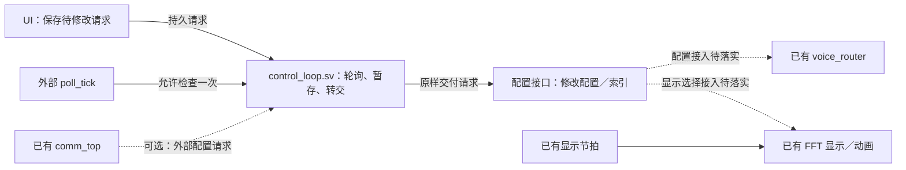

# 独立配置轮询模块设计

日期：2026-10-27。状态：**独立 RTL 已实现，15 组独立仿真通过；尚未接入真实 UI／配置后级，未进行综合、布局布线及板级验收。**

## 1. 范围修正

保持现有工程目录、router、loader、通信、MIDI 解析、FFT、UI 和显示结构。本次只新增一个独立业务 RTL 模块：[rtl/control_loop.sv](../rtl/control_loop.sv)，以及对应的独立测试台和运行脚本。

前稿新增 control/config/midi 目录、拆分配置寄存器及控制器、调整动画和场景存储等内容全部撤回，不作为本任务实施要求。

本模块只轮询、保存正在转交的请求并交付给配置接口。配置编码／索引如何修改仍由配置接口负责，不能为了添加轮询模块而重构目标模块。配置接口是这里的逻辑边界，不表示仓库已经存在一个完整的独立配置层。

## 2. 唯一新增文件

```text
rtl/
├── control_loop.sv          # 唯一新增业务 RTL：独立轮询模块
├── router/                 # 保持现状
├── comm/                   # 保持现状
├── drivers/                # 保持现状
└── ...                     # 其他目录保持现状

FFT_spectrumshow/           # 保持现状
```

本设计不新增 config_pkg、config_regs、config_ctrl、CDC 桥接、MIDI 消费者或动画模块。已有结构之外尚缺的业务能力另行设计，不纳入本次轮询模块。

## 3. 模块位置与职责



图中唯一新增的业务 RTL 文件是 **`rtl/control_loop.sv`**。`配置接口` 是需要对接的逻辑边界，不表示本次新增一个配置层文件或重构现有模块；虚线目标连接不代表当前已经完整实现。多时钟请求须先满足跨域条件，图中省略集成接线细节。

loop 位于请求来源和配置接口之间：只在 poll_tick 到来且暂存空闲时检查请求，取走一条后保持到配置接口接收。配置是否已经生效、系数何时加载、动画如何更新，都不由 loop 决定。comm_top 仅可作为另一请求来源，不是 loop 的子模块。

本模块负责：

- 在外部 poll_tick 到来时检查请求是否存在。
- 若需要多个来源，则按简单轮询顺序选择一个有效请求。
- 接收并暂存一条请求，保持到配置接口确认接收。
- 向原来源确认该请求已被取走。

不负责：

- 乐器、混响、FFT 模式等参数的解释、校验、编码或索引写入。
- 产生音频采样节拍，控制系数加载、reload、start 或音源切换过程。
- 推进动画、读取 FFT 数据、管理页面转场或显示缓冲。
- 等待配置实际生效、管理错误恢复或生成通信最终回复。

请求被取走与配置实际生效是两个不同结果；现有业务完成反馈按自己的接口处理，不由 loop 猜测。

## 4. 已实现接口

采用通用载荷，避免轮询模块依赖业务包。只接 UI 时来源数设为 1；确需接已有通信配置端口时才增加来源，不预先强制接入所有模块。

```text
参数：
    SOURCES                 请求来源数，默认 1
    REQUEST_W               载荷位宽，默认 32，接线时可覆盖

输入：
    clk / rst_n
    poll_tick               外部提供，单周期轮询使能
    src_valid[SOURCES]
    src_request[SOURCES][REQUEST_W]
    req_ready

输出：
    src_ready[SOURCES]
    req_valid
    req_request[REQUEST_W]
    req_source              交付来源编号，多来源时使用
```

来源编号位宽使用 `max(1, clog2(SOURCES))`，保证单来源可综合。loop 只携带原始请求位串，不约定 instrument_id、preset 等字段位置，也不导入 router_pkg。

本模块采用与请求端口相同的时钟域。跨域数据不能直接接入；若未来接真实 UI 时钟与核心时钟不同，在集成任务中明确跨域办法，不在本次自动增加或改造模块。

poll_tick 由调用方提供，因此本模块不另建 tick 文件，也不绑定 LCD frame_pulse。可用已有合适使能，具体轮询频率留给接线时确定。

## 5. 一轮行为

```text
空闲且 poll_tick：
    检查来源 valid
    选中有效来源时拉高对应 ready，握手取得请求
    暂存请求及来源

有暂存请求：
    向配置接口保持 req_valid、req_request、req_source
    req_valid && req_ready 时释放暂存
```

轮询指针和一项暂存属于传输状态，不是配置索引。暂存满时不读取新请求、不覆盖旧请求。第一版不在释放暂存的同一拍接收下一条，允许一个简单气泡，减少接口复杂度。

请求握手和向下游交付都必须按 valid/ready 条件执行，不能只看到 valid 就认为已经处理。多来源时按 round-robin 避免饥饿；单来源时退化为定期检查。

## 6. 对外部接口的最小要求

来源必须独立于 ready 提出 valid，并保持请求到握手。UI 修改请求必须保持到握手；一次短脉冲如果不被外部保存，轮询可能漏掉。本模块不会为补足这个条件而修改 UI 内部结构。接线前只需明确现有 UI 是否提供可保持的请求，若没有，则单列最小接口改动，不扩大为 UI 重构。

配置接口收到请求后负责修改对应配置／索引，loop 不直接写目标寄存器。router、FFT 或动画不因这个模块的加入获得自主修改全局配置索引的权限。

普通值配置是否合并、动作是否逐次执行，由请求生产者与配置接口约定；loop 原样交付，不擅自合并或丢弃有效请求。实时 MIDI Note On／Off 和压力数据继续走原本的实时路径。

## 7. 速度影响

无积压时，轮询带来的额外等待小于一个 poll_tick 周期，再加少量传输时钟。例如 60 Hz 约小于 16.7 ms，1 kHz 约小于 1 ms；这些仅为频率示例，不是当前实现的实测参数。

下游配置接口背压会增加配置排队时间，但不会使 loop 去等待动画完成。loop 不驱动动画，因此动画本身低速不必导致配置低速；两者是否共用使能由集成时决定。

## 8. 实现边界

已实现 `rtl/control_loop.sv`，未修改现有业务模块、现有综合源清单或顶层连线。测试文件位于 `sim/unit/control/tb_control_loop.sv`，运行脚本为 `sim/run_control_loop.py`；测试目录不属于新增业务架构。

模块使用异步低有效复位，复位释放应由集成方同步保证。复位取消尚未交付的暂存请求并将轮询起点恢复为来源 0；复位期间不对来源给 ready。交付后 req_request／req_source 可保留上一条值，仅在 req_valid=1 时有意义。SOURCES 和 REQUEST_W 必须大于等于 1。

真实 UI／配置接口的顶层接线与业务生效能力未包含在本次实现中，跨时钟请求仍须在集成时明确处理。

## 9. 独立验证

从仓库根目录执行：

```bash
python3 sim/run_control_loop.py
# 可选：自定义随机种子，可重复指定
python3 sim/run_control_loop.py --seed 1 --seed 42
```

脚本优先使用环境变量 IVERILOG／VVP 或 PATH，也支持当前工程已有的 micromamba 工具路径。产物写入 `build/control_loop/`，每种参数保存编译日志，每个随机种子保存运行日志。

2026-10-27 运行结果：**15／15 PASS**。参数组合为 `(SOURCES, REQUEST_W) = (1,1)、(1,32)、(2,8)、(3,17)、(5,128)`，各运行种子 1、42、20261027，每组包含 5000 个随机驱动周期及定向检查。

覆盖：无 tick 不读来源、空轮询、全来源竞争的确定性 round-robin 顺序、跳过空闲来源、非二次幂来源数回绕、空轮询不改变优先级、下游背压／暂存满时连续 tick、不带 tick 的输出交付、已接受后来源数据改变、复位取消在途请求及复位后的无陈旧输出。测试台用握手记账，核对来源和完整载荷，并检查 `接收数 = 交付数 + 复位取消数 + 当前暂存数`。

以上仅为独立 RTL 功能仿真结果，不表示真实配置后级或板级时序已验收。
