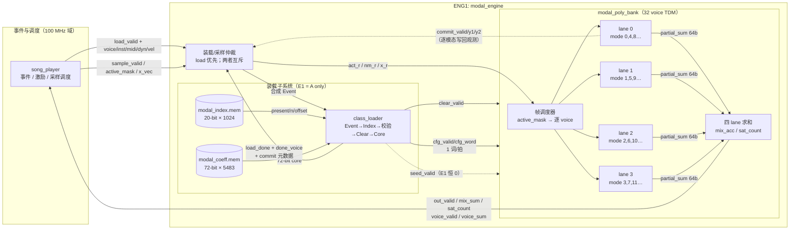
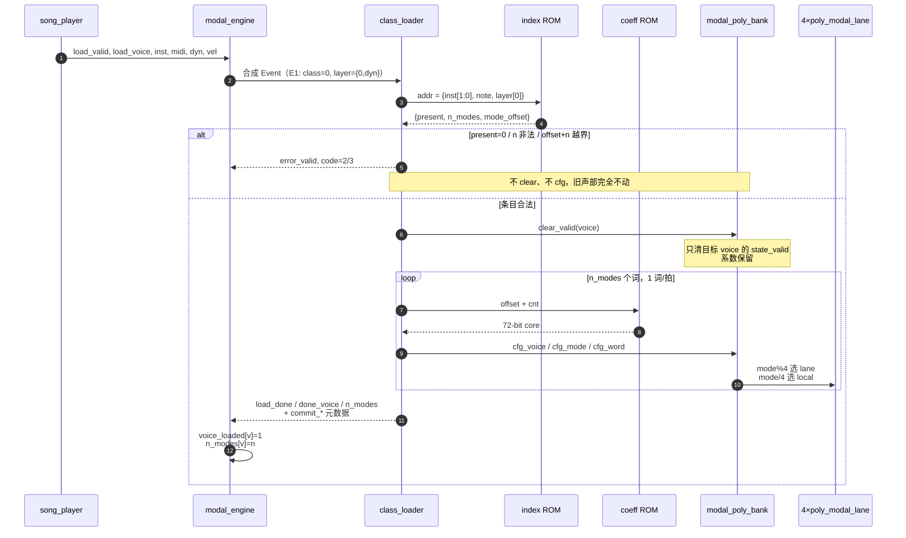
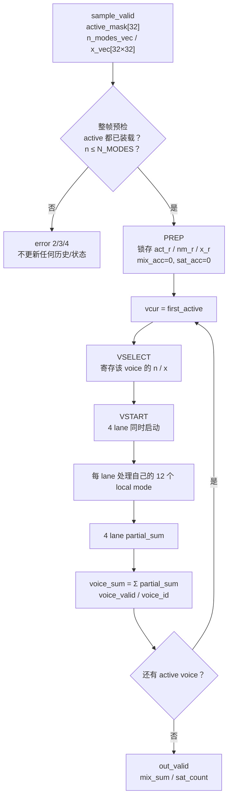
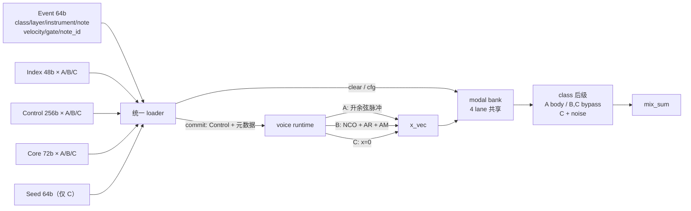

# ENG1（合成引擎 1）数据处理架构

**范围**：本文的 ENG1 指当前生产模态引擎核心：

```text
modal_engine
├─ class_loader.sv      （E1 起替换 coeff_loader）
└─ modal_poly_bank.sv
   └─ poly_modal_lane.sv × 4
```

生产链路中，`mix_sum` 之后还接 `body_filter`（A/guitar 箱体，可旁路）和 `sum_to_i16`，见 §1.1。  
不是 `rtl/simsynth` 的 ENG2（`modal_engine7` / `modal_voice_top`）。  
**状态**：E1 已实现 A 类装载路径；B/C 的 Control/Seed/class 选择仍在目标态，图中用虚线标出。

---

## 1. 一页总览



**两条流严格互斥**：

- **装载流**：改变“这个 voice 是什么声音”，只在 note-on/换音时发生；
- **采样流**：每采样把当前所有 active voice 算一遍，只读系数/状态，写回状态。

空闲时两者同拍到达，**load 优先**，不会同时握手。

### 1.1 在整链中的位置

```text
song_player
   │ 事件/激励/active_mask
   ▼
ENG1 核心：modal_engine → modal_poly_bank（4 lane）
   │ mix_sum (signed 64, Q2.30)
   ▼
body_filter（四节 biquad 串联；A/guitar 开启，B/C 旁路）
   │ signed 64, Q2.30
   ▼
sum_to_i16（SUM_ATT 衰减 + 舍入 + 饱和）
   │ signed 16
   ▼
TX 暂存 → audio_transport 异步 FIFO → I2S → MAX98357A
```

- `body_filter` 不在 `modal_engine` 内部，是 ENG1 的后级，不属于 bank 的每采样递推；
- `mix_sum` 是 64-bit Q2.30，`sum_to_i16` 才降到 16-bit；
- B/C 接入后仍共用同一个 bank，但后级按 class 选择 body/bypass（C 另加噪声）。

---

## 2. 装载流：Event → Index → Clear → Core → Commit

### 2.1 时序



### 2.2 每一步在做什么

| 阶段 | 动作 | 关键契约 |
|---|---|---|
| Event | 锁存 `voice + class/layer/instrument/note/velocity` | E1 由旧端口合成，`class` 必须为 0 |
| Index | 查 index ROM，取 `present / n_modes / mode_offset` | 20-bit A index：`present[19]`、`n[18:13]`、`offset[12:0]` |
| Check | `present=1`、`1≤n≤48`、`offset+n≤5483` | **全部在 clear 之前**，失败不产生任何写副作用 |
| Clear | 清目标 voice 的 `state_valid` | 只清状态，**不擦系数**；其他 voice 不受影响 |
| Core | 1 词/拍 burst 读 ROM，`G` 按 `vel_q` 缩放后写 bank | `cfg` 背压任意长，字段稳定；不丢词、不重复 |
| Commit | `load_done` 同拍给出元数据 | engine 置 `voice_loaded`、记 `n_modes`；voice 此时才可用 |

### 2.3 速度

| 项 | 旧 `coeff_loader` | E1 `class_loader` |
|---|---:|---:|
| 每词 | 4 拍 | **1 拍** |
| 48 模态 | ~216 拍 | **~54 拍**（n+6） |
| 索引/校验开销 | 固定 | 约 3–5 拍 |

48 模态从 216 拍降到约 54 拍，是 E1 最直接的收益；三个 C 同时击打也能塞进一帧剩余周期。

---

## 3. 采样流：一帧怎么算完 32 个 voice

### 3.1 帧级调度



- **一次只算一个 voice**，四个 lane 并行算这个 voice 的不同模态；
- 算完一个 voice 再取下一个，属于 TDM，不是 32 个 voice 同时展开；
- 非 active voice 完全冻结，不读不写；
- 整帧预检在任何状态更新之前完成，后面的非法 voice 不会让前面已提交；
- 输出无 backpressure。

### 3.2 lane 内部

每个 lane 负责全局模态 `k` 中 `k % 4 == LANE` 的部分，每个 voice 最多 12 个 local mode。

```text
每个 local mode 的递推：

  acc = G·x − a1·y1 − a2·y2
  ynew = clamp( (acc + 2^23) >>> 24, −2^31, 2^31−1 )

  写回：mem[state] ← {8'b0, y1_old, ynew}
  部分和：ps += ynew
  饱和：  sat += (ynew 被 clamp)
```

三个乘法点共用**一个** signed 26×32 乘法器，按相位流水复用：

```text
ph0：预取系数地址
ph1：G·x（同时读状态字）
ph2：a1·y1 / a2·y2（跨 mode 重叠）
```

这样每 lane 约 4 拍处理一个 local mode（含调度空隙），32 voice × 12 mode ≈ 384 mode/lane。

### 3.3 存储布局

每个 lane 一块同步单端口 72-bit RAM，系数和状态**交错存放**：

```text
lane L, voice v, 全局 mode k（k%4 = L）
  local = k >> 2
  slot  = v * 12 + local

  mem[2*slot + 0] = { G[25:0], a2[23:0], a1[21:0] }   // 系数
  mem[2*slot + 1] = { 8'b0, y2[31:0], y1[31:0] }      // 状态
```

- 每 lane 深度：`2 × 32 × 12 = 768` 个 72-bit word；
- `clear` 只清 `state_valid` 位图，不擦 RAM；
- `cfg` 写偶地址，`seed`/状态写回写奇地址；
- 写周期读口保持，数据通路不依赖同拍写出的值。

### 3.4 定点格式

| 量 | 格式 | 位宽 | 说明 |
|---|---|---:|---|
| `G` | Q2.24 signed | 26 | 驱动增益 |
| `a1` | Q2.20 signed | 22 | 进乘法器时左移 4 位，等效 Q2.24 |
| `a2` | UQ0.24 unsigned | 24 | 极点半径平方 |
| `x` | Q2.30 signed | 32 | 每 voice 每采样一个 |
| `y1/y2` | Q2.30 signed | 32×2 | 状态 |
| 乘积 | signed | 58 | 26×32 |
| 累加 | signed | 64 | `Gx − a1y1 − a2y2` |
| `voice_sum/mix_sum` | Q2.30 signed | 64 | 32 voice 求和 |

`a1` 左移 4 位后，三个乘积都落在 Q2.24×Q2.30，统一右移 24 位并加 `2^23` 舍入，得到 Q2.30 的 `ynew`。

### 3.5 时间预算

```text
100 MHz / 48.828 kHz = 2048 周期/采样

装载：48 模态 ≈ 54 拍（旧 216）
计算：32 voice × 48 mode，最坏 1508 拍
余量：约 540 拍
```

1508 是父会话实测的满载最坏值，不是理论下界；B/C 接入后目标仍是 ≤1800 拍。

---

## 4. 当前 E1 与目标态

### 4.1 已实现（实线）

- `class_loader` 替换 `coeff_loader`，A 的 20-bit index 在模块内展开；
- Event 由 engine 用旧端口合成，`class=0`；
- Core 改为 burst **1 词/拍**；
- `clear` 与 `cfg` 的原子性、背压、reset 契约保持；
- A-only 的 `core/engine` 逐位回归通过（e01–e07，最坏 1508 周期）。

### 4.2 尚未接（虚线）



目标态新增：

| 模块 | 作用 |
|---|---|
| class 选择 | `Event.class` 选 A/B/C 的 index/control/core/seed region |
| Control 通路 | 装载时读 256-bit，Commit 时一次性交给 voice runtime |
| Seed 写口 | 仅 C：写 `{y2,y1}` 到状态槽并置 `state_valid` |
| 真正的 Commit | 不再只等于 `load_done`，而是 Control + 元数据的生效点 |
| B 运行态 | `base_inc/inc`、NCO 相位、AR 包络、a1 刷新、LFO |
| C 运行态 | seed 变体、噪声支路、回收计时 |

---

## 5. 必须保持的契约

1. **先校验，后 clear**：缺表、n 越界、offset 越界、control/seed 非法，都不能产生 clear/cfg/seed。
2. **clear 不擦系数**：只丢 `state_valid`；失败装载不能破坏旧声部。
3. **Commit 前 voice 不可用**：即使 Core 已经写了一部分，也不能出现在 `active_mask` 的计算里。
4. **装载/采样互斥**：同拍到达 load 优先；`sample_ready` 在装载/clear/cfg/seed 期间为 0。
5. **x=0 仍要算反馈**：`SKIP_ZERO_INPUT` 只跳过 `G·x` 乘积，不能停止谐振器尾音。
6. **整帧预检**：非法 voice 不能造成“前面已提交、后面才报错”。
7. **两个 commit 不是一回事**：
   - `class_loader.commit_*`：装载提交，带 Control/元数据；
   - `modal_poly_bank.commit_*`：每 lane 每模态的状态写回观测，用于验证 `y1/y2/sat`。

---

## 6. 代码索引

| 文件 | 内容 |
|---|---|
| `rtl/core/class_loader.sv` | E1 装载器：Event/Index/Core/Commit 端口，A 路径 FSM |
| `rtl/core/modal_engine.sv` | 仲裁、voice_loaded/n_modes、错误码、loader↔bank 连接 |
| `rtl/core/modal_poly_bank.sv` | 32 voice TDM 帧调度、四 lane、混音/饱和 |
| `rtl/core/poly_modal_lane.sv` | 单 lane：72-bit RAM、单乘法器、三相位递推、写回/commit |
| `rtl/core/body_filter.sv` | ENG1 后级箱体（四节 biquad，可旁路） |
| `rtl/rom/modal_index.mem` | A index（20-bit × 1024） |
| `rtl/rom/modal_coeff.mem` | A core（72-bit × 5483） |
| `sim/unit/core/test_modal_engine.py` | engine 逐位回归 |
| `sim/regression/test_coeff_metadata_review.py` | 索引/元数据拒绝路径 |
