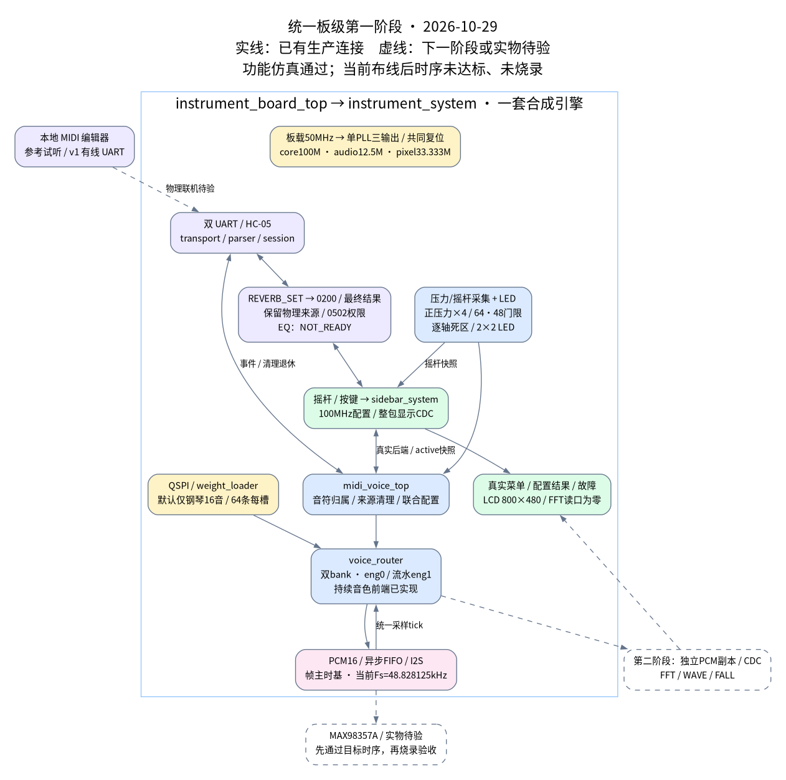
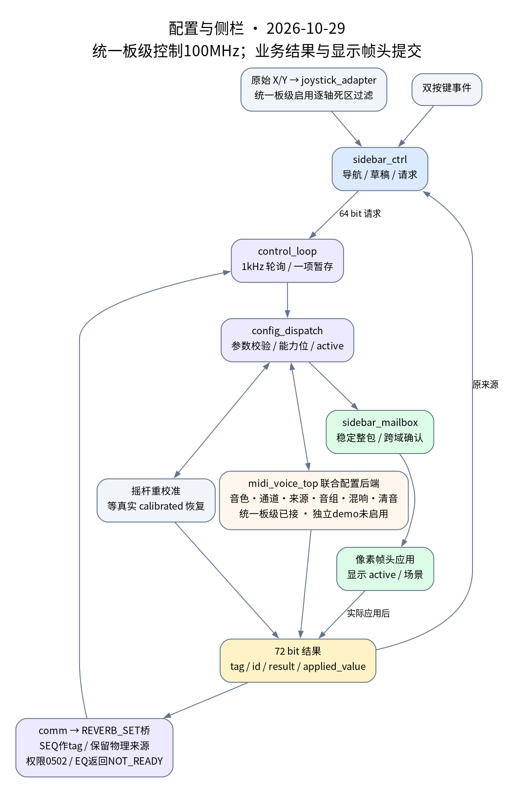
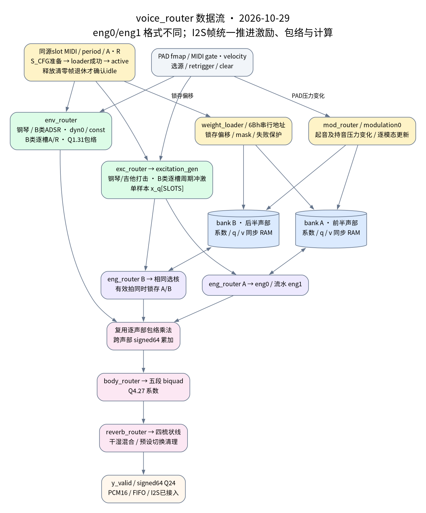

# 当前架构图

更新：2026-10-29。三张图按d93778af及统一板级工作区更新，包含统一板级、MIDI/远程配置、持续前端、I2S连接与FFT第二阶段边界；实线为现有生产连接，虚线表示后续阶段或实物待验；当前整板物理时序未达标。具体接口见 [代码导读](../../CODE_ARCHITECTURE.md)，验证结果见 [维护记录](../工程评审与验证.md#verification)。图内不将旧 core PASS/Fmax 当作当前整机结论。

## 系统边界

[](architecture_overview.svg)

[DOT 源](architecture_overview.dot)：统一板级三PLL/演奏/真实配置/I2S/LCD菜单、默认资源，以及FFT第二阶段和实物边界。

## 配置与显示提交

[](router_control_flow.svg)

[DOT 源](router_control_flow.dot)：摇杆/按键、control_loop、config_dispatch、远程REVERB桥、物理来源权限、联合配置后端及显示CDC；独立demo未启用音频后端。侧栏 CDC 不覆盖主音频。

## router 与后级

[](engine_post_flow.svg)

[DOT 源](engine_post_flow.dot)：双 bank、流水eng1与两路选核、逐槽周期激励/ADSR、资源提交、逐声部包络/混音、五段腔体与四梳状混响。

## 历史图与重新生成

2026-10-22 的共享 RAM/router_system_top 图在 [历史目录](history/2026-10-22/)，保留当时的标注；更早四引擎图在 `history/docs/diagrams/legacy/`。它们不是 voice_router 的当前实例树。

从仓库根目录，对每个 DOT 文件生成对应 SVG/PNG：

```bash
dot -Tsvg docs/diagrams/architecture_overview.dot -o docs/diagrams/architecture_overview.svg
dot -Tpng -Gdpi=130 docs/diagrams/architecture_overview.dot -o docs/diagrams/architecture_overview.png
```

另外两张用相同命令替换文件名。字体使用 Noto Sans CJK SC；SVG 可缩放查看。
