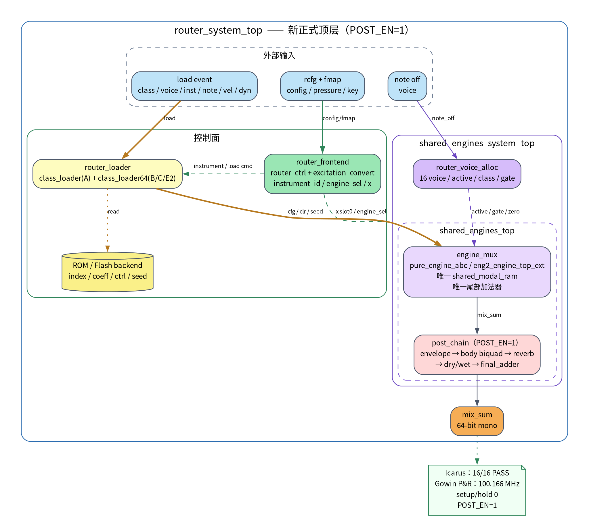
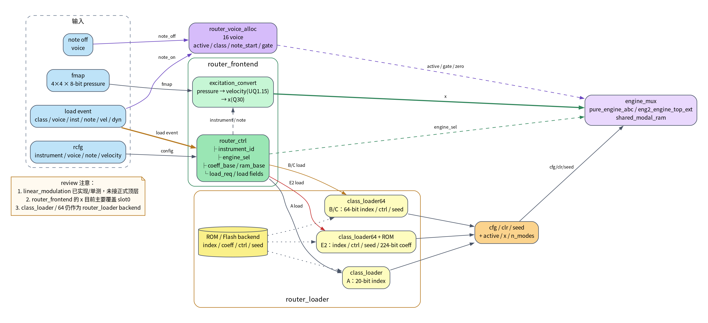
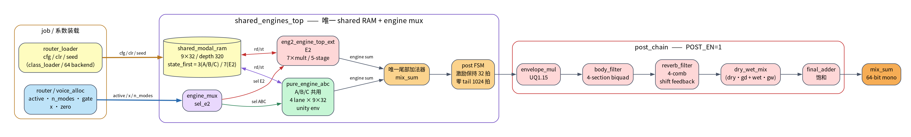

# 新架构图（2026-10-22）

旧图 `engines_system_flow.*` 画的是**重构前**的四引擎并行架构，保留仅作历史对照。
下面三张图对应当前正式顶层和最终 P&R 状态。

## 1. 总览

[](new_architecture_overview.svg)

- 源文件：[new_architecture_overview.dot](new_architecture_overview.dot)
- SVG：[new_architecture_overview.svg](new_architecture_overview.svg)
- 内容：`router_system_top` 的控制面、统一 loader、shared system、engine_mux、post_chain。

## 2. Router 控制 / 装载 / voice

[](new_router_control_flow.svg)

- 源文件：[new_router_control_flow.dot](new_router_control_flow.dot)
- SVG：[new_router_control_flow.svg](new_router_control_flow.svg)
- 内容：`rcfg/fmap → router_frontend → x/engine_sel/load`，以及 `router_loader`、`router_voice_alloc` 到 `engine_mux` 的连接。

## 3. 引擎 / 共享 RAM / 后级

[](new_engine_post_flow.svg)

- 源文件：[new_engine_post_flow.dot](new_engine_post_flow.dot)
- SVG：[new_engine_post_flow.svg](new_engine_post_flow.svg)
- 内容：`engine_mux`、`pure_engine_abc` / `eng2_engine_top_ext`、唯一 shared RAM、尾部加法器、post FSM、`post_chain`。

## 当前验证结果

```text
Icarus：16 / 16 PASS
Gowin P&R：100.166 MHz
Setup 违例：0
Hold 违例：0
Slack：+0.017 ns

Logic：10,050
Register：6,054
BSRAM：113 / 340
DSP：21 / 298
```

正式配置：

```text
POST_EN = 1
```

## Review 时请重点看

1. **`class_loader` / `class_loader64` 还在**
   它们是 `router_loader` 的 ROM/Flash backend；旧的 A/BC/E2 loader 包装已归档到
   `history/rtl/core/legacy_loader/`。如果要求连底层 loader 也完全删除，需要另做一版 flash 接口。

2. **router x 目前主要覆盖 slot0**
   `fmap_valid=1` 时覆盖 A/B/C/E2 的 slot0；还不是完整的 per-voice fmap 分配。

3. **`linear_modulation` 已实现/单测，但未接正式顶层**
   当前没有旋钮/颤音输入。

4. **reverb 是 4-comb 简化版**
   为 100 MHz 收敛去掉了 allpass；带 allpass 的版本有时序/写模式问题。

5. **`router_probe` 是 3-I/O 时序探针**
   用测试 ROM 验证时序和资源，不是整板音频实测。

## 重新生成

```bash
dot -Tsvg docs/diagrams/new_architecture_overview.dot -o docs/diagrams/new_architecture_overview.svg
dot -Tpng -Gdpi=180 docs/diagrams/new_architecture_overview.dot -o docs/diagrams/new_architecture_overview.png

dot -Tsvg docs/diagrams/new_router_control_flow.dot -o docs/diagrams/new_router_control_flow.svg
dot -Tpng -Gdpi=180 docs/diagrams/new_router_control_flow.dot -o docs/diagrams/new_router_control_flow.png

dot -Tsvg docs/diagrams/new_engine_post_flow.dot -o docs/diagrams/new_engine_post_flow.svg
dot -Tpng -Gdpi=180 docs/diagrams/new_engine_post_flow.dot -o docs/diagrams/new_engine_post_flow.png
```
