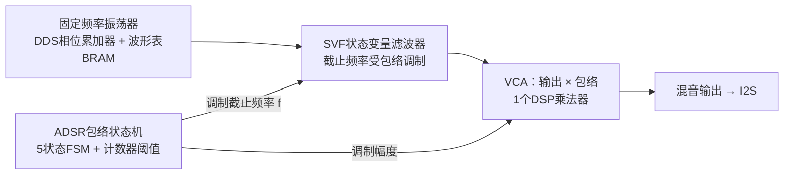
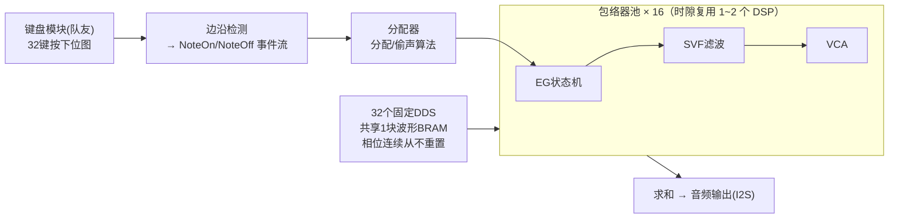

# 传统路线合成引擎 — 方案说明

> 负责人：wwiinnd（传统减法合成路线）
> 赛道：高云半导体 FPGA 竞赛「多音色合成音乐引擎」
> 板卡未到货，先在 MATLAB 中验证算法，本文档随进度更新（v0.1）。

## 1. 现状与分工

| 事项 | 状态 | 位置 |
| --- | --- | --- |
| 单音全链路仿真（振荡器→包络→滤波→输出） | 已完成 | `matlab/single_voice.m` |
| 同键连按（重触发）方案对比仿真 | 已完成 | `matlab/retrigger_sim.m` |
| 键盘扫描模块（4×8 矩阵，32 键） | 队友负责 | `top.sv` |
| 物理建模音色 | 队友负责 | 待开始 |

## 2. 单音信号链（减法合成）



音色设计一句话：**起音亮、衰减暗**。包络同时控制音量（VCA）和滤波器截止频率（SVF），模拟拨弦/打击乐"高次谐波先消失"的自然听感。

## 3. 模块 ↔ FPGA 映射

| 模块 | MATLAB 里的写法 | FPGA 里的实现 | 资源估算 |
| --- | --- | --- | --- |
| 振荡器 | `sawtooth()` | DDS 相位累加器 + BRAM 波形表 | 1 块 BRAM（所有键共享，顺序读取） |
| ADSR 状态机 | for 循环里的 if 分支 | 5 状态 FSM（idle/attack/decay/sustain/release）+ 计数器阈值 | 每个包络器 1 套寄存器 |
| Attack/Decay | 线性斜坡 | 每采样加/减固定步进（步进=dt/A 等参数换算） | 加减法器 |
| Release 指数衰减 | `exp(-rate*t)` | 每采样乘定点常数 K（K=exp(-rate/Fs)） | 每包络器 1 个乘法 |
| 阈值截断 | `if env < threshold` | 比较器：低于阈值直接归零 | 防底噪爆音 + 让包络器回池 |
| SVF 滤波器 | 3 行差分方程 | 2 个 DSP 乘法器 + 加减法 | 每包络器 2 个乘法 |
| VCA | `filt_out .* env` | 1 个 DSP 乘法器 | 每包络器 1 个乘法 |
| 输出混合 | `low*0.5 + band*0.4 + high*0.1` | 3 个常数乘（移位实现 0.5/0.25 档）+ 加法 | 低通为主、带通高通少量增色 |

## 4. 关键设计决策与理由

1. **采样率 48 kHz，与 FPGA I2S 设计严格对齐**，MATLAB 听到的效果即板上效果。
2. **Release 用指数衰减而不是线性**：听感更自然（真实乐器的衰减就是指数型），而且硬件代价只是一个"每采样乘常数"，比查表省得多。
3. **选 SVF 而不是 biquad**：SVF 每采样只要 2 个乘法器（biquad 要 5 个），且截止频率就是一个系数 f，特别适合被包络高速调制；还能免费拿到 low/band/high 三种输出做混合音色。
4. **阈值截断（-80 dB 归零）**：省掉尾巴阶段的无效计算，防止底噪，也让包络器有明确的"回池"条件。
5. **定点化提示**：SVF 的 f 系数范围 0.005~0.3，包络 0~1，建议都用 Q1.15 定点；K 取 exp(-3/48000)≈0.99994，Q1.15 下约 32766/32768。

## 5. 如何验证

在 MATLAB 中运行：

- `matlab/single_voice.m` —— 单音全链路：听一遍 A4 拨弦音色，四张图分别是振荡器/包络/滤波器/最终输出。
- `matlab/retrigger_sim.m` —— 同键连按对比（见第 6 节）：先听方案 A（每次重按有"哒"爆音），再听方案 B（自然连按、尾巴保留）。

## 6. 当前问题：同键连按（重触发）

### 6.1 问题定义

同一个键快速反复按（如颤音、滚奏）时，要求：

- 每次按下都干净地重新起音（不能"哑火"）；
- 上一次按键的余音自然衰减（不能被腰斩产生爆音）；
- 资源有限，不能无限叠加。

### 6.2 为什么难

一个量化事实：按现有参数（Release rate=3.0，Sustain=0.6），包络从松手衰减到 -80 dB 阈值需要约 **2.9 秒**。若每 0.22 秒重按一次，同一时刻会有十几个"正在衰减的尾巴"活着——所以**靠加多包络器是不现实的，必须有回收（偷声）算法**。

### 6.3 方案对比

| 方案 | 资源 | 效果 | 备注 |
| --- | --- | --- | --- |
| A. 单包络器硬重触发 | 最省（每键 1 个 EG） | 尾巴被腰斩，包络从 ~0.5 直接跳 0 → 每次重按有爆音"哒" | 便宜电子琴的做法 |
| B. 固定振荡器 + 包络器池动态分配（**选定**） | 32 键固定 DDS + 16 个 EG 链 | 无爆音、尾巴完整、连按自然 | 电子管风琴分频架构 + 复音偷声的结合 |
| C. 每个音完整复音（osc+EG+SVF 全套复制） | 最多 | 效果同 B | 省不下振荡器，且重触发各次相位随机会互相拍频 |

**方案 B 的额外好处**：同一键的多次触发用的是**同一个固定振荡器**（相位连续、频率从不变），所有叠加的尾巴完全同相，听感像"同一根弦被反复拨动"，不会出现方案 C 那种随机相位拍频。

### 6.4 分配算法（伪代码）

```
Note On(key):
  ① 找空闲 EG → 绑定 key，包络从 0 进入 Attack（从零起音，天然无爆音）
  ② 没有空闲 → 偷"同 key 且正在 Release 且包络值最小"的 EG
     （同音高的尾巴被顶替，人耳几乎无感）
  ③ 还没有 → 偷"任意正在 Release 且包络值最小"的 EG
  ④ 还没有 → 偷"包络值最小"的 EG（切音，最坏情况）

Note Off(key):
  该 key 当前"按住中"的 EG（物理上一个键最多一个）→ 进入 Release
  其余同 key 的 EG 本来就在 Release，保持不动

EG 每采样更新：
  Release 阶段：值 × K；低于阈值 → 归零、解绑、回池
```

### 6.5 MATLAB 验证结论（`retrigger_sim.m`）

场景：A4 每 0.22 s 连按 8 次，EG 池故意只配 4 个（制造池满压力）：

- 方案 A 在每次重按处波形跳变，试听有爆音；
- 方案 B 包络叠加、波形连续；池满后偷声全部发生在"同键 release 尾巴"上（统计见脚本输出），试听无感；
- 偷声时刻与各 EG 包络轨迹在图中用红虚线标出，可直接检查策略是否按预期工作。

## 7. 提议的复音总体架构



**资源可行性**：100 MHz 时钟下每个采样周期约 2083 个时钟周期；16 个 EG × 每个约 4 次乘法 = 64 次/采样，时隙复用 1~2 个 DSP 乘法器绰绰有余。32 个固定 DDS 共享一块波形 BRAM 顺序读取即可。

**与队友的接口讨论（待确认）**：

1. `top.sv` 现在输出 `keycode[31:0]`——从 4×8 矩阵推测是"32 键按下位图"？建议直接传位图，NoteOn/Off 边沿检测放合成引擎侧做（事件语义归属引擎，键盘模块保持简单）。
2. 48 kHz 音频时钟 / I2S 输出由谁负责？
3. 物理建模音色的输出在哪个位置并入混音（建议：两路音源求和后统一过 I2S）。

## 8. 多音色扩展（后续）

一个"音色 patch" = {波形选择， ADSR 四参数， SVF 的 q/f_min/f_max， 输出混合比例}，存一组寄存器。多套 patch 可切换，或映射到不同键区 → 即"多音色"。队友的物理建模音源作为并列音源在混音处汇合。

## 9. 下一步 TODO

- [ ] 把 `retrigger_sim.m` 的分配算法翻译成 SystemVerilog（分配器 + EG 池）
- [ ] 与队友确认键盘位图接口语义
- [ ] 板卡到货后：I2S 输出 + 板上听感对比 MATLAB 结果
