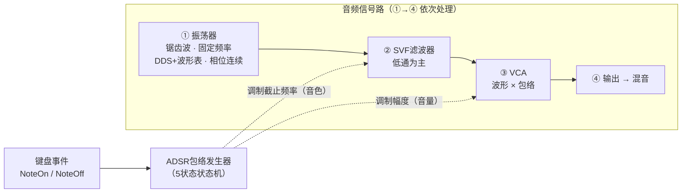

# 声音合成算法方案说明

> 负责人：wwiinnd（传统减法合成路线）
> 赛道：高云半导体 FPGA 竞赛「多音色合成音乐引擎」
> v0.2

## 1. 前因

赛道要求在 Gowin FPGA 上实现多音色音乐合成引擎。分工上我负责**传统减法合成**路线（队友负责物理建模音色与矩阵键盘扫描）。

板卡尚未到货，所以当前阶段的工作方式是：**先用 MATLAB 把合成算法验证到位，板上只做移植**。为此仿真严格对齐硬件条件——采样率 48 kHz（与板上 I2S 一致）、每个模块写成 FPGA 可直接对应的形式（状态机、差分方程、定点常数），保证 MATLAB 里听到的就是板上会听到的。

已完成的工作：单音全链路仿真跑通（`matlab/single_voice.m`）；随后暴露出"同键连按"问题，做了三种算法的对比验证（`matlab/test.m` 与三个单方案文件）。本文档按"框架 → 问题 → 算法 → 对比"的顺序讲清楚。

## 2. 基本框架

减法合成信号链。读法：**实线 = 信号/事件流，虚线 = 包络的调制**。



文字版：合成一个音，主干只有四步——

```
振荡器 → SVF滤波器 → VCA → 输出
```

- **振荡器**：产生固定频率的锯齿波，是声音的"原材料"；
- **SVF 滤波器**：低通为主，负责砍高频，决定音色；
- **VCA**：把滤波结果乘上包络，决定音量；
- **输出**：low/band/high 三路按 0.5/0.4/0.1 混合（低通为主，带通高通少量增色）。

包络（ADSR）不在这条主干上——它是**控制者**。键盘事件（NoteOn/NoteOff）驱动它跑 A→D→S→R 四个阶段，它同时伸手调制两处：

- **滤波器截止频率**（音色）：包络大 → 截止频率高 → 声音亮；
- **VCA 增益**（音量）：包络大 → 声音大。

听感由此而来："**起音亮、衰减暗**"——按键瞬间高次谐波最多、声音最亮；随包络衰减、高频先被滤掉、声音变暗，正是拨弦类乐器"高次谐波先消失"的自然特征。


两个刻意的设计决策：

- **Release 用指数衰减**：真实乐器的能量衰减就是指数型，听感自然；硬件代价仅是每采样乘一个常数。
- **-80 dB 阈值截断**：包络低于阈值直接归零，防底噪，同时给包络器一个明确的"回收"条件（后文的淘汰算法依赖它）。

## 3. 遇到的问题：同键连按

同一个键快速反复按（颤音、滚奏）时，三个要求必须同时成立：

1. 每次按下干净起音（不能"哑火"）；
2. 上一次的余音自然衰减（不能被腰斩出爆音）；
3. 资源有限（不能无限叠加）。

难点是一条量化事实：按现有参数，包络从松手衰减到 -80 dB 回收线需要约 **2.9 秒**。若每 0.2 秒重按一次，任意时刻都有十几个"正在衰减的尾巴"同时活着。所以**加多包络器解决不了问题，必须有淘汰算法**——问题从"怎么叠加"变成"淘汰谁、怎么淘汰"。

## 4. 三种算法

### 4.1 方案 A：单包络器硬重触发（最简基线）

最原始的做法：每个键固定 1 个包络器，重按键 = 包络强行归零、重新 Attack。

```
NoteOn  → 包络清零，进 Attack
NoteOff → 进 Release
```

- 优点：实现代价最低，一键一套状态机，没有任何调度逻辑。
- 缺点：清零即跳变，爆音强度 = 被切瞬间的包络电平，结构上无法消除。

### 4.2 方案 B：固定振荡器 + EG 池 + 偷声

核心思想：**把"音源"和"音符实例"解耦**。振荡器每键 1 个、频率固定、相位连续；包络器做成一个池，每次按键从池里领一个，衰减到阈值后还回去。

```
NoteOn  → ① 领空闲 EG（包络从 0 起音，天然无爆音）
          ② 池满 → 偷"同键且 Release 中、包络值最小"的 EG
          ③ 没有 → 偷"任意 Release 中、包络值最小"的
          ④ 还没有 → 偷全局包络值最小的（切音，最坏情况）
NoteOff → 该键"按住中"的 EG 进 Release（其余同键的本来就在 Release）
```

新音符从零起音、旧尾巴从不改写，正常路径无爆音；固定振荡器还有个副产品——同键多次触发完全同相，叠加听感像"同一根弦被反复拨动"，没有随机相位拍频。

但偷声的本质仍是**瞬间归零**：轻压力下偷的都是安静尾巴、听不出；重压力下（尾巴都还响着）就会切到 0.2~0.3 电平的尾巴——爆音现形。"挑安静的偷"只能缓解，不能根治。

### 4.3 方案 C：固定振荡器 + 活跃表 + 催死（选定）

方案 B 的瓶颈在于"槽位"这个资源又贵又少（一条完整 EG 链是一坨实打实的寄存器）。方案 C 换掉了稀缺资源本身：不维护"槽位 + 绑定"，只维护一张**活跃表**——每行就是 `{键号, 包络值, 滤波器状态}` 共约 7 字节，输出 = 各行 (振荡器 × 包络) 求和。表容量在 FPGA 上近乎免费（128 行 ≈ 1 块 BRAM 的零头）；乘法计算也远不到预算上限（100 MHz 时钟下每采样约 2083 个周期，128 行 × 4 次乘法 = 512 次）——**"装不下"这件事本身变得几乎不会发生**。

更关键的是淘汰动作的改变：**催死，而不是删除**。

```
行数 > 高水位 H   → 给"包络值最小且 Release 中"的行换快衰减系数 K_fast
                    （K_fast = K 的 20 倍速率：尾巴连续加速退场，全程无跳变）
衰减到阈值        → 行自动回收
NoteOn / NoteOff  → 插入新行 / 该键按住中的行进 Release（与 B 一致）
```

淘汰从"离散的删除决策"变成"连续的衰减调度"——爆音在物理上不存在了，而不再是"挑个安静的偷所以听不出来"。

代价与配平（C 仅有的两个旋钮）：

- **被催的尾巴变短**（约 0.1 s 快速淡出而非完整余音）——表容量开大后此路径几乎不触发，尾巴即可完整保留；
- **R_fast 必须满足**：催死一行的时间 < 两次按键的最小间隔（催太温和会出现兜底硬偷，催太狠尾巴损失大）。

## 5. 对比与结论

统一加压场景（`matlab/test.m`）：A4 每 0.15 s 连按 10 次，B 的池和 C 的表都只给 3 个位置，故意把淘汰逼出来。

| | A 硬重触发 | B EG池+偷声 | C 活跃表+催死 |
| --- | --- | --- | --- |
| 淘汰动作 | 每次重按硬切到 0 | 池满瞬间归零 | 换系数连续加速退场 |
| 次数 / 被切电平 | 10 次 × ~0.68 | 7 次 × ~0.28 | 8 次催死（起始 ~0.44），兜底硬偷 0 次 |
| 听感 | 每按必爆 | 有"哒"声 | 全程干净 |
| 资源 | 最省 | N 条完整链 | 每行 ~7 字节，容量近似免费 |
| 短板 | 爆音无法根治 | 重压力下爆音现形 | 被催的尾巴变短；R_fast 需配平 |

最说明问题的一行数据：**C 催死的尾巴（0.44）比 B 切掉的（0.28）还响，却全程无爆音**——差距不在挑谁淘汰，而在淘汰这个动作本身是连续的还是离散的。

结论：**选定方案 C**。轻压力下 C 与 B 行为一致（C 相当于把 B 的"最坏情况处理器"换掉），此前对 B 的验证结论全部保留。

复现与动手：`matlab/test.m` 为三方案同场对比试听；`schemeA_baseline.m` / `schemeB_egpool.m` / `schemeC_activetable.m` 为各方案单独详解，文件尾有"自己动手"实验（例如把 C 的 `R_fast` 调温和，可以看到兜底硬偷现身）。
