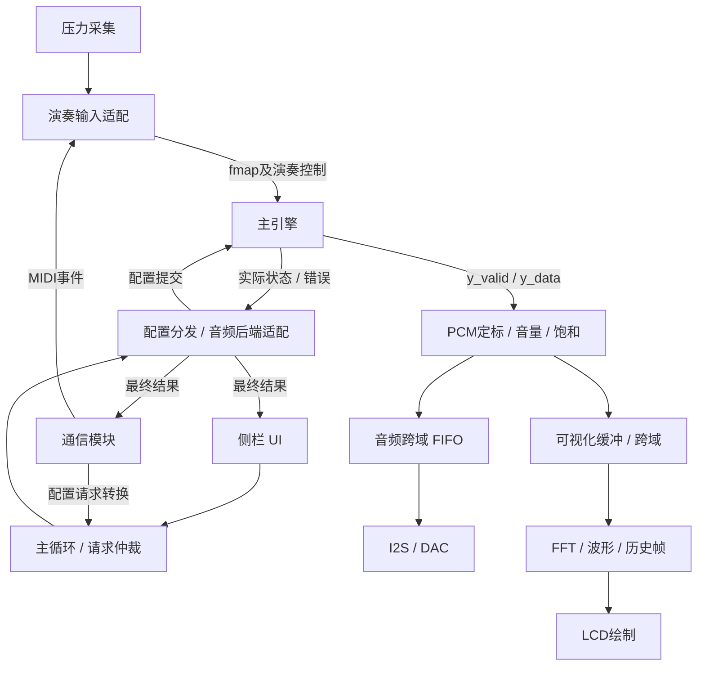

你这次需要看清的是两条边界：**谁负责把业务变成主引擎能接受的输入，以及谁负责把主引擎的结果变成可播放、可显示的数据。** 主引擎内部怎么算一个模态，可以暂时放后面读。

还有一个需要先明确的地方：**端口名和位宽稳定，不代表接口语义已经完整。** 比如现在有 `inst`，但没有带事务编号的“这个音色已经加载成功”回应；有 `fmap`，但没有独立的 MIDI 音高和重触发接口。这些正是外部集成需要和作者对齐的内容。

下面都基于当前源码；“已复现bug”和“尚未完成的对接设计”会分开说明。

## 1. 先看整机需要连接的三条通路



三条通路的时间要求不同：

| 通路 | 处理什么 | 时间要求 |
|---|---|---|
| 演奏通路 | 按下、松开、力度、音高、踏板 | 保持事件顺序，及时响应 |
| 配置通路 | 音色、来源、音区、效果、音量 | 可以等待，但必须知道最后成功还是失败 |
| 音频通路 | 连续采样点 | 按音频采样节拍持续供应 |

当前 `control_loop` 是配置请求的轮询、暂存和转交模块。它**不负责每个音频样本的调度，也不维护 MIDI 音符生命周期**。源码文件头和端口已经写明这一点：[control_loop.sv:1](/home/rubbishbro/Desktop/FPGA_IDC_2026/rtl/control_loop.sv:1)。

因此，不能把所有数据都送入1kHz轮询队列，再认为整个系统已经串起来了。

## 2. 主引擎现在究竟提供了什么接口

先看 [voice_router.sv:26](/home/rubbishbro/Desktop/FPGA_IDC_2026/rtl/router/voice_router.sv:26)，可以把它理解成下面这张表：

| 接口 | 当前含义 | 外部需要承担什么 |
|---|---|---|
| `fmap` | 16个槽的8位压力值 | 维护演奏状态，按约定映射到槽 |
| `inst` | 请求使用的全局乐器编号 | 保持配置请求，区分请求值和实际生效值 |
| `reverb_preset` | 混响预设输入 | 编号转换、安全切换和结果确认 |
| `reload` | 内部取上升沿，要求重载 | 产生明确请求，不能当成长期重复发送的命令 |
| `start` | 启动一次产生一个样本的作业 | 与音频节拍、引擎空闲状态协调 |
| `done` | **空闲电平**，可以接受下一次作业 | 用于作业调度，不能直接解释为换音色成功 |
| `ready` | 挂起的音色／重载变更是否允许执行 | 用于配置流控，不能解释为PCM接收握手 |
| `load_err` | 表加载错误状态 | 传到配置结果、UI和诊断 |
| `y_valid/y_data` | 一个有效的64位有符号结果 | 及时接住，转换成固定格式PCM |
| QSPI端口 | 内部loader对Flash的物理访问 | 顶层引脚、方向控制以及资源安排 |

`done/ready` 的实际赋值在 [voice_router.sv:580](/home/rubbishbro/Desktop/FPGA_IDC_2026/rtl/router/voice_router.sv:580)。

这里最容易误解的有两点：

- **当前音频输出没有 `y_ready`。** 外部不能用反压让一个已经产生的样本“再等一下”。输出到来时，接收端必须有地方保存。
- **当前没有独立的运行时 note/pitch、gate、retrigger、清音事务接口。** 某些演奏功能能否通过现有端口完整表达，需要实际评估，不能只靠接线解决。

---

## 3. 演奏输入：通信事件怎样变成 `fmap`

这部分主要由**外部演奏适配层**负责，但它受到主引擎输入语义限制。

### 3.1 通信模块给的是事件，主引擎要的是状态

通信出口在 [comm_top.sv:29](/home/rubbishbro/Desktop/FPGA_IDC_2026/rtl/comm/comm_top.sv:29)：

```text
event_valid
event_ready
event_data[31:0]
event_source_id
```

一个 MIDI Note On 是“一次事件”；`fmap[slot]` 是“这个槽当前的压力状态”。中间需要有人保存：

- 哪个来源、哪个通道、哪个音符占用了哪个槽；
- 原始力度是多少；
- 键是否仍按住；
- 踏板是否让它继续保持；
- 对应 Note Off 到来时该释放哪个槽；
- 断线时该清理哪些槽。

例如：

```text
收到有线来源的 Note On 60
    → 查找这个音符能使用的音高资源
    → 分配或定位槽位
    → 保存来源、音符到槽位的归属
    → 更新该槽的演奏输入

随后收到 Note Off 60
    → 按之前保存的归属释放原槽
```

不能在 Note Off 时只根据“当前音区设置”重新算一遍槽位，否则中途改音区可能释放错音。

### 3.2 当前力度门限不适合直接复制 MIDI velocity

主引擎目前的起音条件是：

```text
未按下：fmap > 230 才起音
已按下：fmap >= 26 继续保持
```

位置：[voice_router.sv:177](/home/rubbishbro/Desktop/FPGA_IDC_2026/rtl/router/voice_router.sv:177)。

MIDI velocity只有0～127，直接复制过来，任何音都达不到起音门限。

这不是通信解析器的数值解析错误，而是**消费者映射尚未完成**。简单全部填250可以让它响，却会损失力度表达。

双方需要决定：

- 首版允许怎样的力度映射；
- 是否需要把“按键开关”和“力度大小”独立表达；
- 相同音符再次触发时，怎样保证引擎真的识别到新起音。

当前 `fmap` 从一个非零值变成另一个非零值，通常只表示压力变化，并不等于重触发。

### 3.3 音符编号不等于槽位编号

目前每个槽预加载一套音高系数。默认钢琴镜像的16个音是：

```text
40,42,44,46,48,50,52,54,56,58,60,62,64,67,71,76
```

来源：[piano_flash.py:64](/home/rubbishbro/Desktop/FPGA_IDC_2026/rtl/router/tools/piano_flash.py:64)。

因此，收到 MIDI 61 时，当前默认镜像并没有相应资源。外部不能仅把61写到某个寄存器就期待引擎自动产生对应音高。

首版必须明确采用哪种能力：

- 只演奏预加载的16个音；
- 切换音区时重新加载一组音；
- 支持运行时音高／系数更新。

前两种可以保留较多现有结构，第三种需要引擎作者提供相应能力。

### 3.4 有线／蓝牙的选择仍要在外部处理

`pad_voice_top.src_sel` 只有一位，当前含义是：

```text
0：压力垫
1：外部 fmap
```

见 [pad_voice_top.sv:121](/home/rubbishbro/Desktop/FPGA_IDC_2026/rtl/router/pad_voice_top.sv:121)。

它没有区分有线MIDI和蓝牙MIDI。UI虽然可以有三个来源选项，但有线／蓝牙之间的选择、混合和清理策略，需要在生成 `fmap_ext` 之前完成。

**归属判断：** MIDI事件消费、音符归属、来源选择主要属于外部；独立门控、重触发、任意音高能否表达，则是双方必须冻结的输入合同。

---

## 4. UI和主循环：怎样知道配置真正生效

这部分是当前外部集成最重要的工作之一。

### 4.1 现有UI已经留好了音频后端接口

接口在 [sidebar_system.sv:21](/home/rubbishbro/Desktop/FPGA_IDC_2026/FFT_spectrumshow/src/ui/sidebar_system.sv:21)：

```text
backend_supported

backend_valid / backend_ready / backend_request
backend_rsp_valid / backend_rsp_ready / backend_response
```

也就是说，UI已经能够提出请求、等待结果。我们需要补的是把这些请求翻译成主引擎操作的**音频后端适配层**。

独立demo目前把后端能力位设为0，见 [ui_demo_top.v:245](/home/rubbishbro/Desktop/FPGA_IDC_2026/FFT_spectrumshow/board/ui_demo_top.v:245)。这表明它尚未接音频消费者，属于集成缺口，不是UI已经能控制声音。

### 4.2 “接收请求”和“配置成功”必须分开

一次切音色至少包含以下状态：

```text
用户选择吉他
→ 请求被接收并保存
→ 等待允许切换的边界
→ 开始加载
→ 加载完成，检查错误
→ 有效配置切换
→ 返回成功／失败
→ UI更新实际值
```

`config_dispatch` 已经在等待后端结果，而不是看到请求被接收就直接成功，见 [config_dispatch.sv:82](/home/rubbishbro/Desktop/FPGA_IDC_2026/rtl/config_dispatch.sv:82)。

但主引擎当前只给出了 `ready/done/load_err`，没有带请求标识的配置完成回应。因此适配层必须能明确判断：

> 这次完成的是我提交的换音色操作，而不是一次普通采样作业。

如果现有状态组合无法可靠证明，就需要和作者补一个可核验的完成机制。它可以是状态、版本号或明确的确认接口，具体形式再共同决定。

### 4.3 请求值与实际值不能混用

已复现的“钢琴还没切走，模态数先变成20”就是这类问题：

- 外部请求值是吉他；
- 有效音色和系数仍是钢琴；
- 引擎内部模态数却按吉他请求更新了。

位置：[voice_router.sv:732](/home/rubbishbro/Desktop/FPGA_IDC_2026/rtl/router/voice_router.sv:732)。

**修复代码在引擎内部，但它是配置边界问题。**

外部要保存 pending／active、正确展示“等待中”；引擎作者要保证音色、模态数和表版本一起生效。

### 4.4 枚举和格式也要转换

混响编号当前有两套：

| 语义 | UI／线上编号 | router编号 |
|---|---:|---:|
| 关闭 | 0 | 2 |
| 大厅 | 1 | 1 |
| 浴室 | 2 | 0 |

router定义见 [router_pkg.sv:27](/home/rubbishbro/Desktop/FPGA_IDC_2026/rtl/router/pkg/router_pkg.sv:27)。

直接强转会把“关闭”变成“浴室”。这是**尚未接线时就应该防住的外部转换风险**，不是已经复现的主引擎算法bug。

通信配置与UI请求也不是相同结构：前者有来源、SEQ、命令和128位shadow；后者是 `{tag,id,value}`。复合EQ参数不能通过截取64位来转换，回应上下文也必须保留。

---

## 5. 内存和Flash：究竟哪些需要“连起来”

这里应先明确**谁拥有内存、谁允许读写、什么时候可以更新**。

| 存储内容 | 建议归属 | 对外访问方式 |
|---|---|---|
| MIDI音符、来源、踏板状态 | 演奏适配层 | 消费事件，产生引擎输入 |
| 请求、pending／active配置 | 配置后端 | 请求／结果握手和状态快照 |
| Flash音色资源 | 资源加载层 | 明确的加载事务 |
| 当前系数／调制参数表 | 引擎或专属加载／更新模块 | 有仲裁和提交边界的写入 |
| 模态递推状态RAM | 主引擎 | 引擎自行更新，调试只读约定状态 |
| PCM FIFO | 音频传输层 | 样本流读写 |
| FFT窗口／显示帧缓存 | 可视化模块 | 窗口所有权及显示读口 |
| 混响延迟RAM | 效果器 | 由效果器维护清空、有效性和尾音 |

### 5.1 默认48／64模态必须统一

这是一个明确的集成参数风险：

- `pad_voice_top` 默认 `N_MODES=48`：[第14行](/home/rubbishbro/Desktop/FPGA_IDC_2026/rtl/router/pad_voice_top.sv:14)；
- `voice_router` 默认64；
- 钢琴镜像默认也是64。

Flash每槽紧凑存放：

```text
slot起始偏移 = slot × N_MODES × 64字节
```

若镜像按64模态生成，而loader按48模态读取：

```text
slot1正确起点：64 × 64 = 4096字节
loader认为的起点：48 × 64 = 3072字节
```

后面的槽就会读错资源。乐器表基地址也依赖这个参数。

最终顶层若明确覆盖成一致值，可以避免这个组合问题；所以应由集成层统一参数，再让打包器、烧录文件和引擎共同核对。

### 5.2 RAM补齐地址与Flash紧凑地址是两种布局

RAM使用：

```text
slot × NMP + mode
NMP = 2^ceil(log2(N_MODES))
```

Flash使用紧凑的 `N_MODES` 步长。

这两种布局可以共存，但转换必须有唯一合同。不能看见RAM是64步长，就认为Flash必然也是64步长。

### 5.3 系数更新必须有提交边界

后台调制目前直接修改引擎正在读的系数，已观察到一帧混合新旧版本。

这项实现主要由引擎／存储更新负责人修改，但外部UI、力度控制、未来的音色塑形都依赖它。

双方需要约定：

- 参数更新是立即写当前表，还是先写准备区；
- 什么时候整体切到新版本；
- 正在计算的样本使用哪个版本；
- 加载和调制同时请求时谁优先；
- 失败／取消后哪一版仍然有效。

当前A/B bank按声部拆分；它们并没有提供新旧系数版本切换能力。

### 5.4 调试口不能当任意RAM读取口

`ns_rd_addr` 虽然存在，但当前实现返回的是**最近一次引擎读到的缓存状态字**，不是按这个地址重新读RAM。

位置：[voice_router.sv:476](/home/rubbishbro/Desktop/FPGA_IDC_2026/rtl/router/voice_router.sv:476)。

因此，上位机和UI若需要读取某个声部的状态，要另外定义真实状态快照或诊断接口。

Flash的6Bh协议错误则属于**资源加载边界的实现错误**：由维护loader的一方修正物理事务，外部负责引脚接线、资源格式以及错误上报。

---

## 6. 音频节拍：I2S为什么不能只接一个FIFO就结束

这是“内部bug影响外部接口”的典型例子。

I2S会按固定节拍持续消费样本。主引擎必须平均以相同速率提供样本，且最坏计算时间有明确上限。

当前引擎自己产生采样tick，见 [voice_router.sv:143](/home/rubbishbro/Desktop/FPGA_IDC_2026/rtl/router/voice_router.sv:143)。外部 `start` 启动作业后，还会等待内部tick。

所以，仅仅在外部每48kHz发一次start，不能直接推出引擎就会每48kHz输出一个样本。

已复现的eng1问题是：

```text
期望：2083拍左右提供一个样本
实际：4166拍提供一个样本
```

如果I2S消费48k，而引擎平均只提供24k，FIFO最终一定读空。增加深度只能延后读空时间。

双方必须冻结：

| 事项 | 要确定的内容 |
|---|---|
| 音频时间基准 | 由谁决定真实采样率 |
| 作业启动 | start如何与内部tick对应 |
| 输出保证 | 每个音频周期是否保证一个结果 |
| 支持规模 | 哪些引擎／声部／模态组合满足预算 |
| 加载停顿 | 加载期间怎样输出、怎样恢复 |
| 异常策略 | 欠载发零、保持样本还是其它策略，并记录计数 |

**引擎作者负责计算吞吐；我们负责传输、时钟域和异常处理。两边共同确定时间合同。**

另一个需要留意的地方是：两个模块都写“48kHz”，不代表实际完全相同。当前100MHz整数除2083约为48007.68Hz；与精确48000Hz长期运行仍会产生FIFO水位漂移。采样率必须统一设计。

---

## 7. 64位结果怎样接I2S和FFT

### 7.1 外部需要一个明确的PCM适配层

目前输出是64位有符号数，但“64位”只说明存储宽度，没有说明：

- 数值1.0对应哪个整数；
- 各引擎、音色是否同一输出尺度；
- 正常峰值和允许峰值是多少；
- 多声部混音需要多少余量；
- 要输出16位还是24位PCM。

包里有引擎侧的格式说明，例如 [modal_step_pkg.sv:55](/home/rubbishbro/Desktop/FPGA_IDC_2026/rtl/router/pkg/modal_step_pkg.sv:55)，但不能由此直接认定所有路径的最终输出已经有统一DAC尺度。

建议对齐后形成：

```text
64位结果
→ 固定定标／音色补偿
→ 主音量
→ 舍入与饱和
→ 统一PCM
```

**取高16位、取低16位、每段按峰值归一化，分别会产生不同结果。** 电脑导出WAV时能查看整段峰值；实时硬件需要确定的转换规则。

混响乘积截断是主引擎内部数值bug，作者需要修。外部PCM限幅可以处理过大结果，却无法恢复在内部已经截掉的位。

### 7.2 I2S分支需要独立的音频传输

需要对齐：

- 单／双声道；
- 有效采样位数和时隙宽度；
- 时钟来源；
- FIFO读写时钟域；
- 启动预填充；
- 欠载／溢出策略；
- 清音、复位后队列中旧样本怎么处理。

仓库目前只有历史目录中的音频FIFO／I2S实现，接回时需要重新验证。通信目录的 `comm_fifo` 是单时钟FIFO，不能直接充当音频异步FIFO。

### 7.3 FFT应取得一份音频副本

音频分给两条独立消费者：

```text
统一PCM ──→ I2S播放队列
        └─→ FFT采集／窗口缓冲
```

如果让FFT和I2S共同弹出同一个消费队列，一个模块读走的数据就不会再留给另一个模块。显示忙碌也不能让播放停止。

FFT到底显示音量调整前还是调整后的信号，也需要产品层面决定；建议首版显示最终播放PCM，比较容易对照。

---

## 8. FFT和UI的读取接口还有什么要注意

可视化输入位于 [real_audio_chain.v:18](/home/rubbishbro/Desktop/FPGA_IDC_2026/FFT_spectrumshow/src/audio/real_audio_chain.v:18)，要求24位有符号PCM。

有两个具体对接风险：

**第一，两个时钟端口不等于整个模块已经支持任意异步连接。**

当前demo把 `clk_core/clk_pix` 都接像素时钟。内部PCM写侧使用 `clk_pix`，而部分结果在 `clk_core` 产生后交给像素域逻辑。

因此不能直接把 `clk_core` 改接100MHz，再认定跨域问题已经解决。需要逐条核对内部信号，或先让整个可视化核心保持一个时钟域，在入口做明确的跨域传输。

**第二，采集缓冲的ready当前没有向上暴露。**

[real_audio_chain.v:60](/home/rubbishbro/Desktop/FPGA_IDC_2026/FFT_spectrumshow/src/audio/real_audio_chain.v:60) 把 `time_pingpong.wr_ready_o` 留空；缓冲忙时可能不接收样本，而上游不知道。

需要决定可视化来不及时：

- 丢弃哪个窗口；
- 如何重新得到连续的1024点；
- 是否记录丢帧；
- 如何保证不影响音频输出。

这些属于**可视化外部集成合同**，目前不是已经复现的主引擎内部bug。

UI读取柱高、波形、历史曲线时，还要保持同步RAM读延迟和像素坐标／DE对齐。UI应读取可视化模块发布的完整显示帧，而不是直接访问引擎状态RAM。

---

## 9. 错误、断线和复位也属于接口

### 加载失败必须能到达UI

`voice_router` 已有 `load_err`，但 [pad_voice_top.sv:154](/home/rubbishbro/Desktop/FPGA_IDC_2026/rtl/router/pad_voice_top.sv:154) 当前留空。

这项主要属于**外部包装层遗漏**。不把它接出来，外部可能只能看到“没有声音”，无法区分表坏了、没按键还是音频输出断了。

### “停止请求样本”不等于“已经清音”

立即清音可能需要处理：

- 活动声部；
- 尚未执行的音符事件；
- 混响尾音；
- FIFO中已经排队的旧PCM。

只停止start，可能冻结内部状态；FIFO里的旧声音仍可能继续播放。因此清音需要自己的动作合同。

### 通信的idle不等于所有音都停止

`comm_top` 的配置屏障使用事件FIFO空和 `midi_ops_idle`，见 [comm_top.sv:148](/home/rubbishbro/Desktop/FPGA_IDC_2026/rtl/comm/comm_top.sv:148)。

这里的idle应表示：**此前接受的操作已经处理完成，没有未退休操作**，不是等待所有声音衰减到零。

尤其要防止这种等待：

```text
配置要求先松开所有键
→ 通信等待配置完成，挡住后续Note Off
→ 引擎一直看见键按住
→ 配置永远无法完成
```

这是需要在集成时处理的**潜在屏障死锁**，不是本轮已经复现的DUT失败。方案可以是明确拒绝、允许特定清理事件推进或由外部先有序清理，不能靠一直等待。

断线清理也必须保留来源归属：蓝牙断线不应把有线来源的音一起清除。

---

## 10. 已发现问题应怎样分工

“代码在内部”和“只影响内部”是两回事。建议这样划分：

| 问题 | 修改位置／主要负责人 | 外部为什么要了解 |
|---|---|---|
| 声明顺序导致编译失败 | 主引擎源码维护者 | 阻塞真实模块集成；不涉及算法重构 |
| eng1零模态多算一次 | 主引擎内部 | 冻结零作业是否合法；正常外部可避免提交未定义输入 |
| 混响乘积截断 | 主引擎／效果器内部 | PCM适配无法补救内部数据损坏 |
| eng1吞吐不足 | 内部调度修复，双方冻结采样合同 | 决定I2S能否持续供样 |
| pending音色提前改变模态数 | 内部配置提交修复，外部维护事务 | UI必须区分等待值和实际值 |
| 调制混合系数版本 | 内部存储更新机制，双方冻结提交合同 | 影响外部力度、变调、参数更新 |
| Flash命令与地址方式错误 | loader维护者 | 资源加载正确性属于共同接入边界 |
| 48／64模态和镜像不一致 | 集成参数／资源配置 | 我们必须统一顶层和打包器参数 |
| `load_err`被包装层丢弃 | 外部包装／配置后端 | 决定错误能否反馈给UI和通信 |
| MIDI力度／音高／重触发映射缺失 | 外部消费者＋引擎输入合同 | 不能只连接event_data和fmap |
| 混响编号不同 | 外部配置转换 | 直接赋值会选择错误预设 |
| FFT入口跨域、ready和窗口策略 | 外部可视化集成 | 不能影响I2S连续播放 |
| 常量输出仍被TB判PASS | 测试维护 | 需要补正确性判据，与功能代码修复分开 |

你可以先沿这个顺序看源码：

1. [pad_voice_top.sv:133](/home/rubbishbro/Desktop/FPGA_IDC_2026/rtl/router/pad_voice_top.sv:133)：看引擎实际接了哪些端口。
2. [voice_router.sv:580](/home/rubbishbro/Desktop/FPGA_IDC_2026/rtl/router/voice_router.sv:580)：理解 `done/ready/load_err`。
3. [config_dispatch.sv:82](/home/rubbishbro/Desktop/FPGA_IDC_2026/rtl/config_dispatch.sv:82)：看配置如何等待最终结果。
4. [comm_top.sv:29](/home/rubbishbro/Desktop/FPGA_IDC_2026/rtl/comm/comm_top.sv:29)：看通信给外部的是事件和请求，而不是直接的引擎输入。
5. [real_audio_chain.v:18](/home/rubbishbro/Desktop/FPGA_IDC_2026/FFT_spectrumshow/src/audio/real_audio_chain.v:18)：看PCM从哪里进入、缓冲在哪个时钟域读写。

与作者首先需要冻结的合同是：**输入能表达哪些演奏动作、每个采样怎样启动和完成、输出的数值尺度、配置何时生效、表资源怎样定位、系数怎样更新、失败怎样上报。** 这七项明确后，我们才能把外部连接做成可验证的整机框架。