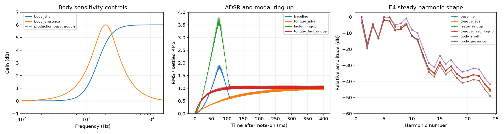
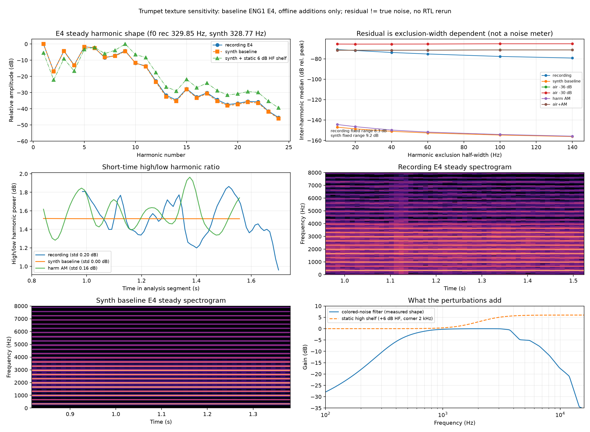
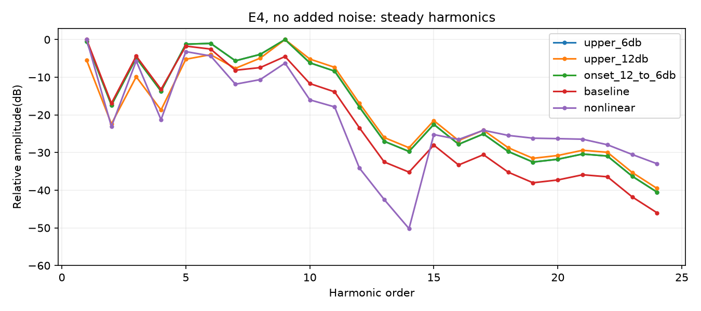
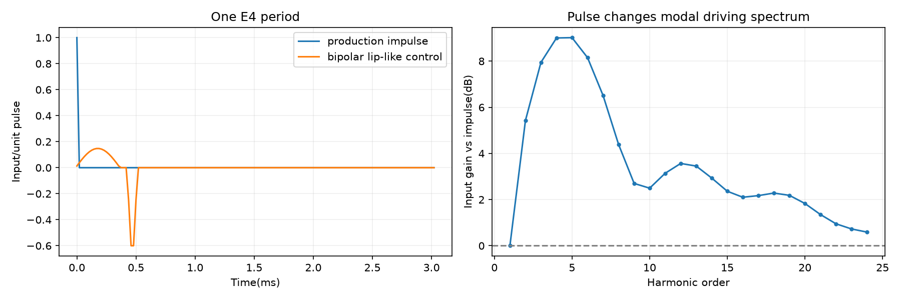

# 小号

参数状态（2026-11-01）：本页保留实验过程；当前已接入配置见[音频设计](音频设计.md)，验证/烧录状态见[调试记录](调试记录.md)。历史“未接入/未烧录”仅针对当时实验快照。

**系数接入更新（2026-11-01）**：小号原G/a1/a2及P1T1元数据已纳入四音色Flash镜像，与逐槽周期/A/R目录一致，尚未实际烧录。当前硬件仍使用周期冲激；Python的双极性唇振、起音随机扰动和气流支路并非Flash系数字段，本轮未将这些算法硬件化。

> **证据更正（2026-10-31）**：下文baseline为Python整数模型离线渲染，并非实际RTL产生的音频；所有本轮乐段均未通过PAD矩阵输入链或该片段的RTL对拍。新激励/包络/纹理属于未实现于当前RTL的候选。“逐点一致”仅指Python产物之间的比较。原“暂定方案”仅保留离线听感偏好，不能作为RTL方案确认。详见[模型验证边界与更正](ENG1模型.md#2026-10-31试听证据更正)。

对象：已交付四小节试听中的生产ENG1小号。baseline原始center PCM与先前交付小号逐点一致；当前无腔体着色，NONE混响。

## 已验证事实

- 单采样周期冲激确实持续发出，E4半秒165个脉冲、间隔146采样；没有误用一次性拨弦。
- E4基线稳定阶段，前24次谐波中目标幅度大于-35dB者，归一化谐波幅度相对参数目标的RMS误差约0.039dB。
  说明整数递推和G标定并未明显破坏该音符参数表的稳定谐波幅度；不代表所有音高、瞬态、相位或原始录音全匹配。
- 同一原始E4小号文件的稳态谐波分布与参数/合成结果作图比较；参数来自录音中段，未存每条谐波的时变包络或相位。
- E4提取的attack约74.6ms，gamma中位数约9.2/s（单模态振幅响应时间尺度约109ms）。输出还乘ADSR，建立过程叠加，不能把测得录音attack再次套用就视为端到端attack相同。
- 生产共同S=1/4，D_STEP1048576；release原始提取数毫秒，经profile下限20ms按满刻度斜率处理，从S仅约5ms，可能造成不自然的断音。

## 候选

| 版本 | 改动 | 稳态谐波幅度相对自身目标的RMS误差dB | 演奏 | 单音 |
|---|---|---:|---|---|
| baseline | 当前生产基线 | 0.039 | [播放](/home/rubbishbro/Desktop/FPGA_IDC_2026/FFT_results/sim/eng1/trumpet_diagnosis/baseline_phrase.wav) | [播放](/home/rubbishbro/Desktop/FPGA_IDC_2026/FFT_results/sim/eng1/trumpet_diagnosis/baseline_single.wav) |
| tongue_adsr | 仅8ms attack、D=0/full sustain、从满幅40ms release | 0.039 | [播放](/home/rubbishbro/Desktop/FPGA_IDC_2026/FFT_results/sim/eng1/trumpet_diagnosis/tongue_adsr_phrase.wav) | [播放](/home/rubbishbro/Desktop/FPGA_IDC_2026/FFT_results/sim/eng1/trumpet_diagnosis/tongue_adsr_single.wav) |
| faster_ringup | 仅gamma×4，重新标定G保持模态目标稳态幅度 | 0.178 | [播放](/home/rubbishbro/Desktop/FPGA_IDC_2026/FFT_results/sim/eng1/trumpet_diagnosis/faster_ringup_phrase.wav) | [播放](/home/rubbishbro/Desktop/FPGA_IDC_2026/FFT_results/sim/eng1/trumpet_diagnosis/faster_ringup_single.wav) |
| tongue_fast_ringup | 新ADSR与gamma×4组合 | 0.178 | [播放](/home/rubbishbro/Desktop/FPGA_IDC_2026/FFT_results/sim/eng1/trumpet_diagnosis/tongue_fast_ringup_phrase.wav) | [播放](/home/rubbishbro/Desktop/FPGA_IDC_2026/FFT_results/sim/eng1/trumpet_diagnosis/tongue_fast_ringup_single.wav) |
| pulse2_only | 仅将每次冲激分成两个半幅样本；保持脉冲面积与系数 | 0.305 | [播放](/home/rubbishbro/Desktop/FPGA_IDC_2026/FFT_results/sim/eng1/trumpet_diagnosis/pulse2_only_phrase.wav) | [播放](/home/rubbishbro/Desktop/FPGA_IDC_2026/FFT_results/sim/eng1/trumpet_diagnosis/pulse2_only_single.wav) |

这些是候选，不给出“最像小号”的自动结论。8ms/full-sustain包络取消了原来4倍峰值到S的下降，所以稳态归一化的10–90%建立时间反而可能增大；不能把单个阈值指标当作实际attack改善。
gamma×4影响共振线宽与建立时间，属于系数候选而非只改输出ADSR；G已重新标定，a1/a2从新极点量化，不是错误地只改阻尼不管增益。
两采样半幅周期脉冲对E4前10次谐波仅轻微衰减（理论第10次约-0.20dB），不预期仅凭它使小号变成另一种乐器。

## 当前判断

没有证据表明“单采样周期冲激格式本身错误”。单一线性谐振器组可以再现稳态谱，却缺少原录音的谐波随力度/气流变化、频率相关起音、相位和残余气声。
这可能使短音符或连奏听起来缺乏铜管特征。优先听包络与共振建立速度对照，再决定是否重提取时变特征或增加受控激励，而非先更换一种脉冲形状就断言解决。
原始录音E4参考为本地库对应文件的短摘录（非模型）：[播放](/home/rubbishbro/Desktop/FPGA_IDC_2026/FFT_results/sim/eng1/trumpet_diagnosis/recording_reference_E4.wav)。

所有候选保持无混响、输出无压缩、同scene正文RMS匹配；均无模态触轨和原始中心PCM触轨。
Source hash、源文件名及数值见results.json。此次未修改生产小号RTL或资源。

## 当前工作区复测：腔体频响与模态建立速度

运行 `python python/modal_sim/trumpet_body_experiment.py`。脚本顺序执行，无需 multiprocessing socket；输出在 `FFT_results/sim/eng1/trumpet_body_experiment/`。

核对 `rtl/router/routers/body_router.sv`：小号使用 default，五段全部直通；`eng1_rtl.py` 因此直接将 mix 送入混响级。将基线整数信号显式经过五段直通滤波，输出逐采样一致；本轮基线还与此前 `mystery_of_love/native/mystery_of_love_trumpet_eng1.wav` 左右声道逐采样一致。

“腔体系数”需区分共享 body_biquad 的串联滤波器与 ENG1 并联模态的 G/a1/a2。当前共享腔体没有频响着色；模态系数仍决定频谱及响应建立过程。本轮分别测试这两个位置与 ADSR。

| 候选 | 改动 | E4前50ms RMS/稳态 dB | 稳态谐波相对原参数目标的RMS误差 dB | 乐句 | E4单音 |
|---|---|---:|---:|---|---|
| baseline | 当前生产模型 | -7.27 | 0.039 | [试听](../FFT_results/sim/eng1/trumpet_body_experiment/baseline_phrase.wav) | [试听](../FFT_results/sim/eng1/trumpet_body_experiment/baseline_single.wav) |
| tongue_adsr | 8ms attack、full sustain、40ms满幅release | -13.42 | 0.039 | [试听](../FFT_results/sim/eng1/trumpet_body_experiment/tongue_adsr_phrase.wav) | [试听](../FFT_results/sim/eng1/trumpet_body_experiment/tongue_adsr_single.wav) |
| faster_ringup | 模态gamma×4并重新标定G；保持原ADSR | +0.92 | 0.178 | [试听](../FFT_results/sim/eng1/trumpet_body_experiment/faster_ringup_phrase.wav) | [试听](../FFT_results/sim/eng1/trumpet_body_experiment/faster_ringup_single.wav) |
| tongue_fast_ringup | 上述ADSR与gamma候选组合 | -4.80 | 0.178 | [试听](../FFT_results/sim/eng1/trumpet_body_experiment/tongue_fast_ringup_phrase.wav) | [试听](../FFT_results/sim/eng1/trumpet_body_experiment/tongue_fast_ringup_single.wav) |
| body_shelf | 基线后增加1.5kHz高架、+6dB、slope=1 | -7.17 | 3.144 | [试听](../FFT_results/sim/eng1/trumpet_body_experiment/body_shelf_phrase.wav) | [试听](../FFT_results/sim/eng1/trumpet_body_experiment/body_shelf_single.wav) |
| body_presence | 基线后增加2kHz峰值均衡、+6dB、Q=0.8 | -7.26 | 1.862 | [试听](../FFT_results/sim/eng1/trumpet_body_experiment/body_presence_phrase.wav) | [试听](../FFT_results/sim/eng1/trumpet_body_experiment/body_presence_single.wav) |

两种腔体EQ是用于判断频谱敏感性的人工候选，没有进行小号管体传递函数测量或拟合。系数量化为Q4.27，使用实际整数BodyFixedPoint模型，补齐五段；与同一量化系数的浮点SOS相比，单音相对RMS误差均小于6e-8，未发生滤波器饱和。

六个乐句使用同一48事件/11.12秒片段，正文RMS统一为-22.697dBFS，峰值低于-1dBFS；单音另行统一RMS。恒定增益、无压缩、无混响，末尾20ms淡出。四种直接合成候选均无模态触轨；六组未归一化的mono/headroom=3 PCM在两个scene均无触轨。

E4的2kHz以上稳态功率占比：基线23.2%，高架38.1%，峰值均衡26.4%；gamma×4约23.0%。腔体候选确实改变了频谱亮度，但前50ms/稳态比变化不足0.1dB。模态候选显著改变建立过程，原ADSR下还会放大起音隆起；组合候选将该隆起抑制到接近稳态。8ms/full-sustain ADSR取消了原有4倍峰值，因此单看前50ms/稳态比会比基线更低，不能据此认为它的ADSR attack更慢。上述数值不直接判定“更像小号”；频谱误差参照的是原参数目标，不能等同于相对真实录音的误差。

E4录音参考：[2.4秒短摘录](../FFT_results/sim/eng1/trumpet_body_experiment/recording_reference_E4.wav)，源为 `trumpet_E4_15_forte_normal.mp3`。源录音attack约74.6ms，模态gamma中位数约9.2/s（1/gamma约109ms）。[完整结果及源hash](../FFT_results/sim/eng1/trumpet_body_experiment/results.json)。本轮新增独立实验脚本，生产RTL和部署系数未改。

## 颗粒、气流与谐波活性：DeepSeek MCP实验

用户指出缺少类似“摩擦”的质感。这里将其作为听感描述，分别测试带色非周期成分、高频谐波随时间变化与静态亮度，不把“摩擦感”预先等同于白噪声。铜管高次谐波与非线性传播的关系可参见 [Myers等，JASA2012](https://www.research.ed.ac.uk/en/publications/effects-of-nonlinear-sound-propagation-on-the-characteristic-timb/)，本轮人工扰动并未实现该物理模型。

Codex设计对照，通过 `deepseek_harness.delegate_to_deepseek` 交给DeepSeek实际生成脚本和产物。首个MCP调用300秒超时后，后台仍完成了工作区文件；另一个只读分析重试也发生回传超时。Codex直接复核落盘结果，修正候选谐波图误将线性幅度标为dB的问题、录音稳态窗口元数据，以及对比声谱图的显示RMS，然后重跑完整脚本。

主脚本：`python python/modal_sim/trumpet_texture_experiment.py`。输出：[实验说明](../FFT_results/sim/eng1/trumpet_texture_experiment/README.md)、[完整数值/hash](../FFT_results/sim/eng1/trumpet_texture_experiment/results.json)。复用生产ENG1的 `baseline_*.npy`，候选是在其后离线叠加，不能称为新增噪声/AM的RTL仿真。

| 候选 | 因素 | Mystery of Love乐句 | E4单音 |
|---|---|---|---|
| baseline | 不加纹理 | [试听](../FFT_results/sim/eng1/trumpet_texture_experiment/baseline_phrase.wav) | [试听](../FFT_results/sim/eng1/trumpet_texture_experiment/baseline_single.wav) |
| air_lo | 带色非周期成分，active RMS相对基线-36dB | [试听](../FFT_results/sim/eng1/trumpet_texture_experiment/air_lo_phrase.wav) | [试听](../FFT_results/sim/eng1/trumpet_texture_experiment/air_lo_single.wav) |
| air_hi | 同一噪声增大6dB至-30dB | [试听](../FFT_results/sim/eng1/trumpet_texture_experiment/air_hi_phrase.wav) | [试听](../FFT_results/sim/eng1/trumpet_texture_experiment/air_hi_single.wav) |
| harm_am | 高频分量4%标准差、2.5–12Hz幅度变化 | [试听](../FFT_results/sim/eng1/trumpet_texture_experiment/harm_am_phrase.wav) | [试听](../FFT_results/sim/eng1/trumpet_texture_experiment/harm_am_single.wav) |
| air_harm | air_lo与harm_am组合 | [试听](../FFT_results/sim/eng1/trumpet_texture_experiment/air_harm_phrase.wav) | [试听](../FFT_results/sim/eng1/trumpet_texture_experiment/air_harm_single.wav) |
| hf_static | 2kHz高架+6dB，静态亮度对照 | [试听](../FFT_results/sim/eng1/trumpet_texture_experiment/hf_static_phrase.wav) | [试听](../FFT_results/sim/eng1/trumpet_texture_experiment/hf_static_single.wav) |

E4真实录音与合成基线的前24次归一化谐波幅度RMS差约0.46dB，说明该段稳态谱形已较接近；不涉及谐波相位和瞬态匹配。高/低次谐波比短时波动标准差：录音约0.20dB，基线近0，harm_am约0.16dB。air_hi约0.02dB；静态高架仍近0，但2kHz以上功率占比由23.2%变为57.5%。这组控制将平均亮度和时变活性分开，并不证明哪种候选听起来更像小号。

录音谐波间残差显著高于周期基线，但对排除带宽敏感；固定及变宽方案的录音指标合计跨度约24dB。该指标同时含窗泄漏、频漂、颤音边带和MP3编码影响，不能当作纯气流噪声。-36/-30dB是人工灵敏度档位，没有宣称拟合出真实气流量。

独立复核12份WAV及源hash：均48kHz/PCM24/双声道，phrase533760帧、single115200帧；scene内正文RMS约-22.499dBFS，实际匹配差低于1e-6dB，峰值低于-1.11dBFS，前0.10秒数字静音。基线只经过恒定增益/末端淡出，量化误差小于一个PCM24量化单位；raw源hash一致。新增纹理跟随信号活动，尾部低于-80dBFS。生产RTL和资源保持本轮实验前状态。

附加独立交叉检查：`python/modal_sim/trumpet_texture_probe.py` / [产物](../FFT_results/sim/eng1/trumpet_texture_probe/README.md)，使用三段等长录音窗口和逐帧f0跟踪；另提供23/37/61Hz更快的人工高频AM，区分慢速活性与快速颗粒。两套脚本的残差指标、频段和时间尺度不同，不应直接混用数值或把某个波动标准差视为摩擦感评分。

## 提高纹理强度

用户要求调高“摩擦感”。`python python/modal_sim/trumpet_texture_strength.py` 复用同一带色噪声和AM随机实现，仅增加强度：旧组合为噪声-36dB/高频AM标准差4%；中档为-24dB/8%；强档为-18dB/12%。频段、AM速率2.5–12Hz、原生产release和腔体均沿用此前方案，仍为离线试听候选。

[中档乐句](../FFT_results/sim/eng1/trumpet_texture_strength/medium_combo_phrase.wav) / [强档乐句](../FFT_results/sim/eng1/trumpet_texture_strength/strong_combo_phrase.wav) / [同响度旧组合](../FFT_results/sim/eng1/trumpet_texture_strength/previous_combo_phrase.wav)。另提供只加噪声、只加谐波波动的强档及全部E4单音，见[音频清单](../FFT_results/sim/eng1/trumpet_texture_strength/README.md)。

12份WAV通过帧数、有限值、RMS、峰值和静音/尾部检查；乐句正文统一-22.782dBFS，峰值不超过-1.11dBFS。原始baseline及生产文件未改，候选参数、实际增益与源hash见[results.json](../FFT_results/sim/eng1/trumpet_texture_strength/results.json)。这些噪声档位是人为听感控制，不是气流实测值。

## 高次谐波假设：不叠加噪声

用户指出质感可能主要来自高次谐波。`python python/modal_sim/trumpet_harmonic_experiment.py` 改为直接调整模态G：第4次及以下不变，第4–10次的dB增益线性上升，第10次以上分别保持+6/+12dB；a1/a2、原有激励、包络及release保持原参数。每组实际运行ENG1整数核，没有添加随机噪声。

| 候选 | 改动 | 乐句 | E4单音 |
|---|---|---|---|
| baseline | 原生产模型 | [试听](../FFT_results/sim/eng1/trumpet_harmonic_experiment/baseline_phrase.wav) | [试听](../FFT_results/sim/eng1/trumpet_harmonic_experiment/baseline_single.wav) |
| upper_6db | 高次模态G渐增至+6dB | [试听](../FFT_results/sim/eng1/trumpet_harmonic_experiment/upper_6db_phrase.wav) | [试听](../FFT_results/sim/eng1/trumpet_harmonic_experiment/upper_6db_single.wav) |
| upper_12db | 高次模态G渐增至+12dB | [试听](../FFT_results/sim/eng1/trumpet_harmonic_experiment/upper_12db_phrase.wav) | [试听](../FFT_results/sim/eng1/trumpet_harmonic_experiment/upper_12db_single.wav) |
| onset_12_to_6db | 稳态+6dB，起音额外+6dB按30ms时间常数衰减；每32采样及note-on更新G | [试听](../FFT_results/sim/eng1/trumpet_harmonic_experiment/onset_12_to_6db_phrase.wav) | [试听](../FFT_results/sim/eng1/trumpet_harmonic_experiment/onset_12_to_6db_single.wav) |
| nonlinear | 原始输出做4倍过采样tanh整形，独立谐波结构对照 | [试听](../FFT_results/sim/eng1/trumpet_harmonic_experiment/nonlinear_phrase.wav) | [试听](../FFT_results/sim/eng1/trumpet_harmonic_experiment/nonlinear_single.wav) |

E4稳态中，第8次以上功率占比：baseline18.83%，+6dB为37.08%，+12dB为59.24%，起音候选稳态37.09%。前50ms相对稳态RMS：baseline-7.27dB，起音候选-5.48dB。非线性对照为15.05%；其高端泛音虽有增加，部分中高次分量同时被重分配，不能将它概括为高次总能量一定增强，也不代表真实唇振物理模型。

为节省运行时间使用8槽装载本段7个实际音高和一个闲置音高；新跑baseline在phrase/single均与先前16槽原始输出逐采样一致。三种模态候选均无系数溢出/模态触轨；10份试听文件通过帧数、有限值、RMS和峰值检查，另独立核对未归一化mono PCM无触轨。乐句正文统一-23.413dBFS，峰值不超过-1.11dBFS。时变G与输出整形属于实验能力，生产RTL和部署表未修改。

[参数、hash与测量](../FFT_results/sim/eng1/trumpet_harmonic_experiment/results.json) / [原始PCM电平复核](../FFT_results/sim/eng1/trumpet_harmonic_experiment/review_checks.json)。

## 激励形状、起音不稳定与少量气流

用户提出激励形状、起音唇振不稳定和少量气流噪声的组合假设。新增 `python python/modal_sim/trumpet_excitation_experiment.py`：冻结当前生产G/a1/a2、ADSR和release，直接替换输入ENG1整数模态核的Q24激励。以下是现象模型的敏感性测试，没有拟合真实唇片/吹气压力/管体反馈耦合。

| 候选 | 改动 | 乐句 | E4单音 |
|---|---|---|---|
| baseline | 原周期单采样冲激 | [试听](../FFT_results/sim/eng1/trumpet_excitation_experiment/baseline_phrase.wav) | [试听](../FFT_results/sim/eng1/trumpet_excitation_experiment/baseline_single.wav) |
| pulse_shape | 较宽开启瓣与较窄反向闭合瓣 | [试听](../FFT_results/sim/eng1/trumpet_excitation_experiment/pulse_shape_phrase.wav) | [试听](../FFT_results/sim/eng1/trumpet_excitation_experiment/pulse_shape_single.wav) |
| onset_instability | 起音每周期频率及幅度轻微扰动 | [试听](../FFT_results/sim/eng1/trumpet_excitation_experiment/onset_instability_phrase.wav) | [试听](../FFT_results/sim/eng1/trumpet_excitation_experiment/onset_instability_single.wav) |
| drive_air | 少量带色噪声随激励进入模态核 | [试听](../FFT_results/sim/eng1/trumpet_excitation_experiment/drive_air_phrase.wav) | [试听](../FFT_results/sim/eng1/trumpet_excitation_experiment/drive_air_single.wav) |
| combined_drive | 上述三项组合 | [试听](../FFT_results/sim/eng1/trumpet_excitation_experiment/combined_drive_phrase.wav) | [试听](../FFT_results/sim/eng1/trumpet_excitation_experiment/combined_drive_single.wav) |
| combined_parallel_breath | 组合版再加少量直达气声作路径对照 | [试听](../FFT_results/sim/eng1/trumpet_excitation_experiment/combined_parallel_breath_phrase.wav) | [试听](../FFT_results/sim/eng1/trumpet_excitation_experiment/combined_parallel_breath_single.wav) |

脉冲使用半正弦双瓣：开启宽约周期12%，间隔2%，反向闭合宽3%，两瓣面积相反、DC为零。按名义周期将基频驱动幅度归一到原冲激，保留其余频谱/相位差；E4下25采样，约0.52ms，第4–5次谐波驱动提高约9dB。原G按冲激标定，换激励会改变整体响应；若选用该激励，需要联合检查/标定G与驱动，不能认为任意新激励配旧表仍保持录音目标谱。

起音扰动每周期更新：频率相对偏移标准差0.6%、限幅1.8%；脉冲幅度扰动标准差8%、限幅0.76..1.24倍。两者按30ms时间常数随起音衰减。模态频率没有跟随驱动抖动一起改变。E4实际检查：前80ms脉冲间隔包含145/146/147采样，0.8–1.4秒稳态全部146采样，说明并非给整个持音持续加颤音。

输入气流是500Hz–10kHz带通固定种子高斯序列，RMS相对名义冲激列为 `0.040*exp(-age/40ms)+0.005`，只在gate期间发出。实际全段能量比：乐句约-35.89dB、E4单音约-42.32dB；这是模态核输入量，不等于可听输出噪声。`combined_parallel_breath` 的额外直达气声按原baseline正文RMS的-36dB定标，跟随原信号包络，用于检查窄带共振器对非谐波成分的抑制，不冒称已测得真实气流传递路径。

关闭所有新特性时，激励调度器通过12000帧含重触发/gate变化的逐点等价检查。四组新激励均实际进入整数核，原生PCM和模态状态无触轨。12份WAV独立检查通过：正文RMS约-22.499dBFS、同scene差小于1e-6dB、峰值低于-1.11dBFS、源hash一致；额外复核所有候选未归一化mono PCM无触轨。完整参数及输入波形数组见[结果](../FFT_results/sim/eng1/trumpet_excitation_experiment/results.json) / [复核](../FFT_results/sim/eng1/trumpet_excitation_experiment/review_checks.json)。生产RTL与部署参数未改。

## 换曲目：Hinos Sentimentais中的赞美诗旋律

用户确认采用Fernando Lopez专辑《Hinos Sentimentais》的任意短片段。选取[专辑第11首](https://www.qobuz.com/ie-en/album/hinos-sentimentais-fernando-lopez/e58131rbp49sa)《Ó Irmãos, a Deus Devemos》，作曲Charles Crozat Converse；使用《What a Friend We Have in Jesus／恩友歌》的同一旋律。用[Timeless Truths公开MusicXML](https://library.timelesstruths.org/music/What_a_Friend_We_Have_in_Jesus/)并与[CCB402谱面预览](https://www.superpartituras.com.br/hinario-ccb/-402--o-irmaos-a-deus-devemos)核对。本轮是按谱单声部试奏，不是Fernando Lopez录音的编曲、速度或装饰音还原。

脚本 `python python/modal_sim/trumpet_hinos_excerpt.py`，取开头4小节、15音符、F大调实音C4..D5，自定72BPM（CCB谱面标60–80），总长14.53秒，最长gate约3.15秒；两处句尾留0.18秒换气。MusicXML部分和弦内音符的duration漏计附点，虽然type带dot；旋律采用声部主音的和弦组时值，与CCB预览一致，提取审计保存在manifest。

| 版本 | 音频 |
|---|---|
| 原周期冲激、生产包络 | [试听](../FFT_results/sim/eng1/hinos_sentimentais/hinos_oiirmaos_baseline.wav) |
| 新脉冲＋起音扰动＋模态前少量气流 | [试听](../FFT_results/sim/eng1/hinos_sentimentais/hinos_oiirmaos_new_excitation.wav) |
| 新激励另加轻微直达气声 | [试听](../FFT_results/sim/eng1/hinos_sentimentais/hinos_oiirmaos_new_excitation_breath.wav) |

三版共用事件、力度、生产G/a1/a2、原ADSR/release，无混响，正文RMS统一约-22.499dBFS，峰值约-5.04/-4.78/-4.80dBFS。整数模态状态、原始mono PCM以及三个试听版本均无触轨；独立核对帧数、单声部事件不重叠、有限值、音频/源hash和响度。C4用C#4 forte录音参数重定音，其余实际演奏音高有对应forte资源，详见[manifest](../FFT_results/sim/eng1/hinos_sentimentais/manifest.json)及[音符事件](../FFT_results/sim/eng1/hinos_sentimentais/excerpt_events.json)。本段有明显长音和句尾，便于与之前快速分解音型的Mystery of Love交叉听辨。

## 离线听感暂定（未通过RTL验收）

用户试听后暂定采用上方主试听 `hinos_oiirmaos_new_excitation.wav`：新双极性脉冲＋起音周期/幅度扰动＋少量模态前气流。保留原生产G/a1/a2、ADSR和release；额外直达气声版仍是对照，未并入该暂定选择。参数与实现以 `trumpet_excitation_experiment.LipExcitation(shape=True, unstable=True, air=True)` 和上方manifest为准。此状态为音色试听暂定，尚未迁移至生产RTL/部署资源。后续测试顺序先小提琴。

## 按当前RTL设计重做Python按键路径

用户明确此次不要求运行RTL仿真器，已新增`eng1_pad_audition.py --instrument trumpet`，直接以合成16路ADC压力驱动板级适配、64/48门控、原周期冲激、ADSR和整数核。没有新增唇振、抖动、噪声或自动连奏。[阶跃按键](../FFT_results/sim/eng1/pad_path_retest/trumpet/step_pressure_listen.wav) / [8ms按下、12ms松开的渐变按键](../FFT_results/sim/eng1/pad_path_retest/trumpet/ramped_pressure_listen.wav) / [输入与结果](../FFT_results/sim/eng1/pad_path_retest/trumpet/results.json)。

原基线与本次阶跃输出非常接近，主要差别为实际板级压力量化；不能把原基线与未实现的新激励候选一起判为无效。两版仍各有14段内部数字静音，渐变压力没有消除原断奏间隔造成的断裂。完整路径、边界和数值见[模型说明](ENG1模型.md#重新实验入口按键压力到声音)。

## 同一矩阵按键启用暂定新激励

用户要求启用实验配置后，使用`eng1_pad_config_experiment.py --instrument trumpet`重做原版/实验版对照。直接复用上一轮渐变ADC输入，逐帧核对gate不变，启用`LipExcitation(shape=True, unstable=True, air=True)`；原ADSR和G/a1/a2保持不变，不加额外直达气声。新激励是Python候选，尚未进入生产RTL。

[同响度原版](../FFT_results/sim/eng1/pad_config_experiment/trumpet/original_listen.wav) / [启用新激励](../FFT_results/sim/eng1/pad_config_experiment/trumpet/experimental_listen.wav) / [配置与核对结果](../FFT_results/sim/eng1/pad_config_experiment/trumpet/results.json)。
