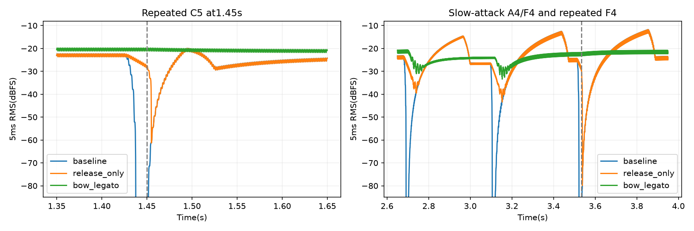

# 小提琴

参数状态（2026-11-01）：本页保留实验过程；当前已接入配置见[音频设计](音频设计.md)，验证/烧录状态见[调试记录](调试记录.md)。历史“未接入/未烧录”仅针对当时实验快照。

**接入更新（2026-11-01）**：小提琴原G/a1/a2已纳入四音色Flash镜像；20ms attack/full sustain/无decay/80ms release已接入`env_router`，使用本帧包络输出，Python生产模型同步。未引入自动连奏或合并重复音；尚未实际烧录。下文“实验包络未进入RTL”保留为当时记录。

> **证据更正（2026-10-31）**：下文“生产基线”仅指采用当前ENG1算法/资源的Python离线渲染，未经过PAD输入链或该片段的RTL对拍。bow_legato修改了包络和演奏事件，尤其把重复同音合并为持续gate，不是当前RTL对原按键事件的响应。其连续性改善不能证明当前矩阵演奏能力。详见[模型验证边界与更正](ENG1模型.md#2026-10-31试听证据更正)。

小号暂定新激励方案后，按原试听顺序进入小提琴。当前先交付生产ENG1基线，使用小提琴自身的模态资源、周期冲激与ADSR；没有套用小号的双极性脉冲、起音抖动或新气流支路。

| 片段 | 内容 | 试听 |
|---|---|---|
| 赞美诗长音段 | 《Ó Irmãos, a Deus Devemos／恩友歌》开头4小节，72BPM，15事件，C4..D5，14.53秒 | [播放](../FFT_results/sim/eng1/hinos_sentimentais/violin/hinos_violin_baseline.wav) |
| 统一快速测试段 | Mystery of Love第5–8小节，100BPM，48事件，E4..E5，11.12秒 | [播放](../FFT_results/sim/eng1/mystery_of_love/mystery_of_love_violin_eng1.wav) |

长音段沿用小号换曲实验的乐谱及事件，便于听起弓、持音和句尾；它是按谱单声部试奏，不是专辑编曲还原。谱面来源和提取方式见[小号记录](小号.md)。

长音段渲染：`python python/modal_sim/eng1_hymn_audition.py --instrument violin`。短段：调用 `eng1_audition.render('violin', ...)`。两段均48kHz，无混响，64条存储/48模态计算，正文恒定增益试听，无动态压缩。长音段正文RMS-22.499dBFS、峰值-5.528dBFS；短段全文件RMS-20.638dBFS、峰值-2.396dBFS（归一化口径不同，不声称两段跨片段响度相同）。

两段均无模态状态/原始PCM触轨，试听已核对帧数、有限值和峰值；长音段额外核对输出及源hash。长音段[原始PCM16](../FFT_results/sim/eng1/hinos_sentimentais/violin/hinos_violin_native.wav)及[配置/资源/事件](../FFT_results/sim/eng1/hinos_sentimentais/violin/baseline.json)，快速段[配置](../FFT_results/sim/eng1/mystery_of_love/violin.json)。

资源来源需保留：实际演奏的F4借用F#4、A4借用G#4、C5借用B4的forte参数并按目标音高重定音；其余实际演奏音高有对应forte录音。参数不是跨音区完全一致的统一音色。当前未选择小提琴候选或修改生产参数，待听辨后决定检查方向。

## 用户报告声音断裂：门控与包络连续性

检查原赞美诗音频，普通换音处确有13–20ms数字零区间，例如1.432771–1.450021秒为17.25ms、3.517479–3.533354秒为15.875ms。6.700042–6.866688秒另有166.65ms句间休止。Mystery快速段也检出20处至少1ms的内部数字静音，最初例子为0.5688–0.5700及0.8570–0.8700秒。

已确认的叠加因素：

- 赞美诗基线沿用了小号的普通音符20.83–25ms断奏间隔、句尾180ms换气，没有针对小提琴改为连续拉弓。
- 原生产S=1/4，从S松键仅约5–13.4ms归零，短于上述gate间隔，于是形成实际静音。
- Attack随资源表变化，C5约40.7ms，A4约264ms、F4约320ms、C4约298ms。下一音从零重新建立，进一步放大断开感。
- 峰值随后约32ms内降至1/4；同音重触发还会清空模态历史并重置包络。长release单独不能保住同音重触发时的能量。

新增 `python python/modal_sim/violin_continuity_experiment.py`，保留原G/a1/a2和周期激励，比较：

| 候选 | 改动 | 试听 |
|---|---|---|
| baseline | 原文件恒定增益对照 | [播放](../FFT_results/sim/eng1/violin_continuity/hinos_violin_baseline.wav) |
| release_only | 仅将release校准为从1/4 sustain释放80ms，原attack/decay/门控不变 | [播放](../FFT_results/sim/eng1/violin_continuity/hinos_violin_release_only.wav) |
| bow_legato | 20ms attack/full sustain/无decay/80ms release；普通换音去掉断奏间隔、尾音重叠；相邻同音连续拉弓并更新力度，保留状态 | [播放](../FFT_results/sim/eng1/violin_continuity/hinos_violin_bow_legato.wav) |

在0.3–13.5秒区间统计至少1ms的数字零段：原版14处；两种候选均剩1处约100ms的有意句间休止。只延长release虽填平普通静音，同音重触发后仍有明显音量低谷：1.45–1.55秒内最低5ms RMS约-61.3dBFS；bow_legato为-21.6dBFS。说明需要一起处理重触发和包络衔接。

三版正文约-22.499dBFS，峰值低于-1.11dBFS，模态状态和原生PCM均无触轨，额外核对输出/源hash、帧数和有限值。[结果与事件调度](../FFT_results/sim/eng1/violin_continuity/results.json)。连奏候选将同音重奏处理成连续拉弓，尚未实现独立的柔和换弓动作；保留原共振建立过程。它是试听候选，没有修改生产MIDI/RTL策略，尚待听感确认。

## 按当前RTL设计重做Python按键路径

`eng1_pad_audition.py --instrument violin`已完成16路ADC压力到板级force_map、64/48门控、原周期冲激和原ADSR的重算，不采用bow_legato，不合并重复音。[阶跃按键](../FFT_results/sim/eng1/pad_path_retest/violin/step_pressure_listen.wav) / [8ms按下、12ms松开的渐变按键](../FFT_results/sim/eng1/pad_path_retest/violin/ramped_pressure_listen.wav) / [输入与结果](../FFT_results/sim/eng1/pad_path_retest/violin/results.json)。

阶跃版原生PCM与旧基线非常接近，差值RMS相对原信号约-45.1dB，主要来自板级压力量化。两版仍各有14段内部数字静音；普通换音静音由阶跃的13.06–20.04ms变为渐变的19.35–26.04ms。当前路径不会把渐变按键自动变成连奏。此次按用户要求只做Python合成实验，不以运行RTL仿真器作为前提；完整路径与边界见[模型说明](ENG1模型.md#重新实验入口按键压力到声音)。

## 同一矩阵按键启用实验包络

用户要求启用实验配置后，使用`eng1_pad_config_experiment.py --instrument violin`，直接复用上一轮渐变ADC输入，逐帧核对gate不变。启用20ms attack、full sustain、无decay、80ms release的`BowEnvelope`，周期激励及G/a1/a2保持不变。原bow_legato中的同音合并和事件重写未启用，每个重复音仍松键再按。实验包络尚未进入生产RTL。

[同响度原版](../FFT_results/sim/eng1/pad_config_experiment/violin/original_listen.wav) / [启用实验包络](../FFT_results/sim/eng1/pad_config_experiment/violin/experimental_listen.wav) / [配置与核对结果](../FFT_results/sim/eng1/pad_config_experiment/violin/results.json)。

## 《咏春》副歌节选

按用户要求，采用七朵组合《咏春》副歌重复记号处开始的8小节主旋律，依据[桃李醉春风简谱](https://www.xinyuepu.com/jianpu/20194/9857.html)人工录入音高/时值/八度。C调、75BPM、44个音符事件，A3..A4，总长26.8秒；末尾括号内器乐过门省略。谱上同音延音线保持，其余重复音保留松键再按；不添加滑音或颤音。

入口`python3 python/modal_sim/violin_yongchun_audition.py`。沿用20ms attack/full sustain/无decay/80ms release实验包络、原周期冲激与模态系数，使用16路合成ADC压力经板级force_map、64/48门控驱动。压力8ms上升/12ms下降，音符间15ms分离，固定MIDI56..71音组；缺失资源的重定音来源在结果中列明。

[副歌试听](../FFT_results/sim/eng1/yongchun_violin/yongchun_chorus_violin_experimental.wav) / [配置、资源与门控](../FFT_results/sim/eng1/yongchun_violin/results.json)。已核对1286400帧、44次按下/44次松开、WAV/hash/有限值/静音边界，模态状态及原生PCM均无触轨。试听仅恒定增益，无混响、EQ、压缩或额外噪声；不是原唱录音的编曲还原。
