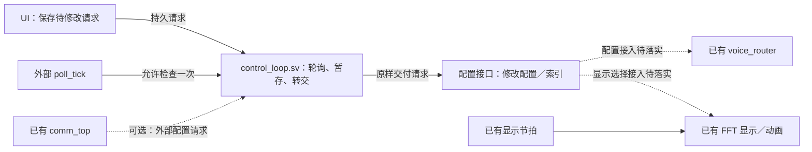

# 控制层与主循环设计调研

日期：2026-10-27。范围：当前 `rtl/router/`、`rtl/comm/`、MIDI／Config parser 与 LCD UI 的接入架构。本文为源码审阅和架构建议，没有修改 RTL，也没有重新执行仿真或板级测试。原 `rtl/core/` 与历史音频链不作为当前实现依据。

后续确定的方案见 [独立配置轮询模块设计](UI控制Loop与配置层设计.md)：保持现有工程结构，独立 control_loop.sv 已实现并通过 15 组功能仿真，仅轮询转交请求。本文保留调研过程及源码边界；下文拆分新增模块、loop 推进动画等早期建议均不作为本次实施要求，以修订设计稿的单模块范围为准。

## 结论与适用条件

当前适合采用 **事件驱动的配置协调层 + 独立 MIDI 演奏状态层 + 按显示帧推进的 UI／动画更新层**，不需要新增轮询所有模块、统一推进采样和通信的全局主循环。

但是，配置协调层不宜只是组合连线或无条件复制寄存器。它需要拥有请求接收、参数转换、目标配置、待提交快照、实际生效状态及完成反馈；遇到换音色、输入源切换等多步操作，用小型事务 FSM 协调。

这里的“事件驱动”指在系统时钟上响应握手、完成和边界事件的同步 RTL。模块继续并行运行，不使用异步事件充当时钟。

## 当前源码说明了什么

| 对象 | 实际实现与依据 | 对上层设计的影响 |
|---|---|---|
| 采样节拍 | `voice_router.sv:120–137` 自己产生统一 `smp_tick` | 上层无需再生成另一个合成调度循环 |
| 声部及后级调度 | `voice_router.sv:508–738` 执行逐采样、逐声部计算并排空后级 | 运算顺序继续由 router 持有 |
| 连续运行请求 | `pad_voice_top.sv:125–141` 已将 `run` 接到 `start` | 不必每个采样从 UI 或上层重新发 start；run 拉低只阻止后续批次启动，不立即中止当前批次 |
| 换乐器 | `voice_router.sv:621–653` 在 S_IDLE 接受 start，锁存 inst 并按需要加载 | 需要保存请求到真正接受；ready 不能等同于“目标音色已加载成功” |
| 批次参数 | 同处锁存 n_voices/n_modes/n_samples；但引擎 `:305/:317` 仍直接接外部 n_modes | 外层应保持运行参数稳定，内部也应收口为一致快照 |
| 混响 | `voice_router.sv:755–758` 将外部 preset 直接送入混响，`reverb_router.sv:55–88/:128–130` 分阶段使用参数 | preset 中途改变可能使同一笔样本混用参数；需要效果级安全提交 |
| 配置通信 | `comm_top.sv:148–154` 已有 MIDI 屏障和 cfg 请求／完成通道 | 接真实配置后级即可，无需再轮询 parser |
| MIDI | analyzer 输出 Event32 和 source_id，保留 channel，不执行演奏策略 | 通道筛选、音符归属、踏板及 fmap／音高适配归消费者 |
| LCD UI | `ui_ctrl.sv:19–42` 已按 ev_valid 更新；`ui_demo_top.v:74–110` 的按键与 UI 处于 pix_clk 域 | UI 本身已是事件驱动；接核心时还要处理跨时钟 |

当前 router 的 ready 是空闲／可接受批次的指示；进入 S_IDLE 就置位，系数加载在后续 start 后发生。done 是一批 n_samples 完成并排空后级，不是独立的 cfg_applied。不要按端口注释推导比源码更强的完成语义。

loader 在 router 拉起 ld_start 后的后续时钟读取外部 inst；router 自己此前已经锁存 inst_lat。配置协调层至少应确保目标值跨接受窗口稳定，较好的内部接口是所有子模块统一消费同一份请求快照。

## 三类时序各自归谁

| 时序 | 所有者 | 触发及完成依据 |
|---|---|---|
| 采样、模态、声部、包络、后级流水 | router／对应 DSP 模块 | sample tick、valid/ready、运算 done |
| UART 位时序、SLIP／CRC、解析、会话恢复 | 已有驱动和 comm | 字节／事件握手、协议状态、会话维护信号 |
| 配置生效、音源切换、清理后恢复 | 配置协调层及 MIDI 消费者 | 请求握手、目标安全点、清理确认、应用成功／失败 |

上层等待条件应是“目标模块报告可提交／已完成”，不采用“等固定若干毫秒，猜加载或流水已结束”。超时计数用于故障判定，不替代正常完成握手。

确定性输出的采样需求最终还要和真实 PCM／I2S 链统一。当前 router 使用整数 `CLK_HZ/SR_HZ` 分频，100 MHz 默认对应约 48007.68 Hz；这不能自动与独立 DAC 时钟严格同步。整机需选择统一采样需求来源或设计速率匹配，并验证启动、批边界和装载期间的供样策略。这是音频传输／router 的接口责任，不依赖全局主循环。

## 建议的模块关系



图中唯一新增的业务 RTL 文件是 **`rtl/control_loop.sv`**。`配置接口` 是需要对接的逻辑边界，不表示本次新增一个配置层文件或重构现有模块；虚线目标连接不代表当前已经完整实现。多时钟请求须先满足跨域条件，图中省略集成接线细节。

loop 位于请求来源和配置接口之间：只在 poll_tick 到来且暂存空闲时检查请求，取走一条后保持到配置接口接收。配置是否已经生效、系数何时加载、动画如何更新，都不由 loop 决定。comm_top 仅可作为另一请求来源，不是 loop 的子模块。

以下保存／提交规则是配置接口的设计参考，不属于轮询模块职责，也不要求按本调研拆分新文件。

## 配置保存及提交规则

建议逻辑上区分：

- `desired`：用户希望的值，可供 UI 展示。
- `pending`：已经接收、正在应用的不可变事务快照。
- `active`：目标实际采用的值；异步加载完成前不冒充已生效。

具体实现可以合并寄存器，前提是保留这些语义。初版不必增加通用总线或庞大命令系统。

| 操作 | 推荐生效边界／动作 |
|---|---|
| 页面、光标、显示开关 | UI 本地立即处理，不进入音频配置事务 |
| 音量／表情等连续参数 | 消费者在定义的采样安全点取快照；需要时平滑，避免增益跳变 |
| 混响预设 | 效果流水排空后原子切换，或将参数快照随样本传递；另行处理延迟 RAM 有效性与尾音 |
| 换乐器／reload | 下一次接受批次时固定配置；内部完成装载并确认结果后更新 active；必要时淡出／补静音 |
| n_modes／n_voices | 初版固定；若开放运行时修改，在明确安全边界成组提交 |
| MIDI 接收通道／移调／音域 | 保留旧音符归属并让新规则只影响新 Note On，或有序清理旧状态后切换 |
| 压力垫／MIDI 切源 | 旧源门控撤销被消费 → 切换输入／清理策略生效 → 准入新源 |

“同一个采样点切配置”仍可能不够：样本已经进入多级流水时，要确保后续各级继续使用该样本对应的参数。可以第一版选更保守的批次排空边界；更细粒度更新再由 DSP 目标模块提供 apply_ready/applied 等明确接口。

提交原子性不保证听感无爆音。参数平滑、尾音保留、清历史状态或交叉淡化是独立的音频策略。`docs/bugs.md` 的 F10 已记录混响扩大延迟范围时的未初始化读取问题，应一并解决。

## MIDI 配置不应变成 parser 的业务逻辑

推荐 parser 继续只解析消息。新增消费者保存通道策略、source/channel/note 到槽位的归属、原始音符与目标音高、按键和踏板状态，再执行力值／音高适配。

例如先收到原始 note 60，移调 +12 后在目标 72 发声。如果 UI 改成 +0，后续 note 60 的 Note Off 必须释放此前目标 72 的槽，而不是重新用新配置计算目标 60。接收通道被改掉也不能导致旧通道的 Note Off 被丢弃。可以先查已存在的音符归属，再对新的 Note On 应用过滤规则。

同音重触发和满槽抢占也需要明确规则。当前 router 只从 fmap 门控取上升沿，非零→另一非零不等同于新 Note On；短暂拉零如果没有被采样消费，也未必产生一次完整释放／重触发。正确方案是明确 retrigger／clear／gate 接口，或由消费者等待已有门控通路确认消费。

当前还有更早的能力边界：loader 将同一张乐器模态记录复制到所有槽，router 没有显式的每槽 note／pitch 配置口。因此 MIDI→fmap 只能表达力度／门控，不能自动完成任意 MIDI 音高演奏。见 `docs/bugs.md` 的 I01；应先明确每槽音高来自系数选择、参数计算还是预载键位表。

通信故障清理同样属于真实消费者：`source_cleanup_done/source_ops_idle` 要在指定来源的音符／踏板和在途操作确实处理后返回。不能为完成接线而直接绑 1。两个通信来源即使 channel/note 相同，也需要按来源区分归属。

## 接现有通信时的具体注意事项

1. `cfg_valid && cfg_ready` 表示请求被接收；真实提交成功或明确失败后，才送 `cfg_done_valid/cfg_result`，并保持到 `cfg_done_ready`。写入 pending 不等于完成。
2. 已有屏障是 `event FIFO empty && midi_ops_idle`。idle 表示此前 MIDI 操作退休，不是全部声音衰减结束。若等待所有门控关闭，且后续 Note Off 又被配置屏障挡住，可能永远等不到完成。
3. 屏障只覆盖已有通信路径；本地 UI 请求也应进入同一个有序提交点，和正在应用的远程配置仲裁。建议初版每拍最多接收一个请求、固定仲裁规则并避免饥饿；不得覆盖已握手的事务。
4. 线上混响编号 `00 NONE / 01 HALL / 02 BATHROOM`，而 router 枚举是 `BATHROOM=0 / HALL=1 / NONE=2`。配置端点必须显式转换，不能强转。
5. 当前线上配置仅支持 EQ_SET 和 REVERB_SET。音色、音源、通道或移调若要从上位机修改，需要正式扩展协议；EQ DSP 未就绪时按现有合同返回 NOT_READY。
6. UI 快速调节可合并尚未接受的目标值；已经接受的远程配置必须各自给最终结果。不能把音符事件当成标量只保留“最后一个值”。

`reload` 若高电平持续多批会导致重复加载；若只打一拍且 router 正忙，则可能被漏掉。应先锁存请求，在明确的批次接受时消费。换音色已自动触发加载，不需要额外长期保持 reload。

loader 有 err，但 voice_router 当前没有接出装载结果；ready/done 也不是配置应用握手。要提供可信的音色切换结果，建议 router 增加明确的 cfg_accept／cfg_applied／cfg_error 或等价状态输出。仅在外层新增计时循环不能弥补缺失的结果证据。

## 跨时钟与定时扩展

现有 UI 在 pix_clk，comm 与 router 默认使用系统 clk。低频、多位配置可用保持数据稳定的 request/acknowledge mailbox；突发命令可用异步 FIFO。逐位两级同步不能保证一组配置原子到达。返回 UI 的 active 状态同样需要跨域。

将来如果加入曲谱 delta-time 播放、自动伴奏、琶音、录放或 MIDI Clock，再添加独立的 tempo／transport 调度器。定时器达到目标 sample counter 时产生事件即可，依然不要求全系统轮询。

当前 midi_analyzer 将 F8..FF 识别后忽略，因此尚不支持 MIDI Clock 的业务动作。MIDI Clock 的 24 脉冲／四分音符属于音乐节拍，和音频采样时钟分工不同。

## FFT 与交互动画是否构成 game loop 的理由

是。若 game loop 指“每帧推进视觉状态、生成一致的显示快照”，它有独立价值，而且当前已有部分实现。需要收窄的是职责范围，而不是取消周期性更新。

- `lcd_timing.v:46–47` 已生成显示帧边界 `frame_pulse`。
- `lcd_fft.v:80–93` 已用该事件推进色相动画。
- `lcd_fft.v:339–367` 的峰值光点状态目前在像素扫描条件下更新；`spectrum_map.v:137–142` 的柱高平滑随频谱处理更新。当前动画尚未统一时间基准。
- `display_frame_buffer.sv:78–80` 尝试在显示帧边界选用完成的频谱 bank。其双 bank／toggle 机制是否能承受任意生产／消费速率，需要另行验证缓冲所有权与跨域，不能仅凭存在双缓冲就认为已经证明无撕裂。

建议建立 `ui_scene_update`：输入交互事件、最新完整频谱快照、配置实际状态和显示 tick；维护菜单转场、光标／滑块位置、透明度、峰值／衰减等视觉状态；输出下一帧显示快照和离散配置命令。

```text
交互事件到达：更新目标状态，按用户动作产生配置请求
显示 tick：按固定步长或经过时间推进动画，准备下一份显示快照
快照完成且到显示安全边界：切换可见状态
像素扫描：读取这一帧固定的可见状态，生成像素
```

批量更新 128 根频谱柱等任务可用 FSM 在多个像素时钟内完成；无需一拍更新所有对象，也无需存储整张像素帧。可以维护双份场景参数／柱高数据，准备完成后在后续边界发布；未完成时继续展示旧快照。

FFT 按音频窗口和处理完成事件生产数据；显示层选择完整结果作为视觉目标。FFT 暂无新结果时，菜单转场、加载指示和视觉衰减仍应继续。视觉状态的定时更新不必等待 FFT 或系数加载，也不控制音频采样推进。显示可以按已定义的策略跳过中间频谱结果，音符事件则必须保留其顺序和语义。

例如用户确认 HALL 时，立即发出一次混响配置请求，音频按安全边界应用；UI 独立执行例如 150 ms 的滑块移动，并根据真实结果显示 pending／成功／失败。默认不把“动画播完”作为音频配置生效条件。

因此可以保留“UI game loop”这个概念，实现为显示 tick 驱动的同步 RTL。时间 tick 本身也是事件；事件驱动和逐帧动画更新能够共同存在。

## 实施顺序与验证重点

建议先明确 MIDI 音高能力及 router 配置完成接口，再实现单在途配置协调器、MIDI 状态消费者，最后接 UI 跨域及真实音频输出。沿用现有通信请求合同，不新增全局主循环。

实现后重点验证：

- 配置与 start 同拍／busy 期间到达、连续快速换音色、reload 只执行一次，以及加载错误／超时。
- 多字段原子提交、混响流水内更新、NONE↔HALL 的历史 RAM 与尾音处理。
- 持音时切通道／移调／输入源、同音重触发和抢占、踏板、单来源断线清理。
- UI 与远程同时提交、完成端背压、配置屏障前后 Note On／Off 顺序。
- 实际采样频率、首帧／稳态／批边界最坏运算时间、加载期间输出及 FIFO 欠载。

`docs/bugs.md` F07 已记录运算超出采样预算的场景；router README 的旧吞吐表不能作为所有路径已满足 48 kHz 的证明。本架构建议不等同于当前 router 实时性已经通过。

## 外部资料及其用途

- [Arm AMBA AXI 协议，通道握手](https://documentation-service.arm.com/static/651c285c15583d1bff972f94)：valid/ready 接受条件及等待期间数据稳定性。这里借用握手原则，不要求引入 AXI 总线。
- [AMD UG934：Register Synchronization](https://docs.amd.com/r/en-US/ug934_axi_videoIP/Register-Synchronization)：shadow／active 双缓冲与边界提交。原文针对视频；本文将一致性原则应用到音频，是架构推论。
- [AMD PG382：XPM_CDC_HANDSHAKE](https://docs.amd.com/r/en-US/pg382-xpm-cdc-generator/XPM_CDC_HANDSHAKE)：多位总线跨时钟的完整握手。Gowin 实现应采用适配本平台的逻辑，不直接实例化 Xilinx 专用宏。
- [MIDI Association：Control Change Messages](https://midi.org/midi-1-0-control-change-messages)：通道音量、表情、延音、All Sound Off 与 All Notes Off 的不同消息定义。
- [MIDI Association：About MIDI Part 3](https://midi.org/about-midi-part-3midi-messages)：MIDI 实时消息及每四分音符 24 个 Timing Clock。
- [Qt：The Animation Framework](https://doc.qt.io/qt-6/animation-overview.html)：运行中的动画由统一定时器推进，说明事件驱动框架与周期动画更新并不互斥；这里只借鉴架构，不引入 Qt。

判断“不需要全局主循环”来自当前源码职责与以上接口模式的综合分析，不是外部标准对本项目的强制规定。
