# 系统 RTL 框图与模块说明（内部汇报版）

本页及同目录PDF是整理前的汇报快照，本轮未重新生成PDF或框图。当前六音色、增益和Flash参数见[音频设计](音频设计.md)，最新源码/板上版本及验证边界见[调试记录](调试记录.md)。

整理：2026-11-01。口径：**以当前工作区源码为准**，不沿用历史文档中已漂移的描述；与旧文档不一致的地方集中列在 [§11](#11-实现现状边界与汇报要点)。

| 项目 | 数值 |
|---|---|
| 目标器件 | GW5AST-LV138FPG676AES（Tang Mega 138K Pro） |
| 生产 RTL 规模 | 96 个源文件 / 19,560 行（`rtl/platform/tang_mega_138k_pro/sources.f`） |
| 实例树模块数 | 82 个模块文件进入 `instrument_board_top` 实例树，13 个包，1 个文件未实例化 |
| 时钟 | core 50MHz / audio 12.5MHz / pixel 33.333MHz（单 PLL） |
| 合成规模 | 16 声部 × 64 模态存储，当前实际计算 48 模态 |
| 采样率 | 48.828125kHz（12.5MHz ÷ 256），相对 48k 高 1.725% |
| 音频接口 | I2S（MAX98357A）+ PT8211 双路同帧输出 |
| 物理实现 | 50MHz 整板 PnR 通过：core Fmax 53.839MHz，setup/hold 违反 0 |

一句话概括：**一块 FPGA 上 16 声部模态合成器**——压力垫/MIDI 触发、Flash 装载模态系数、逐样本递推合成、腔体+混响后级、双声道空间化输出 I2S，同时运行 LCD 菜单/FFT 可视化与串口/蓝牙联合配置。

---

## 0. 图目录

| 图 | 主题 | 回答什么问题 |
|---|---|---|
| [图 1](#1-系统总览) | 系统总览 | 整机由哪些功能块组成、数据怎么流动 |
| [图 2](#2-时钟复位与跨域) | 时钟/复位/跨域 | 三个域怎么来、哪些信号要跨域、用什么协议 |
| [图 3](#3-通信子系统) | 通信与协议栈 | 串口/蓝牙字节怎么变成事件和配置事务 |
| [图 4](#4-配置与控制平面) | 配置与控制 | 摇杆/按键/远程请求怎么变成真实生效的配置 |
| [图 5](#5-演奏前端) | 演奏前端 | MIDI 与压力垫两条触发路径怎么汇合 |
| [图 6](#61-每采样帧头图-6) | router 帧头 | 一个采样周期的激励与包络怎么算 |
| [图 7](#62-计算与后级图-7) | router 计算与后级 | 模态计算、包络乘、混音、腔体、混响怎么串 |
| [图 8](#63-模态存储与双引擎图-8) | 存储与双引擎 | 系数存在哪、谁写、eng0/eng1 怎么选 |
| [图 9](#7-系数装载与-flash) | Flash 与装载 | 系数记录格式、装载时序、失败行为 |
| [图 10](#8-音频输出) | 音频输出 | Q24 混音怎么变成 I2S/PT8211 波形 |
| [图 11](#9-显示与可视化) | 显示与可视化 | FFT/波形/极坐标和菜单怎么叠在一起 |
| [图 12](#附录-a实例树) | 实例树 | 源码里到底实例化了什么 |

全部图源（DOT）与 SVG/PNG 在 [docs/diagrams/rtl_report/](diagrams/rtl_report/)。图由 Graphviz 生成，SVG 可无损缩放，PNG 为 2000px 宽预览。

---

## 1. 系统总览

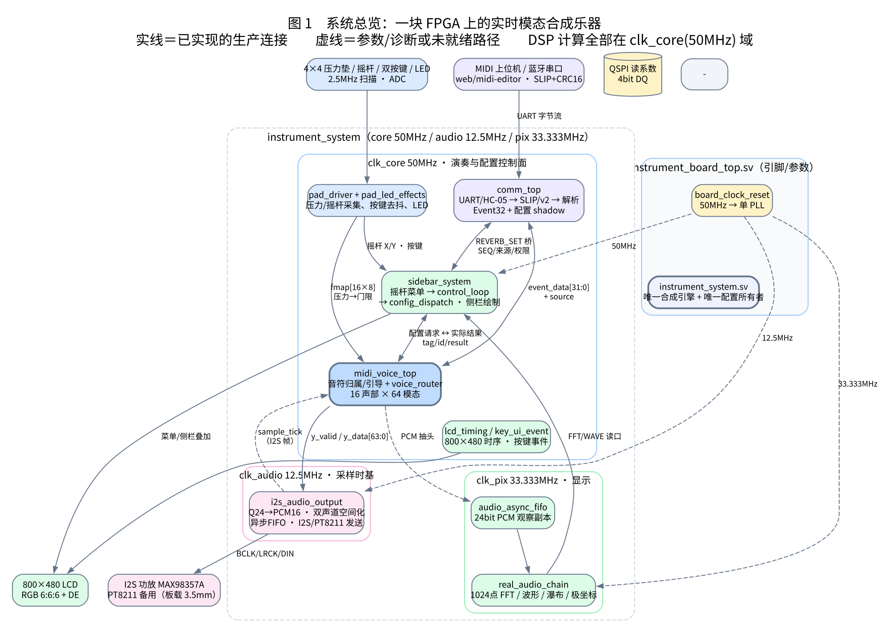

[SVG](diagrams/rtl_report/01_system_overview.svg) · [DOT 源](diagrams/rtl_report/01_system_overview.dot)

顶层只有两层：[instrument_board_top](../rtl/platform/tang_mega_138k_pro/instrument_board_top.sv) 负责引脚与参数，[instrument_system](../rtl/platform/tang_mega_138k_pro/instrument_system.sv) 是**唯一的合成引擎和唯一的配置所有者**（避免两套引擎互相抢 I2S）。

| 功能块 | 实例 | 时钟域 | 一句话职责 |
|---|---|---|---|
| 时钟复位 | `u_clocks` | — | 50MHz 晶振 → 单 PLL 三路输出；失锁统一复位 |
| 压力/摇杆 | `u_pad`、`u_pad_leds` | core | 4×4 压力 + 摇杆 ADC 扫描、LED 灯效 |
| 通信 | `u_comm` | core | 双 UART/HC-05 → SLIP/v2 → 事件与配置事务 |
| 演奏前端 | `u_sound`（`midi_voice_top`） | core | 音符归属、音色装载事务、引导模式 |
| 合成核心 | `u_sound/u_voice`（`voice_router`） | core | 16 槽 × 64 模态逐样本递推 + 后级 |
| 音频输出 | `u_sound/g_audio.u_audio` | core + audio | Q24→PCM16、双声道空间化、异步 FIFO、I2S |
| 配置/UI | `u_ui`（`sidebar_system`） | core + pix | 菜单、参数提交、侧栏与引导页绘制 |
| 可视化 | `u_visualizer_fifo` → `u_fft_chain` | core → pix | 真实 PCM 副本做 FFT/波形/极坐标 |
| 显示时序 | `u_timing` | pix | 800×480、1192×533 总周期、帧脉冲 |

设计上刻意保留的三条边界（汇报时值得强调）：

1. **合成只有一套**。板级、`pad_voice_top`、`midi_voice_top` 共用同一个 `voice_router`，不存在两套引擎同时占 I2S。
2. **显示只观察、不反压**。可视化走独立 24bit 异步 FIFO，DAC 队列满了也不影响播放。
3. **配置不碰音频时基**。配置 mailbox 只传参数快照；音频 CDC 独立。

---

## 2. 时钟、复位与跨域

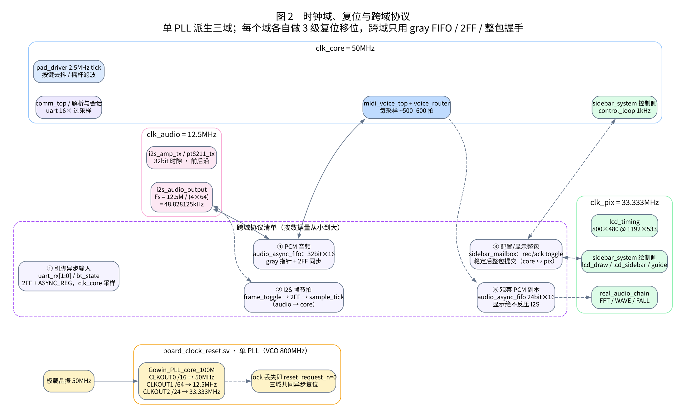

[SVG](diagrams/rtl_report/02_clock_domains.svg) · [DOT 源](diagrams/rtl_report/02_clock_domains.dot)

单 PLL，FCLKIN 50MHz，MDIV=16 → **VCO 800MHz**，三路 ODIV：

| 输出 | 分频 | 频率 | 用途 | SDC 约束 |
|---|---:|---:|---|---|
| CLKOUT0 `clk_core` | /16 | 50.000MHz | 演奏、通信、配置、pad | `divide_by 1`（源自 port clk） |
| CLKOUT1 `clk_audio` | /64 | 12.500MHz | I2S/PT8211 时基 | `divide_by 4` |
| CLKOUT2 `clk_pix` | /24 | 33.333MHz | LCD 扫描、FFT、侧栏 | `multiply_by 2 / divide_by 3` |

注意：模块名 `Gowin_PLL_core_100M` 是历史名，**当前 core 实际 50MHz**。旧文档里的 "core 100MHz" 与 "每采样 735 拍" 都属于 100MHz 时期，不适用于当前签核。

复位：`reset_request_n = rst_n && locked`（异步断言）；每个域自己走 3 级移位同步释放（`core_reset/audio_reset/pix_reset`）。SDC 对复位同步器首级 CLEAR 做 `set_false_path`。

跨域点只有 5 类，全部是"窄脉冲 / 整包 / gray 指针"：

| # | 跨域 | 机制 | 约束 |
|---|---|---|---|
| ① | 引脚异步输入 `uart_rx[1:0]`、`bt_state` | 2 级 `ASYNC_REG` 同步 | `set_false_path -from [get_ports ...]` |
| ② | I2S 帧节拍 audio→core | `frame_toggle` → 2FF → 边沿检测出 1 拍 `sample_tick` | max_delay 10ns + hold false_path |
| ③ | 配置/引导快照 core↔pix | `sidebar_mailbox`：req/ack toggle + 整包保持，帧头接收 | max_delay 10ns |
| ④ | PCM 音频 core→audio | `audio_async_fifo` 32bit×16，gray 指针 + 2FF | 写/读指针各 10ns max_delay |
| ⑤ | 观察 PCM core→pix | `audio_async_fifo` 24bit×16，独立队列 | 同上 |

已知残留：`under_s1/s2`（audio→core 的欠载标志）标了 `ASYNC_REG` 但 SDC 未单独约束；属 bring-up 级 CDC，不是数据路径。

---

## 3. 通信子系统

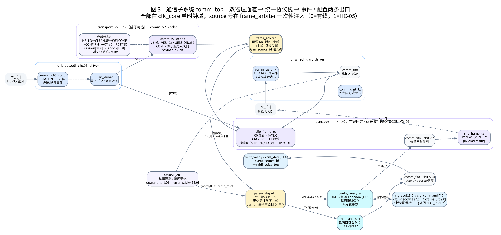

[SVG](diagrams/rtl_report/03_comm.svg) · [DOT 源](diagrams/rtl_report/03_comm.dot)

整个 `comm_top` 在 **clk_core 单时钟域**，没有一处异步 FIFO；分层如下：

```
rx_i[0] 有线 ─ uart_driver(comm_uart_rx 16×NCO / rx_fifo 8b×1024 / comm_uart_tx) ─┐
rx_i[1] HC-05 ─ hc05_driver(同上 + comm_hc05_status 2FF+去抖) ─────────────────────┴→ transport
                                                                                      │
   transport_link(v1: slip_frame_rx / slip_frame_tx / reply_fifo 32b×2) ←→ 帧描述符
   transport_v2_link(v2: comm_v2_codec + 会话状态机)                                       │
                                                                                      ▼
                                                        frame_arbiter（RR 授权 + source 注入）
                                                                                      ▼
                                                        parser_dispatch → midi_analyzer
                                                                        └→ config_analyzer
                                                                                      ▼
                                          event_fifo(33b×64) → Event32 + source   /   cfg_shadow[127:0] ↔ cfg_result[7:0]
```

三条实现要点：

- **source 号只在一处注入**：`frame_arbiter.m_source_id`，0=有线、1=HC-05。事件 FIFO 存 33bit = `{source, event_data[31:0]}`，消费侧永远拿得到物理来源。
- **Event32 位域**：`{kind[3:0], channel[3:0], data1[6:0], data2[6:0], 10'b0}`。
- **解析器只有一个上下文**：`parser_dispatch` 等前一帧完全退休（事件空 + MIDI 空闲）才放下一帧，避免两源交错破坏配置事务。

帧格式（v1 与 v2 的唯一差异在会话字段）：

| 项 | v1 | v2 |
|---|---|---|
| 定界 | SLIP（C0 首尾，DB DC/DB DD 转义） | 同 |
| 帧体 | `VER=01｜TYPE｜SEQ:u16LE｜LEN:u16LE｜PAYLOAD｜CRC16LE` | `VER=02｜…｜SESSION:u32｜PAYLOAD｜CRC16LE` |
| 帧体长 | `LEN + 8` | `LEN + 12` |
| CRC | CRC-16/CCITT-FALSE（0x1021 / init 0xFFFF） | 同 |
| 类型 | 01 MIDI · 02 CONFIG · 80 REPLY | 增加 03 CONTROL、81/86/87/FF 控制类 |
| 会话 | 无，仅 16bit SEQ | `SESSION:u32` + MIDI payload 前 2B 为 `epoch:u16` |

v2 会话：`HELLO → CLEANUP → WELCOME → CONFIRM → ACTIVE`；软错误（序号缺口/长度错/MIDI 语法错/进度超时）只 `epoch+1` 进 `RESYNC` 发 0x86，硬错误（物理故障/队列溢出/心跳超时/错误窗超限）清 `session` 回 `WAIT_HELLO`。三个定时器：心跳 2s、进度 250ms、CONFIRM 1s。

回程：`config_analyzer` 出 `reply_*` → 按 `reply_source` 回到对应链的 `reply_fifo(32b×2)` → v1 `slip_frame_tx`（TYPE=0x80，`{02,cmd,result}`）或 v2 codec → `tx_o[n]`。

未就绪：**EQ 没有 DSP 消费者**，板级桥对 EQ 返回 `NOT_READY(0x06)`；REVERB_SET 才有真实 `0x0200` 结果桥（在 `comm_top` 之外的 `instrument_system` 里）。

---

## 4. 配置与控制平面

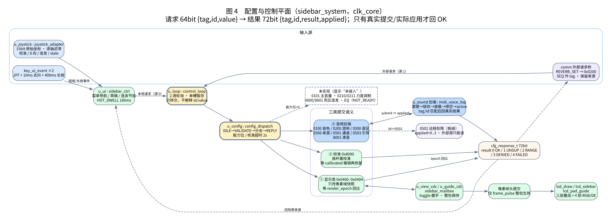

[SVG](diagrams/rtl_report/04_config_control.svg) · [DOT 源](diagrams/rtl_report/04_config_control.dot)

统一请求/结果是两个定长结构（[config_pkg](../rtl/config_pkg.sv)）：

| 结构 | 位宽 | 字段 |
|---|---:|---|
| `cfg_request_t` | 64 | `{tag[15:0], id[15:0], value signed[31:0]}` |
| `cfg_response_t` | 72 | `{tag[15:0], id[15:0], result[7:0], applied_value signed[31:0]}` |

`result`：0 OK / 1 UNSUPPORTED / 2 OUT_OF_RANGE / 3 DENIED / 4 FAILED。

三段职责清晰分离，这是这条链最重要的设计约束：

| 模块 | 只做什么 | 明确不做 |
|---|---|---|
| [control_loop](../rtl/control_loop.sv) | 2 源轮询、单槽暂存、原样转交 | 不解释 id/value、不校验、不改 active |
| [config_dispatch](../rtl/config_dispatch.sv) | 能力位校验、按 id 分三类提交、等真实回执 | 不产生音频、不写显示像素 |
| 后端（`midi_voice_top`） | 清理→锁存→装载→排空→active，回真实 `applied` | 不越权处理本地显示参数 |

三类提交语义（图 4 中间三个分支）：

1. **显示类**（`0x0400–0x0404`）：只改像素域快照，`render_epoch++` 后等 mailbox 回比才算成功。
2. **校准**（`0x8000`）：先撤销 `calibrated`，再等 `calibrated && !stale`，2s 超时判 FAILED。
3. **音频后端**：`0100` 音色、`0200` 混响、`0300` 音区、`0500` 来源、`0501` 通道、`0503` 引导、`8001` 清音，`tag/id` 匹配 + `applied == value` 才回 OK。

权限：`0502` 远程权限由板级处理（外部物理源只能读，本地可写 0..3）。参数字典 `CFG_COUNT=21`，`RESOURCE_MASK` 板级默认 `0x02B`（钢琴/吉他/小号/小提琴），未开放音色在 UI 上显示"未接入"。

时钟域：控制面 core 50MHz，绘制面 pix 33.333MHz；两条 `sidebar_mailbox`（视图快照 ≈804bit、引导 ≈247bit）用 toggle 握手整包搬运，目的端**只在帧头 `frame_pulse` 生效**。

---

## 5. 演奏前端

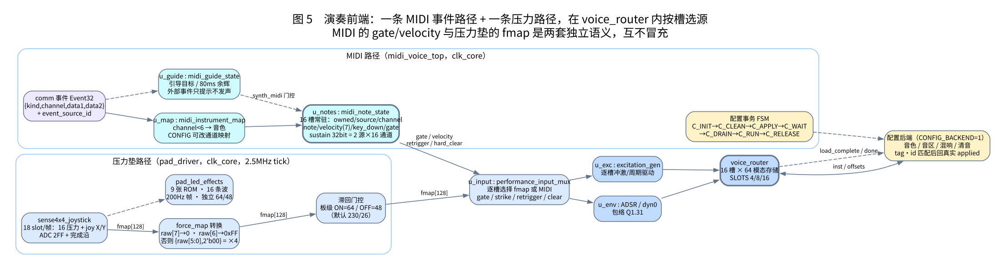

[SVG](diagrams/rtl_report/05_performance_frontend.svg) · [DOT 源](diagrams/rtl_report/05_performance_frontend.dot)

两条触发路径语义完全不同，靠 [performance_input_mux](../rtl/router/routers/performance_input_mux.sv) 在 `voice_router` 内**逐槽选源**：

| | MIDI 路径 | 压力垫路径 |
|---|---|---|
| 输入 | Event32 + source | 4×4 ADC 值（8bit） |
| 触发语义 | `gate` 边沿 + 7bit velocity + retrigger | 滞回门限：板级 ON=64 / OFF=48 |
| 归属 | 每槽 owned/source/channel/note | 槽号即键位 |
| 关闭 | note-off / CC120 / CC123 | 抬起过门限 |
| 特有 | 延音踏板 32bit = 2 源 × 16 通道 | 压力连续值进入激励力度 |

MIDI 侧实例与数据流：

```
comm 事件 → u_map（channel<6 → 音色）→ u_notes（16 槽常驻状态）
          → gate/velocity/retrigger/hard_clear → voice_router
          → u_guide（引导模式：外部事件只提示、不许发声）
```

要点：

- **配置事务状态机在 `midi_voice_top` 里**（`C_INIT→C_CLEAN→C_APPLY→C_WAIT→C_DRAIN→C_RUN→C_RELEASE`），`midi_note_state` 只做 pending/matched 两拍流水和"单在途操作"握手。
- 换音色/音区是**阻塞事务**：清理 → 锁存目标 → loader 装载 → 排空 → 才回 `active` 和真实结果；失败 `table_valid=0` 静音等待显式重试。
- 引导模式：`synth_midi = mode_q && !guide_q`，引导期事件只写 `u_guide`（目标/80ms 余辉），不产生 gate，实体压力键照常发声。
- 压力垫：`pad_driver` 以 2.5MHz tick 扫描 18 个 slot（16 压力 + joy X/Y），ADC 值取高 8 位；`instrument_system` 统一做 ×4 饱和（`{raw[5:0],2'b00}`，正负各自饱和到 0x00/0xFF），再配 64/48 门限。

---

## 6. 合成核心 `voice_router`

`voice_router` 是整个系统最重的模块（1156 行）。它**一个采样周期只产一个样本**：帧内把 16 槽 × 48 模态全部算完，才交后级。

### 6.1 每采样帧头（图 6）

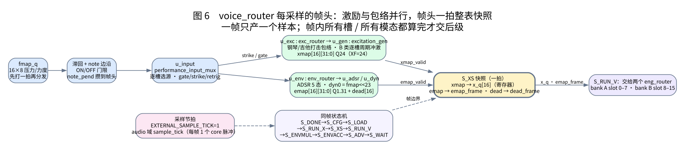

[SVG](diagrams/rtl_report/06_router_frontend.svg) · [DOT 源](diagrams/rtl_report/06_router_frontend.dot)

```
fmap_q（打一拍）→ 滞回 + note 边沿 → u_input 选源 → 激励 / 包络并行 → S_XS 整表快照 → 交双 bank
```

- 激励 `u_exc` 出 `xmap[16][31:0]`（Q24），钢琴/吉他用打击包络，B 类持续音色用逐槽周期冲激。
- 包络 `u_env` 出 `emap[16][31:0]`（Q1.31）和 `dead[16]`，ADSR 或 `dyn0`（`fmap<<23` 钳位）。
- `S_XS` 一拍把 `xmap` 抄进 `x_q[16]` 寄存器，同时锁 `emap_frame/dead_frame`——**整帧同版本**，后续不再回头读。

### 6.2 计算与后级（图 7）

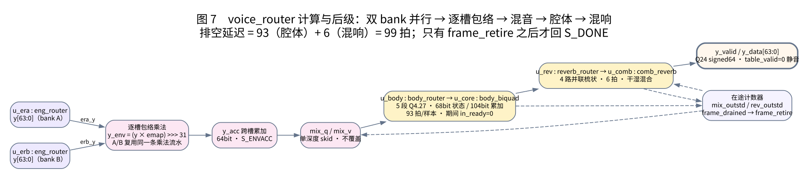

[SVG](diagrams/rtl_report/07_router_compute.svg) · [DOT 源](diagrams/rtl_report/07_router_compute.dot)

```
u_era(bank A) ┐
              ├→ 逐槽包络乘 (y×emap)>>>31 → y_acc 累加 → mix_q → body(93拍) → reverb(6拍) → y_valid/y_data
u_erb(bank B) ┘
```

- 每槽乘自己的包络再累加，A/B 两路**复用同一条乘法流水**（`S_ENVMUL` / `S_ENVACC` / `S_ADV` 三拍一组）。
- 后级握手：`mix_q/mix_v` 是单深度 skid，腔体忙时不覆盖；两个 4bit 在途计数器决定 `frame_drained`，只有 `frame_retire` 后才回 `S_DONE`，保证最后一帧不丢。
- **排空延迟固定 99 拍** = 腔体 93 + 混响 6。
- 输出 `y_valid = rev_out_valid && table_valid`，`y_data = table_valid ? rev_y : 0`（signed 64，Q24），装载失败即静音。

### 6.3 模态存储与双引擎（图 8）

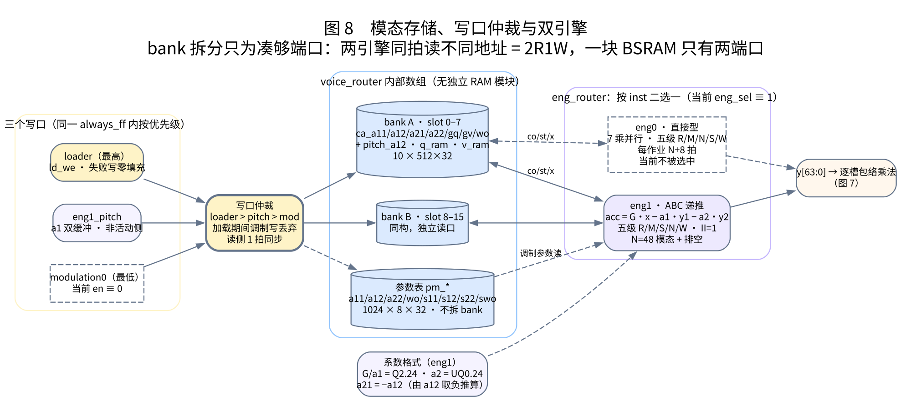

[SVG](diagrams/rtl_report/08_engine_storage.svg) · [DOT 源](diagrams/rtl_report/08_engine_storage.dot)

为什么要拆 bank：两个引擎同拍读不同地址 = 2R1W，而一块 BSRAM 只有两个端口，所以 `slot<8` 走 bank A、`slot≥8` 走 bank B，每 bank 各自 10 张 `512×32`（地址 `{slot[2:0], mode[5:0]}` 退化成拼接）。

| 存储 | 组织 | 宽度 | 深度 |
|---|---|---:|---:|
| 系数（每 bank） | `ca_a11/a12/a21/a22/gq/gv/wo` + `pitch_a12`、`q_ram`、`v_ram` | 32 signed | 512 |
| 参数表 `pm_*` | 8 张，不拆 bank | 32 signed | 1024 |
| 激励 | `x_q[16]` 寄存器 | 32 signed | 16 |

写口三级优先级：**loader > eng1_pitch > modulation0**。加载期间调制写一律丢弃（避免改坏新表）。

`eng_router` 按 `inst` 二选一：

| 引擎 | 结构 | 吞吐 | 当前是否选中 |
|---|---|---|---|
| `eng0` | 直接型，7 乘并行，五级 R/M/N/S/W | 每作业 N+8 拍 | **否**（`eng_sel()` 恒 1） |
| `eng1` | ABC 递推 `acc=G·x−a1·y1−a2·y2`，五级 R/M/S/N/W | II=1，末尾排空 | **是** |

> ⚠️ 汇报要点：源码里 `router_pkg::eng_sel()` 对所有乐器都 `return 1'b1`，`n_modes_of()` 统一 `return 48`。也就是说**当前只有 eng1 在跑，eng0 实例保留但永远不会被 start，modulation0 的 `en=!eng_sel` 恒 0**。README 与旧文档里"钢琴/吉他走 eng0 64/20 模态、其余走 eng1 48"是上一版合同。详见 [§11](#11-实现现状边界与汇报要点)。

### 6.4 定点格式

| 量 | 格式 | 位宽 | 备注 |
|---|---|---:|---|
| 状态 q / qdot | Q24 (s8.24) | 32 | 生成系数时按模态归一化 |
| 激励 x / xmap | Q24（XF=24） | 32 | 必须 `XF = QF` |
| 包络 emap | Q1.31 | 32 | 乘法取 `y_mul[94:31]` |
| 单模态 y / mix / y_data | Q24 语义 | 64 | 饱和度远未触及，不自动归一化 |
| 系数 a11/a22 | Q28 | 32 | |
| 系数 a12 | Q30 | 32 | eng1 里同时是 a1 |
| 系数 a21 | Q23 | 32 | 由 `a21 = −a12` 推算 |
| gq / gv / wo | Q32 / Q34 / Q29 | 32 | |
| eng1 G / a1 / a2 | Q2.24 / Q2.24 / UQ0.24 | 26/26/24 | |
| 腔体 / 混响 | Q4.27 | 32 | 1.0 = 1<<27 |

---

## 7. 系数装载与 Flash

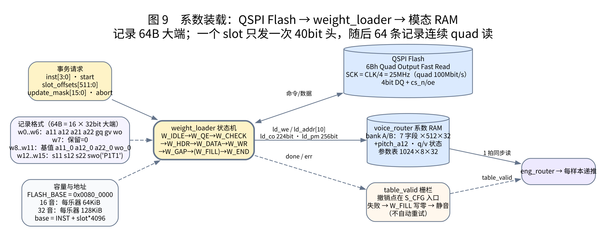

[SVG](diagrams/rtl_report/09_flash_loader.svg) · [DOT 源](diagrams/rtl_report/09_flash_loader.dot)

Flash 记录 **64B = 16 个 32bit 大端字**，前 8 字是系数、后 8 字是调制参数：

| 字 | 字段 | 说明 |
|---|---|---|
| w0..w6 | a11 a12 a21 a22 gq gv wo | eng1 下分别是 G、a1、a2，其余强制 0 |
| w7 | reserved | 必须 0 |
| w8..w11 | a11_0 a12_0 a22_0 wo_0 | 参数表基值 |
| w12..w15 | s11 s12 s22 swo | 调制斜率；eng1 镜像在 swo 放 `'P1T1'` |

地址：`base = FLASH_BASE + inst×TBL_BYTES + slot_offsets[slot]`，`TBL_BYTES = FLASH_NOTES × N_MODES × 64`。16 音 = 64KiB/乐器，32 音 = 128KiB/乐器。板级 `FLASH_BASE = 0x0080_0000`。

装载器 [`weight_loader`](../rtl/router/loader.sv) 状态机：`W_IDLE→W_QE→W_CHECK→W_HDR→W_DATA→W_WR→W_GAP→(W_FILL)→W_END`。

| 项 | 值 |
|---|---|
| 读命令 | `0x6B` Quad Output Fast Read（8bit cmd + 24bit addr + 8 dummy） |
| SCK | `CLK_HZ/4` = 12.5MHz（板级 50MHz 域），quad 有效 50Mbit/s |
| QE 使能 | 每次事务一次，等 `CLK_HZ/50` = 20ms |
| 单 slot | 一次 40bit 头 + 64 条记录连续读 ≈ 32,768 clk ≈ 0.66ms |
| 16 槽总时长 | ≈ 20ms（QE） + 10.5ms（数据） ≈ **30ms** |
| 超时 | `CLK_HZ/10` = 100ms → error_code=4 |

失败行为是设计好的：**所有失败都进 `W_FILL`**，把目标 slot 全部写 0，然后给 `done + err`；`table_valid` 保持 0 → 输出静音；只有显式 `reload` 或换 `inst` 才重装，**不自动重试**（避免 Flash 故障时反复阻塞音频）。

`rtl/core/` 里的 `index_loader20/index_loader64` + `shared_modal_ram` 是另一套 ROM 驱动的历史实现，**不在当前实例树**，`rtl/rom/*.mem` 也只被它消费，不能与 Flash 资源混用。

---

## 8. 音频输出

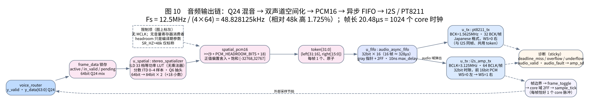

[SVG](diagrams/rtl_report/10_audio_output.svg) · [DOT 源](diagrams/rtl_report/10_audio_output.dot)

```
y_data[63:0] Q24 → frame_data 锁存 → stereo_spatializer(84bit×2) → spatial_pcm16
               → token[31:0]{L,R} → async FIFO 32b×16 → i2s_amp_tx / pt8211_tx → 引脚
```

采样率推导：`Fs = audio_clk / (CLK_DIV × 64) = 12.5MHz / (4 × 64) = 48.828125kHz`，帧长 20.48µs = **1024 个 core 时钟**。相对 48k 高 1.725%，音高也相应偏高；`SR_HZ=48000` 只是系数生成的标称值，不会把 12.5MHz 变成精确 48k。

| 项 | I2S（`i2s_amp_tx`） | PT8211（`pt8211_tx`） |
|---|---|---|
| BCLK | 3.125MHz（audio/4） | 1.5625MHz（audio/8） |
| BCLK/帧 | 64 | 32 |
| 时隙 | 32bit，前 16bit PCM，余补零 | 16bit 满槽 |
| 声道顺序 | WS=0 左 → WS=1 右 | WS=0 右 → WS=1 左 |
| 位对齐 | WS 沿后 1 BCLK 出 MSB | MSB 与 WS 同沿 |

PCM 换算：`>>> (9 + PCM_HEADROOM_BITS)`（双声道路径再 +18 位小数），带正偏置舍入后饱和到 16bit。增益只由编译期 `PCM_HEADROOM_BITS` 决定，**没有音量寄存器消费者**；当前工作区顶层默认 4，而 11-01 上板验收版本用的是 −1（相差 30dB），汇报时不要混用。

时基闭环：发送器在帧末产生 `frame_tick` → 翻转 `frame_toggle` → core 域 2FF + 边沿检测 → `sample_tick`（每帧恰好 1 个 core 脉冲）回灌 `voice_router` 和空间化器。这条回环是"一个帧时间算一帧样本"的唯一依据，不能另外给 `start` 接独立分频。

延迟与余量：结果在 K+1 帧被锁存，K+2 帧开始发送，端到端 **≈2 帧 = 41µs**；FIFO 16 帧 ≈ 328µs 余量。`active=0`（未运行/配置失败/维护）时仍每帧写零 token，BCLK/WS 不断，功放由 `amp_sd` 关断。

诊断（sticky）：`deadline_miss`（到帧边界还没交结果）、`overflow`（窗口内多个结果或 FIFO 满）、`underflow`（收到首个 token 后 FIFO 空）。三者都只上报，不自动重传；panic 不 flush 已排队的 PCM。

限制：无 MCLK 输出、无音量消费者、无自动峰值归一化；SDC 里音频输出只是 bring-up 包络（±40ns），不是 DAC 器件时序规格。

---

## 9. 显示与可视化

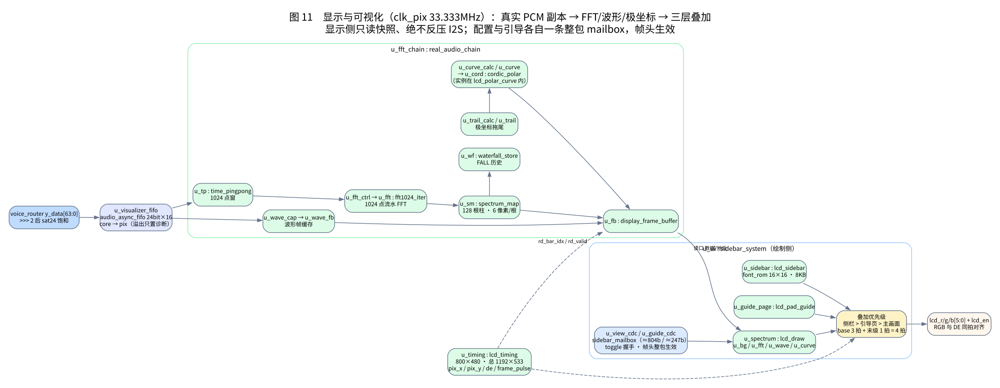

[SVG](diagrams/rtl_report/11_display.svg) · [DOT 源](diagrams/rtl_report/11_display.dot)

像素域（33.333MHz）内三级流水：

```
PCM 副本 → audio_async_fifo 24b×16 → time_pingpong(1024点) → fft1024_iter → spectrum_map(128柱)
                                                    └→ wave_capture / wave_frame_buffer
         → waterfall(瀑布) / trail(极坐标拖尾) / curve_calc+cordic_polar → display_frame_buffer
         → lcd_draw(背景/FFT/波形/曲线) ⊕ lcd_pad_guide ⊕ lcd_sidebar → 4 拍 RGB/DE → LCD
```

- `lcd_timing`：800×480 有效，总周期 1192×533，提供 `pix_x/pix_y/de/frame_pulse`，并支持 180° 旋转。
- 三层叠加优先级：**侧栏 > 引导页 > 主画面**；主画面路径 3 拍 + 末级 1 拍寄存，RGB 与 DE 同拍对齐。
- 配置/引导两条 mailbox 都是整包 + 帧头生效，**不会半帧更新**。
- 字模：`font_rom` 16bit×4096 = 8KB，16×16 字形，来自 Noto Sans CJK SC（OFL），地址 `{glyph[7:0], font_y[3:0]}`。
- 降级：可视化 FIFO 溢出只置诊断位，绝不反压 I2S；`real_audio_chain` 内部写侧仍在 `clk_pix`，PCM 抽头位置已冻结为"混响输出后、PCM16 前"。

---

## 10. 性能与资源

| 指标 | 数值 | 依据 |
|---|---|---|
| 采样预算 | 1024 core 拍/样本（50MHz ÷ 48.828kHz） | 时钟/采样率 |
| eng1 计算 48 模态 | ≈ 598 拍 | 满 16 槽回归 |
| 后级排空 | 99 拍（93 腔体 + 6 混响） | RTL 注释与 TB |
| 帧总占用 | ≈ 600–700 拍，占预算 ~60–68% | 估算，含加载与握手开销 |
| 逻辑 | 70,088 / 138,240（51%） | 2026-10-30 整板 PnR |
| 寄存器 | 33,644 / 139,140（25%） | 同上 |
| CLS | 50,069 / 69,120（73%） | 同上 |
| BSRAM | 149 / 340（44%） | 同上（116 SDPB + 20 SDPX9B + 12 pROM + 1 pROMX9） |
| DSP | 172 / 298（58%） | 同上 |
| Fmax | core 53.839MHz / audio 17.504MHz / pix 39.269MHz | 50MHz 目标已签核，100MHz 未签核 |

证据见[工程评审与验证 §2026-10-30 整板 PnR](工程验证.md#eng1-pitch-pnr-2026-10-30)。

---

## 11. 实现现状、边界与汇报要点

### 11.1 与旧文档不一致、必须按源码讲的三处

| # | 旧说法 | 当前源码事实 | 影响 |
|---|---|---|---|
| 1 | 钢琴/吉他→eng0（64/20 模态），其余→eng1（48） | `eng_sel()` 全返回 1；`n_modes_of()` 全返回 48 | **只有 eng1 在跑**；eng0 的运算结果没有扇出，综合时会被裁掉，两份引擎的并行结构实际只用了一半 |
| 2 | 调制/揉弦链路已实现并工作 | `mod_router.en = !eng_sel(inst)` 恒 0，写口分支永不成立 | 调制整链当前**不参与运算**，UI 的调制开关没有 DSP 效果 |
| 3 | core 100MHz、每采样 735 拍 | core 50MHz、eng1 48 模态约 598 拍 | 汇报时不要用 100MHz 的旧数字 |

第 1、2 条是同一根因：`eng_sel` 被写成常量以统一资源。这属于**有意收口还是遗留**需要项目负责人确认——若保留 eng0 作为备选，应在文档同步说明；若确定只用 eng1，应删除或显式标注 eng0 为“未选中参照实现”，避免后来人误读。

### 11.2 已验证 / 未验证

| 已通过 | 边界 |
|---|---|
| 50MHz 整板 PnR（setup/hold 违反 0，Fmax 53.839MHz） | 不是 100MHz 签核 |
| 2026-10-31 整板时序 + SRAM 下载 + 串口演奏/音量/方向实测 | B 类资源需匹配 P1T1 镜像 |
| 音频数字链路：886,484 组 PCM 向量逐位对拍 | 不替代 DAC 器件时序与听感 |
| 通信 v2 协议会话/帧编解码、16 项 RTL 用例 | HC-05 专用故障场景未逐项实测 |
| 模块级回归：MIDI / loader / router / UI / 通信 | 模块 PASS 不等于整机逐拍一致 |

| 未完成 | 说明 |
|---|---|
| 精确 48.000kHz 时钟 | 当前 48.828125kHz（+1.725%），需换 12.288MHz 参考 |
| 主音量 / 力度曲线 / EQ DSP / CC7 等消费者 | 字典有项、能力位为 0，UI 显示"未接入" |
| 32 音常驻、动态单槽装载 | 板级默认 `NOTE_BANKS=0`，只有 16 槽 |
| 忙时 panic 抢占 | 只在可接收状态处理，不能承诺装载中立即取消 |
| 混响内部乘积位宽（F09） | 部分反馈乘移仍在 64bit 目标 |
| 12dB 增益版下载 | 隔离构建时序通过，但当时未检测到板卡，未下载 |

### 11.3 建议的汇报口径

1. **主打"一套引擎 + 三个域 + 两条独立观察通道"**：这是架构上最稳的部分，也是和竞品/往届方案最容易讲清的差异。
2. **主动说明 eng1/eng0 的现状**，把它作为"资源收口待决策项"，不要等提问时被当成隐藏缺陷。
3. **音质/延迟用数字说话**：99 拍排空、41µs 端到端、328µs FIFO 余量、+1.725% 采样率偏差。
4. **待办用表格列出关闭条件**，与 [bugs.md](bugs.md) 编号对齐（I02/I04/M14/F09/M01 等）。

---

## 附录 A：实例树

### A.1 板级实例树

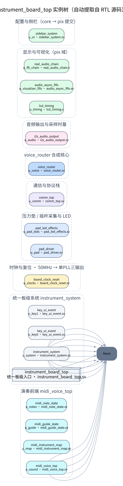

[SVG](diagrams/rtl_report/hierarchy_top.svg) · [DOT 源](diagrams/rtl_report/hierarchy_top.dot)

由 [tools/gen_hierarchy.py](diagrams/rtl_report/tools/gen_hierarchy.py) 直接解析 RTL 源码生成，不是手绘，因此 `generate` 分支会同时列出 v1/v2 transport 与 I2S/PT8211 两条发送路径。

### A.2 voice_router 实例树

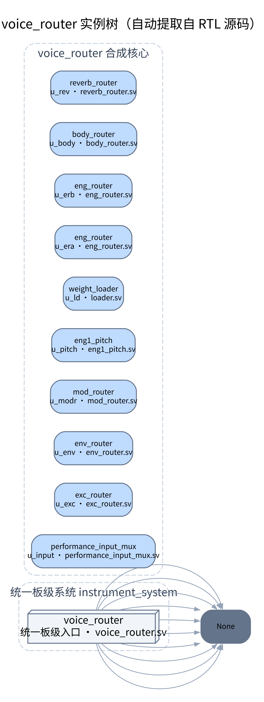

[SVG](diagrams/rtl_report/hierarchy_router.svg) · [DOT 源](diagrams/rtl_report/hierarchy_router.dot)

---

## 附录 B：生产模块清单

按 `sources.f` 顺序统计，行数为文件物理行数。全部 82 个模块文件都在 `instrument_board_top` 实例树内，唯一不在实例树内的是 `lcd_curve_spectrum.sv`（旧曲线画面，当前主画面用 `lcd_polar_curve`）。

| 模块 | 文件 | 行数 |
|---|---|---:|
| `real_audio_chain` | `FFT_spectrumshow/src/audio/real_audio_chain.v` | 232 |
| `time_pingpong` | `FFT_spectrumshow/src/audio/time_pingpong.v` | 147 |
| `wave_capture` | `FFT_spectrumshow/src/audio/wave_capture.sv` | 118 |
| `cordic_polar` | `FFT_spectrumshow/src/display/cordic_polar.sv` | 121 |
| `curve_calc` | `FFT_spectrumshow/src/display/curve_calc.sv` | 195 |
| `curve_store` | `FFT_spectrumshow/src/display/curve_store.sv` | 71 |
| `display_frame_buffer` | `FFT_spectrumshow/src/display/display_frame_buffer.sv` | 97 |
| `lcd_background` | `FFT_spectrumshow/src/display/lcd_background.v` | 24 |
| `lcd_draw` | `FFT_spectrumshow/src/display/lcd_draw.v` | 118 |
| `lcd_fft` | `FFT_spectrumshow/src/display/lcd_fft.v` | 405 |
| `lcd_pad_guide` | `FFT_spectrumshow/src/display/lcd_pad_guide.sv` | 155 |
| `lcd_polar_curve` | `FFT_spectrumshow/src/display/lcd_polar_curve.sv` | 527 |
| `lcd_sidebar` | `FFT_spectrumshow/src/display/lcd_sidebar.sv` | 280 |
| `lcd_timing` | `FFT_spectrumshow/src/display/lcd_timing.v` | 55 |
| `lcd_ui` | `FFT_spectrumshow/src/display/lcd_ui.sv` | 363 |
| `lcd_wave` | `FFT_spectrumshow/src/display/lcd_wave.v` | 69 |
| `trail_calc` | `FFT_spectrumshow/src/display/trail_calc.sv` | 160 |
| `trail_store` | `FFT_spectrumshow/src/display/trail_store.sv` | 27 |
| `waterfall_store` | `FFT_spectrumshow/src/display/waterfall_store.sv` | 68 |
| `wave_frame_buffer` | `FFT_spectrumshow/src/display/wave_frame_buffer.sv` | 71 |
| `fft1024_iter` | `FFT_spectrumshow/src/fft/fft1024_iter.sv` | 387 |
| `fft_ctrl` | `FFT_spectrumshow/src/fft/fft_ctrl.v` | 173 |
| `spectrum_map` | `FFT_spectrumshow/src/spectrum/spectrum_map.v` | 195 |
| `key_ui_event` | `FFT_spectrumshow/src/ui/key_ui_event.sv` | 110 |
| `sidebar_ctrl` | `FFT_spectrumshow/src/ui/sidebar_ctrl.sv` | 138 |
| `sidebar_mailbox` | `FFT_spectrumshow/src/ui/sidebar_mailbox.sv` | 50 |
| `sidebar_system` | `FFT_spectrumshow/src/ui/sidebar_system.sv` | 210 |
| `audio_async_fifo` | `rtl/audio/audio_async_fifo.sv` | 164 |
| `i2s_amp_tx` | `rtl/audio/i2s_amp_tx.sv` | 118 |
| `i2s_audio_output` | `rtl/audio/i2s_audio_output.sv` | 156 |
| `pt8211_tx` | `rtl/audio/pt8211_tx.sv` | 38 |
| `stereo_spatializer` | `rtl/audio/stereo_spatializer.sv` | 180 |
| `comm_top` | `rtl/comm/comm_top.sv` | 219 |
| `comm_v2_codec` | `rtl/comm/comm_v2_codec.sv` | 671 |
| `frame_arbiter` | `rtl/comm/frame_arbiter.sv` | 59 |
| `session_ctrl` | `rtl/comm/session_ctrl.sv` | 75 |
| `slip_frame_rx` | `rtl/comm/slip_frame_rx.sv` | 488 |
| `slip_frame_tx` | `rtl/comm/slip_frame_tx.sv` | 171 |
| `transport_link` | `rtl/comm/transport_link.sv` | 54 |
| `transport_v2_link` | `rtl/comm/transport_v2_link.sv` | 1201 |
| `config_dispatch` | `rtl/config_dispatch.sv` | 159 |
| `control_loop` | `rtl/control_loop.sv` | 79 |
| `config_analyzer` | `rtl/drivers/analyzer/config_analyzer.sv` | 459 |
| `midi_analyzer` | `rtl/drivers/analyzer/midi_analyzer.sv` | 488 |
| `parser_dispatch` | `rtl/drivers/analyzer/parser_dispatch.sv` | 100 |
| `comm_hc05_status` | `rtl/drivers/bluetooth_hc05/comm_hc05_status.sv` | 78 |
| `hc05_driver` | `rtl/drivers/bluetooth_hc05/hc05_driver.sv` | 48 |
| `comm_fifo` | `rtl/drivers/common/comm_fifo.sv` | 132 |
| `Gowin_ADC` | `rtl/drivers/gowin_adc/gowin_adc.v` | 63 |
| `joystick_adapter` | `rtl/drivers/joystick_adapter.sv` | 221 |
| `led8x8`、`pad_driver`、`sense4x4_joystick`、`shift_timer` | `rtl/drivers/pad_driver.sv` | 452 |
| `pad_led_effects` | `rtl/drivers/pad_led_effects.sv` | 269 |
| `comm_uart_rx` | `rtl/drivers/uart/comm_uart_rx.sv` | 256 |
| `comm_uart_tx` | `rtl/drivers/uart/comm_uart_tx.sv` | 136 |
| `uart_driver` | `rtl/drivers/uart/uart_driver.sv` | 47 |
| `midi_guide_state` | `rtl/midi/midi_guide_state.sv` | 64 |
| `midi_instrument_map` | `rtl/midi/midi_instrument_map.sv` | 15 |
| `midi_note_state` | `rtl/midi/midi_note_state.sv` | 203 |
| `board_clock_reset` | `rtl/platform/tang_mega_138k_pro/board_clock_reset.sv` | 15 |
| `instrument_board_top` | `rtl/platform/tang_mega_138k_pro/instrument_board_top.sv` | 45 |
| `instrument_system` | `rtl/platform/tang_mega_138k_pro/instrument_system.sv` | 320 |
| `Gowin_PLL_core_100M` | `rtl/platform/tang_mega_138k_pro/ip/gowin_pll_core_100m.v` | 47 |
| `Gowin_PLL_core_100M_MOD` | `rtl/platform/tang_mega_138k_pro/ip/gowin_pll_core_100m_mod.v` | 186 |
| `PLL_INIT` | `rtl/platform/tang_mega_138k_pro/ip/pll_init.v` | 224 |
| `eng0` | `rtl/router/engines/eng0.sv` | 276 |
| `eng1` | `rtl/router/engines/eng1.sv` | 151 |
| `weight_loader` | `rtl/router/loader.sv` | 228 |
| `midi_voice_top` | `rtl/router/midi_voice_top.sv` | 470 |
| `body_biquad` | `rtl/router/parts/body_biquad.sv` | 383 |
| `comb_reverb` | `rtl/router/parts/comb_reverb.sv` | 208 |
| `eng1_pitch` | `rtl/router/parts/eng1_pitch.sv` | 182 |
| `envelope_ADSR`、`envelope_dyn0` | `rtl/router/parts/envelope.sv` | 155 |
| `excitation_gen` | `rtl/router/parts/excitation.sv` | 208 |
| `modulation0` | `rtl/router/parts/modulation.sv` | 218 |
| `body_router` | `rtl/router/routers/body_router.sv` | 161 |
| `eng_router` | `rtl/router/routers/eng_router.sv` | 117 |
| `env_router` | `rtl/router/routers/env_router.sv` | 106 |
| `exc_router` | `rtl/router/routers/exc_router.sv` | 116 |
| `mod_router` | `rtl/router/routers/mod_router.sv` | 58 |
| `performance_input_mux` | `rtl/router/routers/performance_input_mux.sv` | 102 |
| `reverb_router` | `rtl/router/routers/reverb_router.sv` | 168 |
| `voice_router` | `rtl/router/voice_router.sv` | 1156 |

### B.1 包（13 个）

| 包 | 文件 | 行数 |
|---|---|---:|
| `sidebar_font_pkg` | `FFT_spectrumshow/src/ui/sidebar_font_pkg.sv` | 131 |
| `ui_pkg` | `FFT_spectrumshow/src/ui/ui_pkg.sv` | 16 |
| `comm_pkg` | `rtl/comm/comm_pkg.sv` | 19 |
| `config_pkg` | `rtl/config_pkg.sv` | 177 |
| `clk_rst_pkg` | `rtl/drivers/pkg/clk_rst_pkg.sv` | 29 |
| `joystick_pkg` | `rtl/drivers/pkg/joystick_pkg.sv` | 18 |
| `pad_driver_pkg` | `rtl/drivers/pkg/pad_driver_pkg.sv` | 48 |
| `math_state_pkg` | `rtl/math/math.sv` | 480 |
| `fxp_pkg` | `rtl/math/pkg/fxp_pkg.sv` | 166 |
| `modal_step_pkg` | `rtl/router/pkg/modal_step_pkg.sv` | 143 |
| `pitch_tables_pkg` | `rtl/router/pkg/pitch_tables_pkg.sv` | 847 |
| `router_pkg` | `rtl/router/pkg/router_pkg.sv` | 110 |
| `sustain_profiles_pkg` | `rtl/router/pkg/sustain_profiles_pkg.sv` | 523 |

---

## 附录 C：图的重新生成

```bash
cd docs/diagrams/rtl_report

# 全部 DOT → SVG/PNG（需 graphviz 与 librsvg）
./render.sh

# 实例树：直接解析 RTL，不需要手改
HIER_DEPTH=3 HIER_OUT=hierarchy_top.dot python3 tools/gen_hierarchy.py
HIER_ROOT=voice_router HIER_DEPTH=1 HIER_OUT=hierarchy_router.dot \
  python3 tools/gen_hierarchy.py

# 报告：Markdown → HTML → PDF（需 markdown 包与 Chrome）
PYTHONPATH=build/report_diagrams/.pylib python3 tools/build_report.py
google-chrome --headless=new --no-pdf-header-footer \
  --print-to-pdf=../../系统RTL框图说明.pdf \
  build/report_diagrams/report.html
```

更完整的说明见 [图集 README](diagrams/rtl_report/README.md)。

本文中所有端口名、位宽、状态名均取自当前源码；如与实现不符，以 RTL 为准并回改本文。
