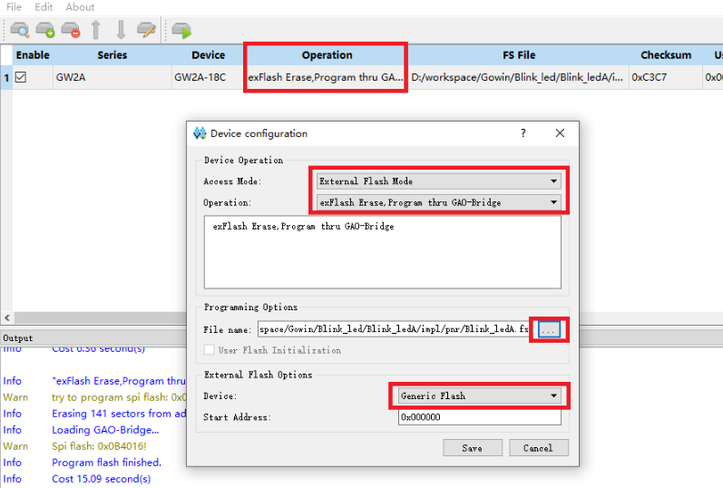

# 2026年高云杯竞赛常见问题汇总

## 一、赛事相关

### 1. 后期信息修改是否可以修改选题方向？
**回复：** 否，信息修改不支持作品的颠覆、赞助厂商以及选题方向的修改，可以修改部分信息，但需要经过组委会审核。

### 2. 怎样才算有参赛资格？
**回复：** 联络人审核属于校内对学生信息的审核，不影响参赛资格，参赛资格以企业审核为准。

### 3. 是否一定要加入组委会的大赛官方QQ群和关注大赛公众号？
**回复：** 是，QQ群和公众号会作为信息辅助渠道，建议以队长为代表进群避免重要通知遗漏。

### 4. 作为参赛人员，是否应该本届大赛关注各个时间节点?
**回复：** 是，各个关键节点都应该关注，比如提交截止，报名截止，信息修改截止时间。

### 6. 报名的时候网站跳不出来怎么办？
**回复：** 有可能是浏览器拦截了弹窗，在设置中修改或者更换浏览器即可，推荐使用谷歌、360和QQ浏览器。

### 7. 新入学的学生还没有学生证或学生证件丢失如何报名？
**回复：** 先上传录取通知书、学信网截图、学生卡等能证明学生身份的文件，填写报名信息，等拿到相关证件后再进行替换即可。

### 8. 比赛可以单人组队吗？
**回复：** 比赛允许单人组队，最多3人。

### 9. 是否必须有指导老师？
**回复：** 可以没有指导老师进行参与，最多2人。

### 10. 没有指导老师参与的话，队伍人数小于两人？
**回复：** 队伍人数和指导老师人数互不影响。每支参赛队伍不超过3人，每队不超过2名指导老师。

### 11. 团队是否需要每个人都注册？
**回复：** 每名队员均需注册并完善信息，由队长创建团队、添加队员，组建完队伍之后，所有成员均可查看队伍报名状态。队长可以调整成员顺序、指导老师顺序及转让队长。

### 12. 注册的时候没有对应学校怎么办？
**回复：** QQ群内找组委会李老师。

### 13. 报名信息填错无法修改怎么办？
**回复：** 报名截止或审核通过之前可以自行修改，如已加入团队，请退出团队后修改，如报名截止或审核通过后，每支队伍仅有一次修改机会，后续会发布修改申请书模板，请及时关注网站通知截止时间。

### 14. 如何申请开发板？
**回复：** 从企业参与的可持续角度以及学生重视和珍惜角度出发，本年度板卡给予方式由企业决定，详情见企业选题指南。

### 15. 作品中可以出现与学校相关的内容吗？
**回复：** 为了保证大赛的公平性，作品中不得出现与学校相关的任何内容，包括学校名称、logo、地图位置等等，出现即按照违规处理。队伍名称、作品报告、作品视频、演示过程均不得出现学校信息。

### 16. 不同参赛平台是如何评奖的？
**回复：** 原则上分组进行评审。

### 17. 不清楚学校是否有联络人以及联络人信息？
**回复：** 报名截止后组委会统一尽快审核，联络人报名过程中随时审核。

### 18. 待审核状态是否为正常状态？
**回复：** 是，持续到报名截止前待审核状态都为正常状态。

### 19. 各大平台的赛题具体信息怎么获取？
**回复：** 各大平台的选题指南陆续发布到大赛官网的下载中心，请有需要的同学自行下载。同时我们将组织大赛宣讲，给大家详细讲解赛题内容，欢迎大家关注。大赛宣讲视频回放均已上传官网-培训视频。

### 20. 各个平台的开发板更多资料去哪获取?
**回复：** 我们在QQ群里整理了各个平台比较完整的资料合集，下载中心也有板卡资料。

### 21. 申请下来的板卡会有配套的基本例程吗？
**回复：** 官网下载中心或者qq群有板卡资料。

### 22. 是否可以更换参赛平台？
**回复：** 报名截止或组委会审核通过以后不允许更换参赛平台，审核通过之前可以自行取消报名，修改信息。

### 23. 不同学校能组队吗？
**回复：** 目前仅支持同一学校组队，不支持跨校组队，证书只体现一所学校。

### 24. 作品提交后是否可以修改姓名错误、队员顺序等信息？
**回复：** 否，请填写并检查完成后提交。

### 25. 请问同一个题目是研究生本科生一起评比的吗？
**回复：** 原则上评审时会分开进行评审。

### 26. 作品可以涉密选择不公开答辩吗？
**回复：** 所有参赛队伍必须承诺作品不涉及知识产权和涉密问题，必须上传作品文档/视频等，入进入国赛，需参加答辩，不得以各种理由推脱。

### 27. 本科组对芯片的速度等级有限制吗？
**回复：** 具体可以看各家选题指南，大部分平台本科生和研究生要求一样。

### 28. 作品名称、简介后期能修改吗？
**回复：** 含在有且只有一次的修改机会里面，要给出合理解释，否则不予批准。

### 29. 作品提交前，作品题目和作品简介可以修改吗？
**回复：** 含在有且只有一次的修改机会里面，要给出合理解释，否则不予批准。

### 31. 宣讲时提到可以在往届作品基础上进行提升工作，需要获得授权吗？可以提供获得工程文件的渠道吗？
**回复：** 是指在自己往届作品上提升，不是在其他队伍的作品基础上提升。

### 33. 研究生组可以本科生当队长吗，如果可以的话，现在还能改队长吗？
**回复：** 队长与学历无关，由队伍自己决定，只要对应组别正确，有研究生只能参加研究生组。

### 34. 没有联络人会对参赛资格有影响吗？
**回复：** 没有联络人的，组委会代审核，不影响参赛资格。

### 35. 借用板卡或自备板卡分别如何评审成果呢？是否需要寄出板卡，还是仅拍摄视频演示？
**回复：** 无论借用还是自备，会参考板卡不同分开评审，初赛看作品报告和作品视频，必要的调取代码，决赛现场评审。

### 36. 如果自备板卡，国赛后不要求上交作品（板卡）吧？
**回复：** 无论借用还是自备板卡，组委会不会强制留取队伍的作品，借用的板卡根据不同企业要求归还企业。但是不排除特殊情况线上评审，需要核验作品，但是核验结束会归还。

### 37. 指导老师可以填一位外校研究生导师么，保外校的情况。
**回复：** 证书上包含学校、全体队员姓名、指导老师姓名等信息，如果老师不介意证书不是自己的学校，可以填。

### 38. 一等奖、二等奖、三等奖、最佳工程、最佳创意奖是所有4个企业赛道的作品混在一起评选吗？
**回复：** 不同的企业分开评审，但是最佳工程、最佳创意奖是一起评。

### 39. 各个企业奖获奖比例/数量大概是怎样的？
**回复：** 各个企业获奖比例一致。

### 40. 还没审核可以修改邮寄地址嘛？
**回复：** 队伍自己的信息报名截止后不可以修改。

### A1. 只能用对应赛题的推荐板卡吗？
**回复：** 推荐板卡只是技术上的推荐，实际上你可以使用任意的、高云FPGA为主芯片的板卡参赛（sipeed,小梅哥,易思达,嘉立创等都可以）。并且不会影响评分。该条目适用于选题包括选题一的所有选题；同理，选题三的“边缘计算平台”，佬们也可以自己选择自己的板子，树莓派、rk3588、3568，jetson，甚至你直接插一块5090说不定都行。

### A2. 关于在作品/成品模块中的MCU、软核
**回复：** 
1. 使用MCU的部分可能不会计入你的工作量，无论是成品还是自制的部分。
2. 只要不是绝大部分功能都采用软核、MCU，就不会导致棋赛。
3. 选题二的音频、视觉效果部分根据要求绝对不要用软核/MCU。否则可能不会计入工作量。
4. 此处“不能用软核”的软核指的是通用的CPU/MCU软核如M1软核（俗话说是跑C语言的那种）。根据具体算法需求专门设计的状态机或者串行架构的算法加速器不是软核。这体现了FPGA的不可替代性。当然你用那种内置的Risc-V CPU硬核的情况也比较类似于软核。
5. “可能不会计入工作量”：
   - ① 不会因为你的某个功能模块MCU了就直接给你整个模块不计入工作量，比如你的某个模块使用MCU进行1%的功能，那么不会影响剩余99%部分的工作量计算。
   - ② 如果评委认为你的这部分MCU/软核应用的比较合理，可能根据实际情况打折或正常计入你的工作量。
   - ③ 不计入工作量指的不是从总分扣分，应该理解为对这部分功能的设计和实现的分数造成的间接性影响。
6. 考虑对于实时性的影响。今年三道题对于实时性都有比较高的要求。

### 41. 在初赛阶段，本科生和研究生队伍是分开按比例选拔的吗？
**回复：** 据说是的。但是国特(最佳工程/创意、高云杯)是一起评的。

### 43. 高云EDA工具直接在浏览器搜索下载商用版还是什么，然后许可证怎么办？
**回复：** 去高云官网找一找就有，叫做云源软件。许可证也是在官方办理。

### 44. 对于开放性题目，是否允许使用一块高云 FPGA 作为主控，外接其他 FPGA 开发板作为副板参与系统工作？
**回复：** 不要再问这种ntr问题 -- 高云梁老师。不要在A企业的赛道使用B赛道的板卡，在其他品牌的板卡上开发可能不算你的工作量，而且容易被扣除印象分。如果都是高云的FPGA作为主控的板卡那你用114514片138K组大型集群都没问题。

### 45. 队员年级填错了，把他踢出队伍是不是就可以修改了？
**回复：** 报名信息填错的问题需要去1群(721849943) 找组委会老师帮忙。不过理论上报名没有截止的话你说的办法好像还真行。

### 46. 线下赛说需要敲代码之类的具体什么形式？
**回复：** 之后会在群里发送赛题，然后你需要在限时时间内实现它。题目一般比较简单，你基本只需要学会并应用状态机就行。检查方式为检查仿真波形+简单问辩，会提供testbench文件。必须配置仿真，不能用板卡+逻辑分析仪。不能用AI作答，发现AI作弊会大幅降低评分甚至发棋赛奖。

### 47. 申请板卡了，有什么已经申请了的邮件通知吗？
**回复：** 等统一开奖后群里应该会有通知。[板卡申请已结束并不会再次开放申请，没板佬请自备板卡]

### 48. 国赛的综合测评和现场答辩是每个队员都要参加吗？
**回复：** 1个人以上参加即可。组内可交流。共同完成1个小组作业。

### 49. 板卡说“统一开奖”的意思 是否指 不是申请板卡就可以获得？如果没有获得板卡，应该在哪里能购买到高云官方正版板卡？
**回复：** ①正确的，能不能发到板卡得看运气。②可以参考选题指南，去各个板厂的某宝店铺；通常只需买高云FPGA作为主控的开发板就行，不强制要求厂商。

### 50. 报名填写团队信息的时候，项目还没开始做，作品名称和简介该如何写？
**回复：** 好问题，建议是大概写写先，可以转述部分赛题，可以先说一部分你准备实现或者比较有把握实现的功能，可以保守一些。我之前就是这么干的。

### 51. 高云开放型题目要求体现FPGA的性能和不可替代性(不使用MCU)，是完全禁用MCU吗？如果MCU只是处理一些小任务不替代FPGA可以用吗？
**回复：** 理论上是可以的。实际上能更多用FPGA就尽可能多用FPGA。

### 52. 针对选题三，请问组委会是否提供 FPGA 开发板以外的小车基础套件及传感器的选型建议或参考采购清单？例如小车底盘、电机及驱动模块、摄像头、IMU、测距传感器等。
**回复：** 没有的。佬们可以自己发挥创意。

### 53. 选题三提供地图和障碍物吗？
**回复：** 没有的。佬们可以自己发挥创意。

### 54. 显示已经报名成功过后，想再添一个人进来，该怎么操作？是选择解散队伍重建一个吗？
**回复：** 由于竞赛网站更新，可能得去1群咨询组委会的工作人员。

### 55. 选题一如果自选其它开发板，板上带了mcu，但是我不用，会被怀疑用了吗，需要给mcu拆掉吗？
**回复：** 不需要。这不是电赛/智能车识别你的MCU存在与否决定你棋赛，本竞赛对于MCU的使用宽容非常多，更多考虑的是实际因素。

### 56. 没有申请到官方板子，要用自备开发板，报名信息必须修改为自备的吗？
**回复：** 应该是不需要的。

### 57. 请问今年是不是完赛提交作品后可以保留开发板？
**回复：** 借出的板卡是，没有做出来要归还板卡。禁止倒卖。

### 58. 如果选用题目套件以外的外设，如带mcu驱动的电机，或带显示驱动芯片的显示屏，会被扣分或禁止吗？
**回复：**

1. 首先，题目套件仅供参考。选题二、三只用题目套件而不用其他外设，显然做不出来，也做不好。
2. 相对于 J280，使用高性能 MCU 伺服驱动代替有刷电机，性能可能不降反增。使用 MCU 顶多降低少量“印象分”，同时会降低作品的整体性（本质上把无刷伺服控制的软硬件部分“外包”给其他公司了），但总体效果可能更好。因为 MCU 的实时性显然低于 FPGA，所以如果要用无刷电机，最好自己做 FOC 驱动——这并不比六步换向困难，哪怕是电压开环（技术含量最低，但效果远超有刷，并且能体现 FPGA 优势）。评委可能会想：这么简单都不做，印象分自然会降低一些。
3. 带显示驱动芯片的显示屏：

   - 如果指串口屏（通过上位机设计 GUI、通过串口通信的屏幕模组），需要自行评估取舍。现在 AI 这么发达，不如改成软核 + LVGL，作品的一体性会更高。用纯硬件逻辑写界面也有人做过，但视觉效果有限、可能浪费较多资源，除非是 FPGA 优化仙人；综合来说更推荐软核 + LVGL。如果是赛题二的视觉效果，就必须纯 HDL 实现。推荐的“鄙视链”为：串口屏 < 用 MCU 自己搭建 LVGL 串口屏 < 软核 + LVGL < 设计巧妙的纯硬件逻辑或软硬件异构逻辑。串口屏处于底端，尤其在 AI 时代，要具体考虑如何分配工程时间和设计。
   - 如果指输出 RGB、MCU（8080/8086 并口）、HDMI、SPI 等视频（或 GRAM 操作指令/数据），屏幕本身的液晶驱动芯片是可编程的，或者外接的 HDMI 显示屏用 MCU 控制，这显然无关，不属于作品应考虑的范围，只是显示器厂家的选择。

### 59. 关于成品的外壳包装等，其原图纸必须队伍自己画吗，可以外包吗？
**回复：** 这种非核心部分外包通常问题不大，对于整体评分应该有少量的正面作用，相对于没有做外壳包装等。不过答辩的时候要实话实说，否则如果露馅的话可能会大幅扣分。

### 60. 比赛奖项是只有国奖还是有地方奖项？
**回复：** 只有国奖，不过获奖比例通常不低。

### 61. 选题3的任务5提到需要人员识别，物体识别，这里的要求是只要可以识别是人员还是物体就行了吗，还是要具体识别出是老人还是小孩，长发还是短发，或者说需要在多个人物里面分辨每一个人吗，指定目标跟随是跟随物体还是需要跟特定的人员？
**回复：** 题目没有明确的内容 = 你可以自己发挥创意。你可以根据自己的工程进度安排、技术栈分布等情况自行决定功能的增减等等，只需要“符合题意”即可，甚至勉强符合题意也行。而具体你是如何实现功能的，实现的效果好不好？这才是提分点。自然是功能越多、越实用、性能越高越好。

### 62. 之后高云会补充题目要求吗，还是目前放出的就是完整赛题了，例如选题3的任务6需要指定目标搜索，后面会给出目标的具体信息吗还是参赛团队自己选定？
**回复：** 按照以往惯例没有出现“改变主意了”的情况。题目没写明白默认代表你可以自由发挥。

### 63. 后期信息修改是否可以修改使用的板卡？
**回复：** 如果有修改信息的机会应该是可以的。因为今年是新系统所以我也不是很确定。不过你填的是哪个板卡和用的是哪个板卡，这个应该影响不是很大。

### 64. 报名信息大概什么时候能审核通过，现在还没通过正常吗？
**回复：** 去1群(721849943) 找组委会老师帮忙问下看看？

### 65. 选题一，使用逻辑派 FPGA-G1（板载 GD32F303 MCU），但该 FPGA 无内置 ADC。由于没找到合适的高精度高分辨率 ADC 模块，计划用板载 MCU 自带的 ADC 采集摆杆角度，MCU 不做滤波、换算、PID 等任何处理，仅将原始数据透传给 FPGA，由 FPGA 完成全部滤波、PID 和 PWM。请问：这种 MCU 仅做 ADC 采集和透传的方式，是否违反选题一的规定？是否必须改用外置ADC采集模块直连 FPGA 才合规？
**回复：** 这样技术上显然不违反规定，只是说可能评委会稍微怀疑你MCU内置ADC的性能，或者因为ADC过MCU导致的可能的延迟和性能下降。有条件的话还是尽可能弄一个ADC，让AI给你移驱动就好了。

### 66. 赛题二同样可以使用推荐的适配板卡以外的其他板卡吗？
**回复：** 佬详细看一下啊，都说可以可以可以可以。你选一选二选三选四都可以随便用高云FPGA的板卡。

### 67. 选题三，拓展要求任务五六中提到允许使用 RK3588，是否可以用k230？
**回复：** k230可能不符合视频需要通过FPGA采集的题目要求(基础要求都做不到可能扣大分直接发棋赛奖）。如果你摄像头是通过FPGA采集然后通过视频接口传到k230进行边缘运算处理这样显然是可以的。总之其实我也感觉有点迷。可能出题人是希望基于FPGA顺便实现视频增强、某些运算或者前置视觉算法处理。如果能做到这点有利于体现FPGA的不可替代性。如果只是走个过场在技术上可能没啥必要性，但是这是题目要求的，还是做一下吧。不然到时候扣你基础分不就棋赛了。

### 68. 赛题二中使用串口屏(淘晶弛)仅用作FPGA模式、参数的配置，例如选择合成的乐器，打开录音模式以及调节音量，当然富有丰富的图形化界面，这种情况违规吗？
**回复：** 不会违规。更具体的得分情况和建议可以详细查看问题58。

### 69. 选题三可以使用群公告里的视觉模块（https://wiki.sipeed.com/）吗？
**回复：** 与问题67是同类问题。直接 `#define k230 Maixcam` 秒了。

### 70. 参加赛题三使用 ACG720，基础任务由 FPGA＋软核 CPU 完成，拟外接 Raspberry Pi 5，仅用于任务 5、6 的视觉识别与高级任务决策，通过串口或以太网与 FPGA 通信。是否属于“RK3588 等边缘 AI 平台”的允许范围？是否有额外限制？
**回复：** 可以。见《A1. 只能用对应赛题的推荐板卡吗？》原文：“同理，选题三的‘边缘计算平台’，佬们也可以自己选择自己的板子，树莓派、rk3588、3568、jetson，甚至你直接插一块 5090 说不定都行。”

### 71. 请问 Gowin RiscV_AE350_SOC RDS 软件的许可证怎么申请？
**回复：** 这个硬核好像用得很少，可能得在群里问问大佬以前是怎么操作的。之前好像说这个没得申请，或者说（对于学生来说）挺难用（好像还有反馈说 link 贵之类的）。

### 72. 赛题二最后一步 FPGA 输出音频直接用 60K 的板载 PT8211 模块可以吗？算不算违反“最终通过 I2S 接口输出音频信号至 DAC 解码发声”这个要求？
**回复：** 应该不违规。但最好再用 GPIO 引出一个 I2S，会更安全一些，反正交给 AI 就是一句话的事（另见技术相关第 100 题）。

### 73. 赛题2中“控制信号到音频输出总延迟 ≤10ms”需要把“传感器产生数据 → 接口读取 → FPGA 判定/滤波 → 触发音高”的整个输入链路也算进去吗？
**回复：** 见技术相关第 103 题。

### 74. 赛题2中“控制信号到音频输出总延迟 ≤10ms”的控制信号，指的是物理信号（人的行为）还是传感器输出的电信号？
**回复：** （暂无回复）

### 75. 赛题2中同一按键的失谐分量算不算“多个独立振荡器”？复音数量与单音加法分量乘算大于三十二，是否算满足要求（即同时活跃的振荡器数目大于三十二）？
**回复：** 可以。

### 76. 赛题2能不能使用多块高云 FPGA？
**回复：** 可以。

### 77. 题目2指标里的“独立振荡器数量”具体是按物理并行 NCO 数算，还是按具有独立 phase/FCW 状态的 voice 数算？例如现在是 4-lane TDM，每个采样周期轮询 32 个 voice，32 个 voice 都有独立 phase、FCW 和 ADSR 状态，这种算 4 个独立振荡器还是 32 个？
**回复：** 算 32 个。

### 78. 赛题一“在保持摆杆平衡的基础上，加入位置控制，通过键盘或拨码开关设定目标位置，控制电机平滑地移动到指定方向并保持静止”，这个输入使用带 miniPC 的串口作为输入允许吗？
**回复：** 这种情况下最好还是做一个物理交互；可以在这个简单物理交互的基础上再加串口上位机。

### 79. 今年有开放式的选题四吗？为什么比赛报名的时候有四个选题，但高云官网只有三个选题？
**回复：** 有。选题指南有选题四，报名时也可以选择选题四，因此可以做开放题。不过开放题有可能“神仙打架”，如果现在还在选题，不太推荐，除非你有可以快速移植到高云平台、或本身就是高云平台原生开发的作品可以直接套用。

### 80. 实现作品过程中更换了控制算法，与提交的作品介绍不一致会有影响吗？
**回复：** 几乎不会。保险起见，可以把原本的算法留着但不调用（例如通过关闭注释或某些配置启动）。

### 81. 还能改团队信息吗？
**回复：** 去 1 群（721849943）找组委会老师帮忙问一下。

### 82. 赛题一自己购买高云芯片、自己绘制核心板和底板并使用，加分效益高吗？还是添加一些其他相同难度深度的功能对成绩更有好处？成绩主要看算法，还是这种自己设计的硬件也同样重要？
**回复：** 实际上，自制硬件对评分的提升可能超乎想象。如果自制硬件是针对题目特化、更个性化、更高性能的，硬件加分可能更多。如果能进线下赛，建议最终成品使用黑色阻焊和沉金工艺；在性能提升的基础上做得更美观，可能带来意想不到的收获。

### 83. 选题二用 Sipeed Tang Console 60K 这个板子可以吗？
**回复：** 不看问题 A1，是想棋赛？都说可以的（原文连续重复多遍）。

### 84. 选题三展示的场地有多大？
**回复：** （暂无回复）

### 85. 选题四相关要求去哪里看？只在报名界面见过，高云官网怎么没有选题四相关事宜？有什么其他硬性要求吗，只要是高云的开发板就行？
**回复：** （暂无回复）

---

## 二、技术相关

### 1. 到手板子不正常显示（比如屏幕和摄像头）
**回复：** 去github (github.com/sipeed/TangPrimer-20K-example) 看看硬件相关例程单测一下。另外有可能是自身接线错误。

### 2. Programmer为什么认不到？
**回复：** 去单独下载一个最新的教育版高云云源编程器：http://www.gowinsemi.com.cn/faq.aspx

### 3. flash下载不了
**回复：** 在 Programmer 的 Device configuration 中按截图配置：

- Access Mode：`External Flash Mode`
- Operation：`exFlash Erase,Program thru GAO-Bridge`
- File name：选择工程生成的 `.fs` 文件
- Device：`Generic Flash`
- Start Address：`0x000000`

配置完成后点击 `Save`，再执行下载。

### 6. github上面的LCD例程用了没有反应
**回复：** 核心板与底板没接好，FPC排线没接好，拨码开关没放下去。

### 7. github上面hdmi的例程用了没反应
**回复：** 可能显示器时序要求严格，不能用。

### 13. 下载教育版和商业版有什么区别？
**回复：** 商业版可以使用我们所有IP。

### 22. 有关数学计算的ip不够用，自己写的精度达不到，是否可以考虑使用DSP来作为计算？
**回复：** 自行设计数学计算IP。

### 24. 请问20k的板子配有数模转换模块嘛 比如将音频信号处理为数字信号的模块？
**回复：** 麦克风可以视为音频 DAC。

### 26. 在线逻辑分析仪打不开，显示error:Cannot connect to jtag sever
**回复：** 去单独下载一个最新的教育版高云云源编程器：http://www.gowinsemi.com.cn/faq.aspx

### 27. ddr3的一个地址对应一个bit的数据，还是一个字节的数据？
**回复：** 不考虑掩码的话，每次都是16bits。

### 30. RISC-V有移植好的实时操作系统吗？如果有，是否支持SD卡、USB等外设？
**回复：** 根据官方文档来。

### 31. 邮箱申请软件的License没有回应，想要使用商业版怎么解决？
**回复：** 会回应的，没有的话找梁老师。

### 32. 对于萌新有什么官方的帮助呢？
**回复：** 多学习多写代码。

### 34. 使用第一种方法移植RV核之后，测试流水灯可行，掉电之后程序又无法执行，而且板子和未按下开关时锁定状态一致。
**回复：** 没下载到 flash 中。

### 37. 如果开发板有很多问题，可以申请更换吗？
**回复：** 如果确认是开发板问题，可以更换，前提是指导员确认了。

### 39. 有没有各个模块的例程？
**回复：** 佬去github找找。

### 40. 在按键亮灯时，S0好像不起效果
**回复：** 尝试约束到别的按键，来进行对比操作。

### 41. iis有例程嘛？
**回复：** 小梅哥有例程，网上也有很多资料，自己写一下也不难。

### 45. 板子下载例程以后没有反应。之前插上就会闪灯，现在插上两个LED常亮。
**回复：** 拨码开关。

### 48. 9K的板子如何支持从外部flash启动？
**回复：** 不支持。

### 52. 高云xcorr的ip核只有gw2a-lv55芯片的例程，教育版打不开该工程文件，应该怎么移植到gw2a-lv18？
**回复：** 申请license。

### 55. 灯不亮
**回复：** 六个灯，换一个试试。

### 62. 麦克风阵列输出的音频数据里每个麦克风都有左右声道还是比如MIC_D0左右声道分别表示0号麦克风和1号麦克风？
**回复：** WS 引脚决定输入数据。

### 65. 板子接麦克风后怎么获取麦克风输入？
**回复：** 根据麦克风时序协议要求来自行分析数据结果。

### 72. 申请许可证后大概多久会发？
**回复：** 最快当天就会下来。如果两三天还没下来或者着急用，可以群里私信@高云敦洋洋 问问。也可以先用Sipeed的在线认证服务器。

### A3. “大猪蹄子”大佬的常见高云FPGA技术问题博客，佬们可以先去找找看
**回复：** https://bigpig.ongridea.com/1k3ie0

### A1. 只能用对应赛题的推荐板卡吗？
**回复：** 推荐板卡只是技术上的推荐，实际上你可以使用任意的、高云FPGA为主芯片的板卡参赛（sipeed,小梅哥,易思达,嘉立创等都可以）。并且不会影响评分。该条目适用于选题包括选题一的所有选题；同理，选题三的“边缘计算平台”，佬们也可以自己选择自己的板子，树莓派、rk3588、3568，jetson，甚至你直接插一块5090说不定都行。

### A2. 关于在作品/成品模块中的MCU、软核
*(同赛事相关A2，此处不再赘述，核心原则为：尽量不要用通用CPU软核替代FPGA核心算法，体现FPGA不可替代性及实时性。)*

### 76. 赛题二 音频包络必须为ADSR包络吗？
**回复：** 命题相对灵活，应该不是定死的。

### 77. 赛题三 的场景是完全自定义吗？
**回复：** 可以的，但是得注意一下便携性，如果占地太大可能得提前和组委会沟通。在直播答疑的时候指导员表示可以自带自定义场景，企业方基本认可。

### 78. 赛题三 陀螺仪这些外设能够带MCU吗？
**回复：** 能别用就别用，因为实时性是本期竞赛的大主题，如果你模块mcu了那就不实时了，他不是硬性地直接地扣你mcu的分，只是对于实时性的评估可能略差一些。总体来说还是效果优先一些。

### 79. 选题三 能用选题1的推荐板卡吗？
**回复：** 当然可以。已确认没有合规性问题，佬们可以自己选择合适的板卡。选题1推荐j280更多是因为j280套件是预制硬件方便你开发。完全自制当然是可以的。

### 80. 如果成功到申请选题2的推荐板卡，是否会包含配套TANG MEGA NEO底板，以及供电和下载调试所需配件，甚至是音频输出与传感器扩展接口。还是就单单一张核心板？
**回复：** 至少底板肯定会有，音频输出应该有板载的。外设和传感器得你自己准备了。

### 81. 赛题一 倒立摆是一定要用套件吗，可以自己做倒立摆吗？
**回复：** 可以自制，也可以买第三方倒立摆的套件。

### 82. 选题三 能否使用带MCU激光雷达？
**回复：** 可以的，这不是智能车/电赛的硬性规定，不会出现你模块疑似MCU了的问题。

### 选题三 可以用高云ACG525 加上正点原子的RK3588开发板吗？
**回复：** 可以的。详见“只能用对应赛题的推荐板卡吗？”。

### 83. 选题一 电机是否能更换？可以用步进电机或者无刷电机吗？
**回复：** 可以的。整套自制或者买别家都可以。不过驱动电机最好不要带MCU。

### 84. 赛题二我用DDS IP 生成四个通道正弦波算不算独立？
**回复：** 无法具体断定，建议详细阅读赛题并且根据自己实际设计确定。最终应该还是比较注重于整体效果；是否合规应该是说得通即可，但是评分肯定得看效果了。

### 85. 赛题一 如果使用无刷电机FOC 驱动板也需要使用fpga制作吗？
**回复：** 最好是FPGA制作的，建议FOC和主控合并在一个芯片上，直接引出驱动信号到三个半桥的驱动板。要做好反炸板保护，使用高速光耦或者磁耦合等芯片隔离较好。也要注意控制工程进度，建议优先做纯电压开环，先把功能实现了，再想电流环啥的。

### 86. mega60k的官方pinout和资料里提供的dock原理图是不是有冲突？dock里面写r17是属于bank8，pinout里写的是bank6，以哪个为准？
**回复：** 实际上你可以让AI帮你看看高云的资料，应该按照官方资料为准。

### 87. Sipeed的Mega底板集成了I2S功放功能，赛题2是否强制要求FPGA向外输出I2S流？如果自制底板，是否允许FPGA以其他协议向外输出音频流？
**回复：** 用I2S不好嘛？实际上你来问问题的时间你已经把向外输出I2S的功能用AI或手动实现了。我的建议是最好留一个。

### 88. 有推荐给新手的学习路线吗，对 fpga 一概不了解，目前就看了几集野火？
**回复：** 小梅哥、sipeed、易思达、嘉立创等开发板商都有提供入门（“点灯“）教程和参考例程，看不懂的可以问AI，想要实现简单的功能也可以让AI帮你实现，然后你再学习设计思路。所以你要做的第一件事是部署你的agent工具（codex/claudecode/dsh/workbuddy甚至豆包工作）。

### 89. 赛题2的FM 合成中，调制器是否同时计入同时活跃可闻独立振荡器总数？
**回复：** （暂无回复）

### 90. 赛题二 使用IP核算不算基于 HDL 实现。哪些可用、哪些不可用。
**回复：** 看 “关于在作品/成品模块中的MCU、软核”。此处不能用软核指的是禁止使用软件通用CPU核心进行处理，而不是不让用IP核。

### 91. 选题2 可以通过串口屏进行参数调节和模式选择吗，不在音频和视觉方面使用mcu，会不会算用了mcu扣分？
**回复：** 我觉得这点理论上是没问题的，往届国赛也有很多串口屏被应用。佬们可以根据自己的工程设计决定。当然如果你发现了不使用串口屏而是纯FPGA进行的参数设置和模式调节的方案那就更好了。

### 92. mega60k 我搞了测试程序有时候同时按下key0 1 2核心板会断电有时候不会断电是为啥是程序问题还是推荐换一下供电方式？
**回复：** 这种问题可能比较具体、复杂，建议查看“大猪蹄子”技术博客，或者在群里找在线的大佬实时交流。

### 93. AD电位器要求必须是高云？
**回复：** 1. 不指定一定要使用J280的硬件，可以自制和选购。2. ADC可以自己选型。

### 94. 选题一可以不用高云的板子吗 用学校发的ZYNQ的板子可以吗？
**回复：** 不要再问这种ntr问题 -- 高云梁老师。不要在A企业的赛道使用B赛道的板卡，在其他品牌的板卡上开发可能不算你的工作量，而且容易被扣除印象分。

### 95. 选题2中控制信号到音频输出总延迟小于10ms，这里延迟是否包含除FPGA外的电路，比如电容检测芯片？
**回复：** 很可能是包含的，理论上应该是全链路的延迟。不过实际执行的时候有可能会有所宽限。当然如果光是FPGA里面的延迟都比这个大就等着棋赛吧。

### 96. ACG720FPGA有JTAG芯片吗 直接用USB接开发板UART的typC就能下载程序吗？
**回复：** 没买过这个，建议可以群里问问小梅哥或者淘宝客服。通过查看产品高清大图看到ACG720上面的2.54下载接口出厂应该是会插好附赠一个迷你的下载器，直接用Type-C数据线连接板卡上的迷你下载器就可以了。

### 97. 机械琴键开关负责选音/触发，独立 FSR 压力垫实时控制已发声部的力度，这是否算两个独立可控演奏维度？是否要求两种不同的传感器原理？
**回复：** 算的，不要求必须使用不同的传感器原理。

### 98. 赛题二可不可以一部分功能用 STM32 实现、一部分功能用 FPGA 的 20K 板子实现？或者说，信号先经过 STM32 处理，再输入 FPGA 完成后续处理？
**回复：** 简单的功能也能用 FPGA 简单地实现，特别是简单功能，哪怕让 AI 给你实现也比用 MCU 强。如果性能不足，最好增加配置；如果预算不允许，那就做“优化仙人”，或者按你说的用 MCU——但到时候印象分不佳，或者延迟做不好，高云变成“高 ping 战士”就棋赛了。

### 99. 20K 在下载时一直卡在 0 是什么原因？
**回复：** 这种问题可能比较具体、复杂，建议查看“大猪蹄子”技术博客，或者在群里找在线的大佬实时交流。

### 100. 赛题二最后一步 FPGA 输出音频直接用 60K 的板载 PT8211 模块可以吗？算不算违反“标准 I²S 输出再外接 DAC 模块”的赛题要求？
**回复：** 应该不违规。但最好再用 GPIO 引出一个 I2S，会更安全一些，反正交给 AI 就是一句话的事。

### 101. 选题二在一个音频采样周期（如 48kHz，20.8μs）内，通过高速时钟轮询完成 128 个算子的计算并累加混音输出，是否算“128 个振荡器同时活跃”？还是要求物理电路完全并行？
**回复：** 这样是可以的，这体现了你的仙人级优化水平；FPGA 的运行频率显然远高于音频采样率。按照音频采样率来跑 FPGA，这是把 FPGA 当红石电路耍。

### 102. 选题二在 Tang Nano 20K/Primer 25K 等资源有限的板卡上，全并行无法综合。是否允许采用“分组并行 + 组内分时复用”方案达成拓展要求？
**回复：** 复用！狠狠复用！复用是正确的，这体现了你的仙人级优化水平。

### 103. 赛题2的延迟时间到时候有什么具体的测量方法？自己如果要验证延迟时间，有什么方法？
**回复：** 规则没说就是不明确，我也不知道。说实话这个标准我也觉得有些迷。最终很可能不会测，或者说如果你能够证明出来，分数应该会更高。比如可以用高速相机、示波器 + 传感器等方式证明。

举个例子：我前年参加高云杯做音频题，当时扩展部分要求采样率最高 1536K 或 768K 更好。我用示波器采集 LRCK 和模拟输出，通过能够处理 384K 左右的正弦音频来证明采样率指标。虽然这还不够直观，但显然比单纯念指标好得多。也就是说，低延迟的体现方式甚至也可以成为创新的一部分。

### 104. 赛题2评分标准对“过采样”的定义是什么？对波表实时插值属于过采样吗？
**回复：** 这种实时插值的情况可能处于算和不算之间。如果算法优化得很精妙，可能反而加分；除此之外，竞赛还是更倾向于实际效果，评分按具体效果为准。

### 105. 选题1摆杆转不起来，感觉电压不够，一般是芯片问题还是电机问题？
**回复：** 难说，确实都有可能；这里提供的信息难以判定具体是哪个环节出问题。

### 106. Tang Mega60K 开发板上面的 40 个排针，除了 5V 和 GND 以外的 38 个，是不是都可以当普通 I/O 扩展用、都能用来做 SPI 通信？CST 文件里一堆在板子上找不到的引脚，是因为复用了吗？
**回复：** 自己看原理图：芯片上有引脚不等于引到了核心板，核心板上有引出引脚不等于引到了排针。用于 SPI 通信的引脚注意 bank 电压匹配即可，优先选用电压匹配的引脚，否则需要使用驱动/缓冲器或电平移位器（双向引脚）。

### 107. 申请的 license 大概多久能发下来？已经两天了还没收到邮件。
**回复：** 一般情况下当天就会有，但国庆期间可能放假。

### 108. 赛题2基础要求写“支持四路及以上独立声部同时并发发声”，统计规则又写“FM 按调制运算器统计”。那么 4 个声部 × 每声部 4 算子 = 16 个振荡器，还是算 4 声部？“复音数 ≥32”指的是声部数还是振荡器数？
**回复：** 我记得按振荡器数量算可以，或者做 32 个声部也可以，两种都合规。

### 109. 赛题2系统吞吐量指标以“同时活跃可闻独立振荡器总数 × 实际音频输出采样率”为核心评分依据，过采样不叠加加分。“同时”是指一个音频采样周期，还是必须并行？
**回复：** 你把一套硬件通过时分复用在同一个采样周期里运行多次，作为多个独立振荡器使用，正常情况下也能被视作并行。

### 110. 赛题二现场验证要求“支持测试模式下输出多路不同频率音频，频谱可观测对应数量独立谱峰”，多路是要输出多路 I2S 吗？
**回复：** 一个输出通道就符合要求。做多个输出通道可能属于创新设计。一般建议板载音频输出 + 一个 I2S 引出，两者输出相同的音频通道，相当于把板载 DAC 的 I2S 额外引一份到排针。

### 111. 赛题二如果要使用可以触屏的 HDMI 显示屏，显示屏是否需要带 HDMI 驱动板？
**回复：** 可以，这不是安路赛道。

### 112. 赛题对 Verilog 语言的具体标准有要求吗？比如 Verilog-2001 或 SystemVerilog？线下测验考察时是否也有类似要求？
**回复：** 赛题没有要求，理论上用 VHDL 都行。线下测试题型很简单，只需要会 Verilog，不过需要配置仿真环境。可以看看 1 群里前几年的线下综测题。

### 113. 赛题二开发板可以用 Tang Mega 138K Pro Dock 吗？
**回复：** 可以。

### 114. 赛题二“拨弦”是指动作还是声音？
**回复：** （暂无回复）

### 115. 赛题二的 10ms/5ms 延迟，计时起点和终点如何定义？
**问题详情：** 例如，使用 TTP229 电容触摸按键，其芯片内部典型响应时间约 16ms，但 FPGA 首次完整接收到有效按键数据后，到 I2S 输出有效音频数据的实测延迟约 3.4ms。想确认：

1. 计时起点是手指实际接触按键、传感器输出有效电信号，还是 FPGA 读取并确认有效控制事件？
2. 计时终点是 FPGA 通过 I2S 输出有效 PCM 数据，还是 DAC/功放输出模拟音频，或扬声器实际发声？
3. 传感器内部扫描、接口通信、FPGA 消抖等时间是否全部计入？基础 10ms 和拓展 5ms 是否采用相同测量口径？
4. 是否有官方认可的延迟测量方法或判定标准？

**回复：** （暂无回复）

### 116. 赛题二可以使用有源音箱吗？不确定小喇叭是否能满足需求，或者音箱是否能提高音质上限。
**回复：** （暂无回复）

### 117. 赛题二可以使用外接的琴键采集信息吗？
**回复：** （暂无回复）

### 118. 赛题二采集的外设必须纯手搓吗？可以用成品方案吗？
**回复：** （暂无回复）

### 119. 赛题二能否给出统一的延迟测量标准和方法？此外，使用 MIDI 键盘时，键盘自带力度感应，能否算入多维度控制？
**回复：** （暂无回复）

### 120. 赛题三不用边缘 AI 平台，全部集成到一张高云板卡上，但即使优化到极致，性能也很难超过带边缘 AI 的方案；评委老师对这种情况是什么看法？
**回复：** （暂无回复）

### 121. ACG-720 接显示器可以显示图像，但用 HDMI 接 RK3588 一直提示 no locks available；电脑接 RK3588 是有信号的。请问是哪里出问题了？
**回复：** （暂无回复）

### 122. 赛题二可以将 I2S 引出后接 MAX98357 模块吗？这算不算违反“I2S 接口输出音频信号至 DAC 解码发声”？
**回复：** （暂无回复）

### 123. Programmer 里经常出现 “Cable failed to open via the location” 和 “No Gowin devices found!” 报错，已经对照 Sipeed 网站的常见问题排查过，换成教育版也还是有。有时没有 error，但 FS file 那里没有文件了，为什么？
**回复：** （暂无回复）

### 124. 赛题二和手机的通信必须是蓝牙吗？可以用 Wi-Fi 模块吗？
**回复：** （暂无回复）

---

## 三、参考链接汇总
- **Sipeed Wiki:** https://wiki.sipeed.com/
- **“大猪蹄子”大佬的常见高云FPGA技术问题博客:** https://bigpig.ongridea.com/1k3ie0