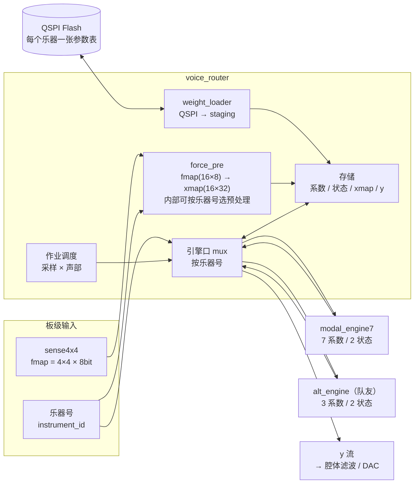
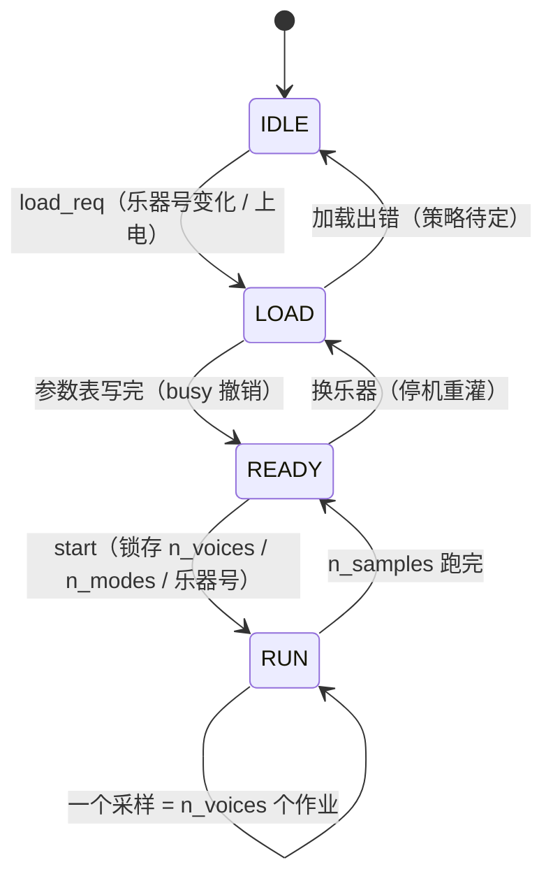

# 声部路由器（`voice_router`）设计

> 目标：把现有的 `modal_voice_top`（7 乘法器引擎 + 多槽存储 + 调度）扩成一个**路由器**：
> 同一份存储，两套互斥的**模态引擎**（我们的 / 队友的），激励由 `force_pre` 统一给出，
> 参数表从 QSPI flash 按乐器号加载。

## 0. 结构草图

## 0.1 状态机草图

- `RUN` 内部是"采样 → 声部 → 模态"三层循环；每个采样结束把 `y_out` 写一拍。
- 换乐器只在 `IDLE/READY` 发生，`RUN` 期间不允许改乐器号。

---

## 1. 已确定

### 1.1 分工与数据流

| 模块 | 职责 |
|---|---|
| `force_pre` | **一次处理整个 `fmap`**，输出整张 `xmap`（16 路 × 32 位定点）。输入只有 `fmap` + 时钟，内部自行按采样计数；**不需要声部号**（路由器按槽位分配）。内部可按乐器号切换多个预处理模块。 |
| `weight_loader` | QSPI flash → staging → 系数块；与 `busy` 互锁 |
| `voice_router` | 持有全部存储、管地址、调度作业、按乐器号 mux 引擎口、结果求和 |
| `modal_engine7` / `alt_engine`（队友） | 计算引擎，**接口完全一致**，互斥工作。两边都是"对模态做处理得到输出"，没有 DDS |

数据流：`fmap → force_pre → xmap → (路由器按槽位分配) → 当前引擎 → y 流`。

### 1.2 没有显式路由信号

- **不做** `route` 端口。两处"路由"各自按**乐器号**决定：
  - 路由器：按乐器号 mux 到哪个引擎；
  - `force_pre`：按乐器号选哪套预处理。
- 乐器号由上层给，路由器锁存后同时分发给两处。

### 1.3 参数表 = 地址偏移

- 一个乐器一张表，放在系数块的一个地址段里：**基地址 = 乐器号 × TABLE_SIZE**。
- **`TABLE_SIZE` 固定为钢琴表的大小**（16 槽 × 80 模态 × 28 B ≈ 35 KiB）：其它乐器的表都能整块装进去，
  所以不需要变长表，也不需要表头。
- 地址管理（系数/状态/xmap/结果的偏移与拼接）**全部在路由器**，引擎只看到"本声部内的偏移"。
- 换乐器 = 停机重灌整张表（对应 UI 里的"选择乐器"）。

### 1.4 存储结构不变

沿用现在的四块存储，全部 1R1W：

| 存储 | 布局 | 端口归属 |
|---|---|---|
| 系数块 | 7 × 32 位 × (乐器段 × 槽 × 模态) | 引擎读、顶层写（加载器） |
| 状态块 | (q, q̇) × 槽 × 模态 | 引擎独占（原地更新） |
| xmap | 32 位 × 槽 × 块长 | 引擎读、`force_pre` 写 |
| 结果 y | 64 位 × 块长 | 引擎给流、路由器写 |

**两个引擎都只读自己需要的字段**：

| 引擎 | 只读系数 | 状态槽 |
|---|---|---|
| `modal_engine7` | 7 个（a11 a12 a21 a22 gq gv wo） | q、q̇ |
| `alt_engine`（队友） | 3 个 | q、q̇ |

所以 RAM 结构和端口都不用改，`dds_iir_engine` 只是"少读几个字段"。

### 1.5 引擎公共口（给队友的契约）

| 组 | 信号 | 宽度 | 方向 |
|---|---|---|---|
| 作业 | `start` / `st_zero` / `n_modes` | 1 / 1 / `$clog2(N+1)` | in |
| 结束 | `y_valid` | 1 | out |
| 系数读 | `co_re` / `co_addr` / `co_data` | 1 / `$clog2(N)` / `coeff_t`(7×32) | out/out/in |
| 状态读 | `st_re` / `st_addr` / `st_q` / `st_qdot` | 1 / `$clog2(N)` / 32 / 32 | out/out/in/in |
| 状态写 | `st_we` / `st_waddr` / `st_q_wdata` / `st_qdot_wdata` | 1 / `$clog2(N)` / 32 / 32 | out/out/out/out |
| 激励读 | `x_re` / `x_addr` / `x_data` | 1 / `$clog2(块长)` / 32 | out/out/in |
| 结果 | `y_data` | 64 | out |

**语义约定**（比位宽更容易踩，必须写进接口说明）：

1. 一次 `start` = 递推**一个采样**；`y_valid` 那一拍既是结果有效、也是作业结束；
2. `st_zero=1` 时先跑 N 拍清零 pass（note-on 用），所以路由器永远不写状态；
3. 系数/状态槽的**含义由参数表决定**；引擎读哪些字段、怎么解释，是引擎自己的事。

### 1.6 互斥 ⇒ 口 mux 即可

两个引擎不会同时工作，所以存储只有一套、口按乐器号 2 选 1，不需要双口/仲裁：

| mux 组 | 位宽 | 备注 |
|---|---|---|
| `start` / `st_zero` / `n_modes` | 1 + 1 + 6 | 未选中的引擎 `start=0` |
| `co_re` / `co_addr` | 1 + 6 | |
| `st_re` / `st_addr` | 1 + 6 | |
| `st_we` / `st_waddr` | 1 + 6 | **未选中的必须强制 `st_we=0`** |
| `x_re` / `x_addr` | 1 + 6 | |
| 回程：`co_data` / `st_q` / `st_qdot` / `x_data` | 224+32+32+32 | 存储侧按乐器号送给选中的引擎 |
| `y_valid` / `y_data` | 1 + 64 | |

粗估 10 组 2:1 mux ≈ 200–400 LUT；BSRAM 不变（24 块）。

### 1.7 时序预算（互斥，吞吐不变）

| 引擎 | 每声部/采样 | 16 声部 |
|---|---|---|
| 模态（钢琴 80 模态） | 92 拍 | 1472（71%） |
| 队友引擎（3 系数，模态处理更轻） | ~20 拍 | ~320（15%） |

因为按乐器二选一，任一时刻只跑一个引擎，**总量不超过 71%**。

### 1.8 三层调度（与现在一致）

- 采样（`n_samples`）× 声部（`n_voices`）× 模态（`n_modes`）；
- 每个（采样 × 声部）一个作业，`start` → `y_valid`；
- 路由器每采样把各声部的 `y` 求和写进输出缓冲（每采样一个值）。

---

## 2. 待确定

| # | 事项 | 影响 | 谁定 |
|---|---|---|---|
| 1 | **QSPI 具体形态**：时钟频率、1/2/4 线、片选数量、是否 DMA | 加载时间（35 KiB 一整套钢琴，4 线大约 1 ms；1 线 ~4 ms） | 硬件/板子 |
| 3 | **`xmap` 定标**：8 位力值 → 32 位定点左移多少位，必须与系数生成时的 `XF=28` 对齐 | 力度/音量整体比例 | 你（和系数生成脚本一起） |
| 4 | **`force_pre` 内部路由**：多个预处理模块怎么按乐器号选（mux？还是每个乐器一个实例） | `force_pre` 的面积 | 你 |
| 5 | **队友引擎的 3 个系数用哪几个槽、什么含义** | 参数表格式 | 队友 |
| 6 | **是否保留 `x_ram`**：`force_pre` 若逐采样实时算，可直接旁路（省 5 块 BSRAM）；若按块预处理就保留当 staging | 4 KiB / 5 块 | 你 |
| 7 | **加载出错策略**：CRC 校验失败/超时怎么办（保持旧表？报警？） | `weight_loader` 状态机 | 待定 |
| 8 | **换乐器时状态块怎么处理**：全部清零（会切断正在发声的音）还是保留 | 听感 | 你 |
| 9 | **y 求和后的归属**：路由器直接输出 64 位流，还是把腔体滤波也放进来 | 模块边界 | 你 + 队友 |
| 10 | **将来要不要混音**（两个引擎同时跑） | 那时存储要两套或加双口 | 远期 |
| 11 | **`y` 输出宽度**：内部 64 位是否收窄（见第 4 节） | ~7% FF、可能 1 块 BSRAM | 你 |

## 3. 建议的落地顺序

1. 先把 `modal_voice_top` 改名/扩展成 `voice_router`，**只加乐器号 + 引擎口 mux**（引擎 B 先用
   一个"空壳"占位），跑通现有 7 个作业的回归；
2. 接 `force_pre`（恒等版）：`fmap → xmap`，验证 xmap 能正确分配到 16 个槽位；
3. 接 `weight_loader`（QSPI 先用仿真模型），验证"换乐器 = 停机重灌"；
4. 队友的 `dds_iir_engine` 接进来，用同一套口跑通。

## 4. 输出位宽（`y` 的 64 位 / 40 位小数是否有必要）

### 数字从哪来

`y = Σ wo·q`，每项是 `(wo_mant·q_int + 2^14) >>> 15`，都不饱和。`YF = 40` 是"每模态归一化"
（`q` 归一到 Q1.24、`wo` 吸收 `peak_q`）带来的**标度约定**，不是精度需求 —— 整数运算里
多留小数位不花钱，但决定位宽的是**整数部分的量级**。

| | 量级 |
|---|---|
| 黄金向量实测最大 `|y|` | 4.12e10 ≈ **2^35.3**（37 位有符号就够） |
| 理论最坏界（80 模态同相位、同号、都取极值） | ≈ 2^69 —— 假想情形，实际不会发生 |

所以 **40 位小数里，只有约 36 位是"有用"的整数量级，剩下的都是分辨率余量**；
按 24 位音频算，2^-40 的相对分辨率比需求高 16 位。

### 收窄的收益与风险

| 位宽 | 余量（相对实测 2^35.3） | 省下的资源 |
|---|---|---|
| **64（现状）** | 2^28.7 ≈ 4e8 倍 | — |
| 56 | 2^20.7 | ~32 FF |
| **48** | 2^12.7（4096 倍）| ~64 FF、~32 LUT、`y_out` 可能少 1 块 BSRAM |
| 40 | 2^4.7（26 倍）—— 和弦/强奏时偏紧 | 不建议 |

### 结论（建议）

1. **内部保持 64 位**：收窄到 48 位只省约 64 FF（占 832 的 7%）和可能 1 块 BSRAM，
   换来的是"最坏情况下有溢出风险"的判断负担，不值得。
2. **真要省，砍在边界上**：给腔体滤波/输出的那一级本来就要移位（`YF=40`），
   在那里一次移位截到 32 位，引擎和路由器内部不动 —— 这样既不引入溢出风险，
   下游的位宽也自然收敛。
3. 如果一定要动内部，**48 位是稳妥下限**（相对实测 4096 倍余量）。
